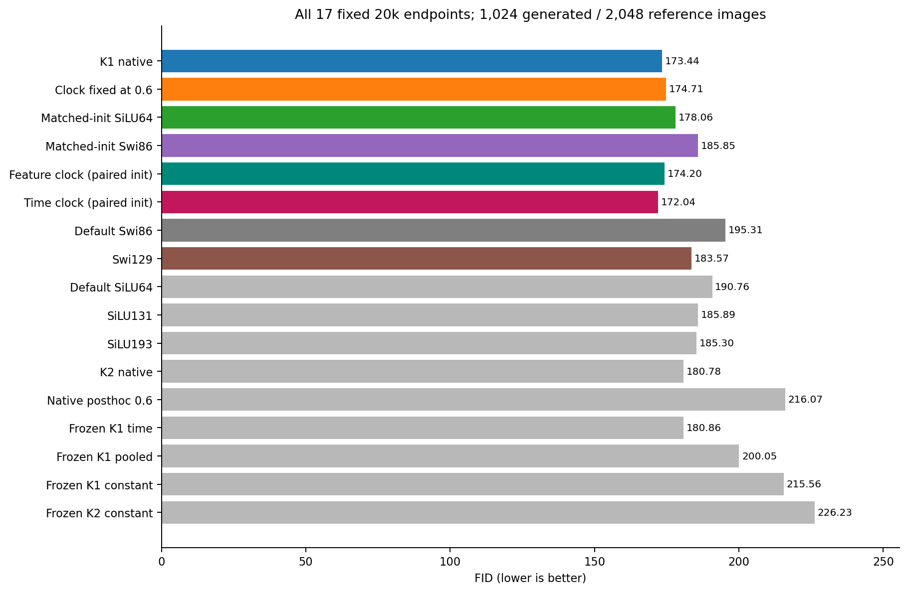
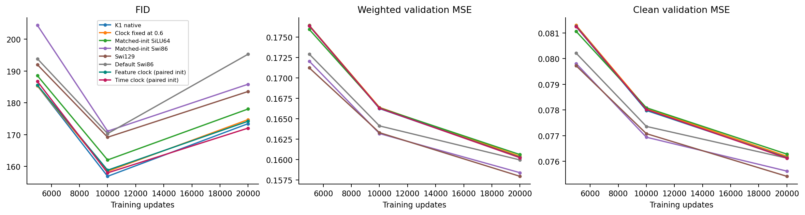
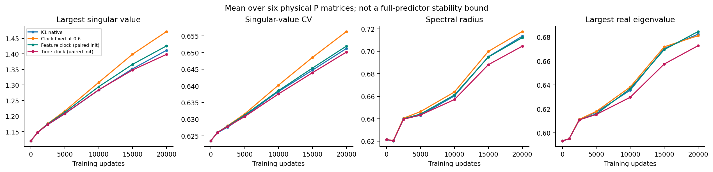
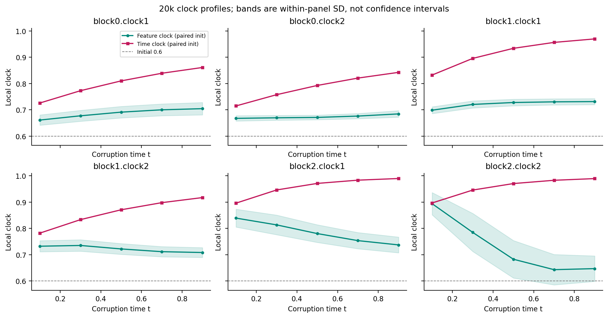

# A small FID gain from time-only clocks, below the registered margin

The paired time-clock model reaches **FID 172.04**, compared
with **174.20** for its matched-initial-function feature-clock control and
**173.44** for native K1. The improvements are 1.24% and
0.80%, respectively. Both fitting guards pass, but the
registered 5% FID requirement does not: the required endpoint was at most
164.7651. This setting stops under its original rule.
The measured small improvement is retained; it does not establish a new ODE
method or justify tuning this setting further.

## Question and fixed comparison

Does replacing feature-dependent local clocks with functions of the known
noise time improve generation? Both cold K1 arms start from the same full
parameter state and the same FFN function. Each final clock head is zeroed,
so every initial clock is float32(0.6); all clock parameters remain trainable.
Only the clock input changes: local image features versus the existing
JiT conditioner. AdaLN already has time information in both arms.

Each model receives the original 20k updates, batch 64, 45k/5k CIFAR-10 split,
weighted clean-image target, original optimizer and unchanged data stream.
CPU Heun128 uses the same 1,024 starts at 5k, 10k and 20k, followed by the
original uint8/Inception pipeline and 2,048 real references. **20k is primary.**
This small image screen is not the standard large-sample CIFAR-10 benchmark.
All six new and 35 historical endpoint rows are retained in
[comparison.csv](comparison.csv). The exact 17 primary endpoints follow.

| Endpoint | Weighted MSE | Clean MSE | FID |
|---|---:|---:|---:|
| K1 native | 0.160267 | 0.076153 | 173.44 |
| Clock fixed at 0.6 | 0.160392 | 0.076197 | 174.71 |
| Matched-init SiLU64 | 0.160598 | 0.076280 | 178.06 |
| Matched-init Swi86 | 0.158379 | 0.075619 | 185.85 |
| Feature clock (paired init) | 0.160259 | 0.076141 | 174.20 |
| Time clock (paired init) | 0.160213 | 0.076125 | 172.04 |
| Default Swi86 | 0.159944 | 0.076124 | 195.31 |
| Swi129 | 0.157935 | 0.075416 | 183.57 |
| Default SiLU64 | 0.159842 | 0.075990 | 190.76 |
| SiLU131 | 0.159023 | 0.075724 | 185.89 |
| SiLU193 | 0.158280 | 0.075516 | 185.30 |
| K2 native | 0.160527 | 0.076292 | 180.78 |
| Native posthoc 0.6 | 0.167715 | 0.078856 | 216.07 |
| Frozen K1 time | 0.160664 | 0.076303 | 180.86 |
| Frozen K1 pooled | 0.161006 | 0.076366 | 200.05 |
| Frozen K1 constant | 0.161452 | 0.076417 | 215.56 |
| Frozen K2 constant | 0.163194 | 0.076846 | 226.23 |

The time arm has the lowest observed 20k FID in this table, but its 1.39-point
improvement over native K1 is below the fixed margin. In particular, a lower
score than default Swi86 alone would omit the stronger native, fixed-clock
and matched ordinary controls.

## Fitting and generation do not move together

Feature-clock FID changes 185.58 →158.79 →174.20; time-clock FID changes
186.76 →157.95 →172.04. Their validation MSEs continue to decrease. The plotted
ordinary and original ODE controls also worsen in FID from 10k to 20k. This is
a shared fitting/generation mismatch, not evidence that one new clock alone
causes the late degradation. The 10k score does not replace the primary20k
comparison. No duration or checkpoint rescue follows.

The [stored learning and clipping curves](figures/training-curves.png) show
nearly overlapping new-arm validation errors. At20k their weighted MSEs are
0.160259 and 0.160213; clean MSEs are0.076141 and 0.076125. Late clipping-window
fractions are0.0032 and 0.0030. These observations provide no large fitting
advantage or late clipping crisis that would explain a large quality change.
The curves retain each original logging interval; clip fractions summarize
windows, not instantaneous events.

## What P learned

All four P families share the same initial matrices. The mean largest
singular value over their six matrices starts at 1.1202 and ends at 1.4115 for
native K1,1.4719 for fixed clocks,1.4257 for paired feature clocks and 1.3984
for paired time clocks. Mean singular-value CV increases from 0.6235 to about
0.650–0.656. The time arm is slightly smaller by these summaries; it does
not show a distinct spectral regime that explains its FID.

The [individual eigenvalue plot](figures/P-eigenvalues.png) keeps all six P
matrices per family, including both positive and negative real parts. These
are physical local parameters, not the Jacobian of the complete FFN or
predictor. Their modest differences do not establish a stability mechanism
or a benefit from imposing a spectral cap or uniform singular values.
Complete layer/state records are in [P-history.csv](P-history.csv) and
[P-eigenvalues.csv](P-eigenvalues.csv).

## The time clocks learned a real schedule

The time-only clocks are not flat. For example, block0.clock1 rises from
0.7259 at t=0.1 to 0.8611 at t=0.9; block2.clock2 rises from 0.8969 to 0.9896.
Both late-block time clocks approach the original upper bound of 1.0. In
contrast, the paired feature-clock mean in block2.clock2 falls from 0.8942 to
0.6470 over those endpoints, with within-panel variation. Here increasing
FM time moves the input toward clean data. A time-only clock is identical
across images at a fixed time by construction; its zero within-panel SD is
not an uncertainty estimate.

The clocks are therefore active, but learning a nonconstant profile does
not establish that time adaptation caused the small FID difference. Changing
the clock input also changes parameter-gradient routes through the shared
conditioner. At fixed t the local computation is exactly
`W2(t) SiLU(W1(t)h)`, with `Wj(t)=I+sj(t)Pj`. This is an ordinary conditional
matrix family, as verified before training. The
[primary-work check](../closest-prior-work.md) also rules out a first-use claim
for timestep-conditioned weights. No hidden Gaussian observation law,
full-model stability result or ODE-specific function-class advantage follows.

## Fixed-start examples and actual cost

The [fixed-start panel](figures/fixed-start-cases.png) uses starts 0–7 for all
eight preselected models. Start 3 retains a similar blue upper area and dark
central form across rows; start5 retains its bright diagonal patch. The
paired feature/time outputs differ in color and local contrast, but these
eight coarse 32×32 examples do not show a clear semantic improvement. They
illustrate source pairing and do not estimate recognition or diversity.

Both new arms have 211,094 trainable parameters. Time clocks use 8,322 versus
16,512 FFN forward MACs per token at 64 patches, a 49.60% reduction; measured
backward work is 24,966 versus 49,536. This is not a twofold whole-model speedup.
The observed training times in the single concurrent CPU cohort were 1907.68s
and 2112.82s, with about 100% of one CPU thread each. MPS was used for feature
extraction, with no CUDA allocation. Full phase/resource records are retained
in[resources.csv](resources.csv).

## Supported claims and next decision

- **Small finite improvement at lower local work.** Source: all 17 endpoints,
  [32 continuous contrasts](primary-contrasts.csv), measured preflight costs.
  Allowed: time-only clocks give172.04 at the fixed20k endpoint, below native
  by 0.80% and the paired feature control by 1.24%. Forbidden: a decisive
  performance breakthrough or satisfaction of the 5%rule. Decision: retain
  the descriptive comparison; stop this setting.
- **Active time profiles with similar P growth.** Source: all 420 clock
  records,168 P summaries and 10,752 eigenvalue records. Allowed: this clock
  input changes the learned schedules while the shown P summaries remain
  close. Forbidden: those spectra prove full-network stability or explain
  the FID change causally. Decision: descriptive evidence only.
- **No new uniquely ODE computation.** Source: the conditional-matrix identity
  and bounded primary-method review. Allowed: a specific conditional mixing
  restriction was tested. Forbidden: first time-conditioned diffusion weights
  or general separation from ordinary transformers. Decision: any next model
  needs a different, justified operation or restriction and strong controls.

There is no tau, normalization, raw-time encoder, calendar, width, order,
optimizer, EMA, training-duration or checkpoint rescue. Old stopped families
remain stopped. This report closes the registered clock-source setting; the
broader useful-ODE architecture objective remains open. No next architecture
is selected by these results alone.

The actual controller, curation and plotting commands all exited0. All14
checkpoint predictions,70 panels,42 stream boundaries,12 active boundary
updates,6,144 sampled images,6,144 generated feature rows and 2,048 reference
rows passed their registered checks. This is not a complete optimizer-
trajectory replay. See[stats-appendix.md](stats-appendix.md),
[figure-catalog.md](figure-catalog.md) and[execution-receipts.json](execution-receipts.json).
The original implementation, sealed earlier studies and submitted Report1
remain unchanged.
