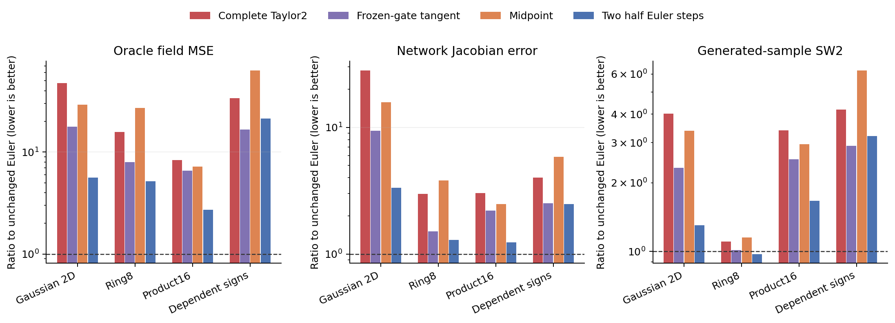
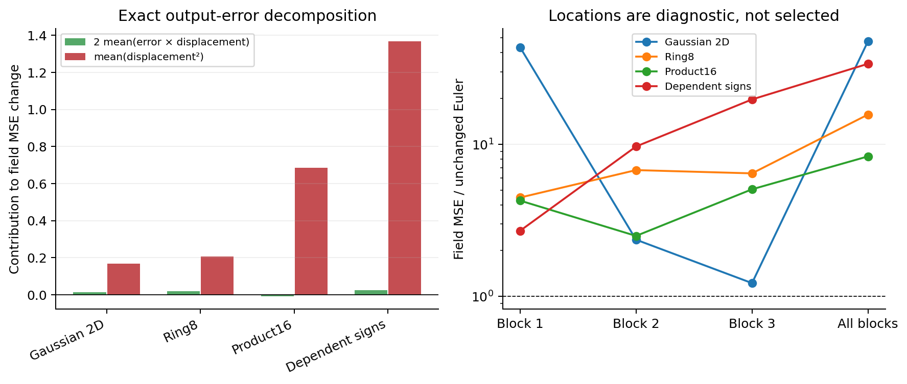

# A more accurate hidden integrator did not improve the fitted predictor

The registered post-training upgrade failed on all four validation laws. The complete-Taylor correction includes the derivatives of LayerNorm, time modulation and both SwiGLU factors. Midpoint and two half-Euler steps also increased final field error. No new architecture is retained from this cycle, and no fresh Taylor training is selected.

## What changed

The unchanged residual block is `h + c*A(h,t)`, with `c=1/sqrt(3)` and external time t held fixed. The candidate adds `c²/2*J_A(h,t)*A(h,t)`. We replayed existing nominal SwiGLU128 checkpoints at1000,2500,5000 updates, intervening at each individual block and all three. Only the final all-block candidate was eligible to advance. No duration, coefficient, position or checkpoint was tuned.

These are checkpoint interventions, not independently trained methods. They test whether a fitted residual field can be upgraded after training. They do not compare the best achievable trained Euler and higher-order architectures.

## Main observations

| Target | Unchanged field MSE | Complete Taylor2 MSE | Error ratio | SW2 ratio |
|---|---:|---:|---:|---:|
| Gaussian2D |0.003927|0.186691|47.54|4.02|
| Ring8 |0.015296|0.239813|15.68|1.11|
| Product16 |0.092326|0.768499|8.32|3.40|
| Dependent signs |0.042467|1.435618|33.81|4.20|

Complete-Taylor, midpoint and two half-Euler steps execute the same dense matrix work:130752 MACs per16D example, versus81792 unchanged. Equal extra compute does not recover the original predictor here. Full network-Jacobian error also increases on every law. Ring8 generation changes less than its field error, illustrating why neither metric should substitute for the other.



## Why the correction hurts

Let e be the original prediction error and delta the actual change in the final network output. On exactly the same validation inputs,

```text
new_MSE - old_MSE = 2*mean(e*delta) + mean(delta²).
```

This is an exact output identity, independent of a small-step assumption. On Product16 the cross term is slightly helpful (-0.00864), but the displacement energy is0.68481, giving a net error increase0.67617. Only5 of20,000 examples improve. On dependent signs, the cross term is also harmful (+0.02501) and displacement energy1.36814;84 of20,000 examples improve. Thus the correction is not merely fixing an omitted derivative with a consistent prediction benefit. These measurements do not justify choosing a smaller or negative coefficient afterward.



The accompanying [examples](results/examples.json) contain the largest increase, largest decrease and median change per law, selected by an explicit rule. They show x,t, oracle and both predictions; they are descriptive cases, not additional selection criteria.

## Mathematical interpretation

An accurate integrator approximates the flow of a specified field. Our training loss supervises the final prediction, not the intermediate hidden field's exact flow. Those are different quantities. A scalar example already demonstrates the gap. Suppose a target hidden map is `h -> 2h`. A fitted Euler block can implement it exactly using `A(h)=h/c`. Its complete Taylor2 update is `2.5h`, and the exact flow of that same field is `exp(1)*h`. Reducing integration error therefore need not reduce prediction error. An exact-flow model would need a different learned field, `A(h)=log(2)*h/c`.

This example explains why higher integration order alone supplies no guarantee. Our observations support rejecting this specific frozen-checkpoint upgrade; they do not prove that solver-aware training can never work. We also have no evidence from this cycle that a missing SwiGLU gate derivative caused the original ODEFFN gap.

## Verification and scope

The formal run completed in23.11seconds on one Mac CPU thread, with sampled peak RSS0.260GiB. It created no new training runs. An independent implementation replayed204 field cases (34,680,000 predicted coordinates),100 full-network-Jacobian panels and20 generated batches. All91 input bindings and333 formal output files remained unchanged. The maximum full-bank prediction difference between implementations was1.10e-5 under the documented float32 tolerance; this is numerical agreement, not bitwise identity.

The audit uncovered and preserved a count typo and numerical replay failures. A nested-AD discrepancy through the installed fused LayerNorm path was resolved using elementary normalization in the independent implementation; float64 central differences independently agree with the formal analytic implementation to below8e-10 on the fixed fixture. See [deviations](deviations.md), [audit](results/audit.json), and [fixture](results/nested-ad-verification.json). Scientific acceptance thresholds were unchanged. The submitted Report1, training data, historical checkpoints and original professor block are untouched.

## Next question

Do not start a Taylor-training rescue. The earlier Product16/sign-code comparison still changes the number and probabilities of Gaussian components together. Before explaining its reversal as a general consequence of coordinate coupling, examine a single full-component-support mixture control with an exact oracle. Such a control could narrow the interpretation of the ISRU observation; it would not itself be a new ODE method. Its mathematical specification and acceptance rule must be registered separately before training.
