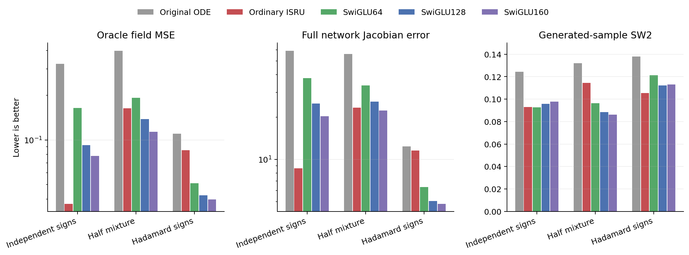
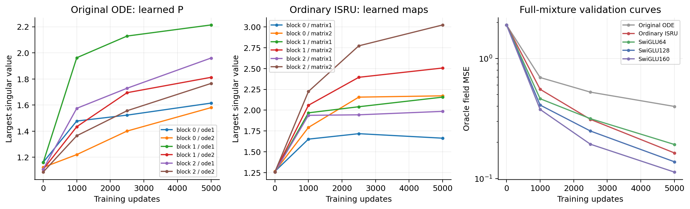

# The literal Gaussian-component count does not explain the ISRU reversal

Ordinary ISRU still loses to the stronger SwiGLUs when all65536 original Gaussian components retain positive probability. Its mixed-law field MSE is0.16356 versus0.11325 for SwiGLU160, a44.4% increase; its generated-sample SW2 is32.9% worse. The professor's original ODE is further behind. This narrows the earlier transfer interpretation but supplies no new winning ODE architecture.

## One changed target, unchanged models

We trained the original ODE-K2, ordinary ISRU and three SwiGLU controls on `.5*Product16 + .5*Hadamard-sign-code`. Every original component keeps its location, variance and positive weight. The target still matches the endpoint laws' low-order sign marginals, mean, covariance and radial distributions. It changes only component probabilities relative to Product16. There is no mixture-weight sweep.

Five models were trained from the exact paired historical cold states with seed0,5000 updates and the existing pair-velocity FM protocol. The ten Product16/sign-code endpoint outcomes in the plots are explicitly reused historical runs. They are not fresh replications. Full settings are in [protocol.md](protocol.md).

| Model | Field MSE | Jacobian error | SW2 | Parameters | Inference MACs |
|---|---:|---:|---:|---:|---:|
| Original ODE-K2 |0.39896|56.0249|0.13204|83862|106944|
| Ordinary ISRU |0.16356|23.2838|0.11444|58512|57408|
| SwiGLU64 |0.19234|33.4988|0.09625|58572|57024|
| SwiGLU128 |0.13803|25.6903|0.08845|83598|81792|
| SwiGLU160 |0.11325|22.2086|0.08613|95820|93888|

ISRU is better than the almost parameter/MAC-matched SwiGLU64 on field and derivative error, but has worse generation. It loses field error to both larger practical controls. Original ODE has approximately the same parameters as SwiGLU128 and more executed matrix work, while field error is2.89times larger. None of these comparisons establishes an ODE advantage.



The result rules out the literal change from65536 to32 positive-probability Gaussian components as a sufficient explanation of the earlier reversal. It does not isolate coordinate dependence from every other difficulty. Probability concentration and posterior ambiguity also change. The categorical component-label entropy is16bits for Product16,11.497bits for this mixture and5bits for the code law; fixed component count does not mean fixed effective diversity.

## What the exact oracle adds

Let m0,C0 and m1,C1 be the two branch-specific conditional endpoint means and covariances at the same noisy state/time. If w is the posterior probability of the sign-code branch, the total conditional covariance is

```text
C = (1-w)*C0 + w*C1 + w*(1-w)*(m1-m0)*(m1-m0)^T.
```

The last positive-semidefinite rank-one term represents uncertainty between different branch means. It appears in the oracle velocity Jacobian multiplied by `t*(1-t)/d(t)^2`. Changing the mixture therefore changes the field's local interactions even though the component means, global covariance and radial distribution are fixed. A P eigenvalue argument based only on those common global quantities would miss this information.

The post-outcome decomposition gives squared Frobenius energy of this between-branch Jacobian response equal to0.1332times the total nonlinear covariance-response energy on the20000 anchors. This is a ratio of squared norms, not an additive13.32% variance attribution: the within/between terms have cross inner products. It measures a non-negligible target term, not a demonstrated bottleneck in the learned ODE.

The descriptive [case](results/posterior-case.json) selects the anchor with the largest between-branch response. At t=0.6808, its posterior code probability is0.3559 and the term's Frobenius norm is38.26. ISRU's pointwise error is0.1056, lower than SwiGLU160's0.3050 despite its worse overall error. This counterexample prevents interpreting a large between-branch term as an automatic ISRU failure. The [uncertainty bins](results/posterior-posterior-bins.csv) also differ in external time; their error associations are not causal effects.

## Learned matrices and checks



All six original P matrices and six ordinary ISRU maps were retained across cold/1000/2500/5000 snapshots. The final original-P singular maxima range1.58–2.21. Their values do not prove numerical instability; the matrix exponential converges for every finite P, and P is not the full normalized/gated network Jacobian. The ordinary maps are labeled separately because they are not ODE generators.

Before training, an independent65536-component enumeration verified the new oracle and its AD Jacobian to2.92e-13 and2.28e-12. All five cold states and exact three-step resume checks passed. After training, independent data regeneration, full-bank oracle checks,20 native checkpoint replays,25 complete Jacobian panels, five generated batches,48 matrix spectra and all5000 consumed stream batches passed. All310 bindings and earlier sealed artifacts remained unchanged. See [audit](results/audit.json).

Formal training took56.17seconds with two one-thread Mac CPU workers, using a sampled summed peak RSS0.802GiB. GPU resources were not reserved. The submitted Report1 and previous source/data/checkpoint evidence remain unchanged.

## Consequence for the next design

The two autoresearch cycles reject two shortcuts: upgrading a fitted hidden integrator after training, and explaining the saturation result solely by literal component count. They do not justify imposing a new hidden covariance constraint. The older [covariance-field study](../../research-architecture-search/covariance-readout.md) already showed that a valid internal covariance geometry can fail the end-to-end task.

The next mathematical review must connect a proposed generator to the complete normalized prediction map and show what useful computation it adds over matched SwiGLU. Input-dependent interactions are a question to explain, not a license to reopen stopped coupling/gate settings. No third architecture is selected from this control alone.
