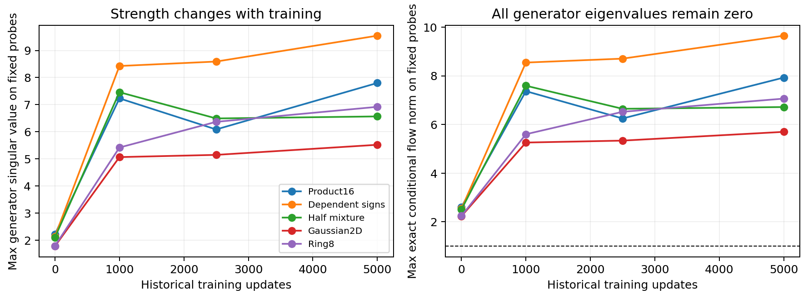

# An exact ODE baseline retains all SwiGLU behavior

The new `GatedShearFFN` reproduces ordinary SwiGLU, including its complete gradients and deterministic training trajectory. This is a useful baseline identity, not a performance improvement. A meaningful successor must change the useful computation and outperform this equivalent ordinary implementation.

For fixed FFN input h, define `g=SiLU(Wg*h+bg)` and `v=V*h+bv`. The lifted ODE `u'=g*v, v'=0`, starting at `(0,v)`, has the exact endpoint `(g*v,v)` after duration one. Its square-zero generator makes all higher exponential-series terms vanish. The usual output projection then gives the original biased SwiGLU. The [theory note](theory.md) gives the full derivative, norm formula and prior-work boundaries.

## What passed

- All 44 historical checkpoint predictions matched bitwise across five target laws and three nominal SwiGLU widths where available.
- All 55 full-network-Jacobian panels and 11 generated batches matched. Eleven fitted-head parameter-gradient probes were bitwise equal.
- One 5000-update paired trajectory on the half-mixture had identical native/shear losses and gradient norms. The four saved model, optimizer, RNG and runtime-buffer states also matched the existing historical trajectory exactly. This is compatibility evidence, not an independent repetition or a new quality result.
- Every executed inference operation count, parameter count and dense training/inference MAC count matched. No latency improvement is claimed from equal operations.
- Independent literal generator matrices at 132 actual FFN contexts gave identical values; 33 local derivative probes agreed within 9.54e-7 in float32. The separate float64 literal matrix-exponential fixture agreed in gradients to 2.78e-17. [Audit](results/audit.json).

Normal forward execution evaluates the exact closed form; it does not allocate a doubled latent state or run a numerical solver. To convert a caller-verified ordinary SwiGLU block:

```python
from synthetic.gated_shear import GatedShearFFN
block.ffn = GatedShearFFN.from_swiglu(block.ffn)
```

The projections are copied, preserving state keys and parameter order. The auxiliary flow holds its conditioning input fixed. It does not make the complete normalized residual network an autonomous physical flow.

## Implication for P constraints

All conditional generator eigenvalues are zero, while its nonzero singular values are the gate magnitudes. On final nominal SwiGLU128 probes, the largest exact conditional flow norms were 7.93 on Product16, 9.65 on dependent signs and 6.72 on the half-mixture. These are maxima on finite fixed probes, not global bounds. A separate gate-strength-100 witness has zero generator eigenvalues but flow norm 100.01.



Thus eigenvalues alone do not control finite-time amplification for a nonnormal generator. Nor does conditional lifted volume preservation imply an invertible, volume-preserving or monotone FFN after its input-dependent encoder and projected readout. The raw singular distributions remain outside Git; their quantiles are [published](results/generator-quantiles.csv).

The formal run took 42.33 seconds on one Mac CPU thread, with sampled peak RSS 0.331GiB; independent replay took 9.37 seconds. All 369 bindings and earlier sealed studies stayed unchanged.

## Remaining scientific gap

An ODE representation alone is insufficient: any map F(h) can trivially be encoded as `u'=F(h), u(0)=0`. Our constrained shear is more informative algebraically, but still adds no inductive bias to SwiGLU. It cannot be reported as a new successful method.

The next review asks whether a square-zero transport between activated gate channels adds useful interactions at almost the same cost as a slightly wider SwiGLU. Its proposed operator, fixed-feature rank witness and required ordinary controls are recorded [separately](../cycle04-gate-transport/design.md). No feedback or quality-training extension is selected by this compatibility result alone.
