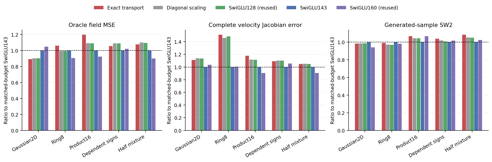
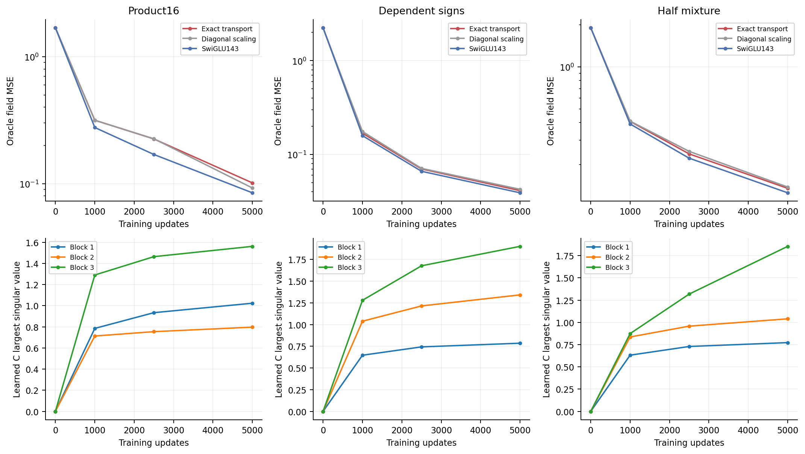

# Exact gate transport did not beat ordinary extra capacity

The candidate fails the registered continuation rule and is stopped without a partition, coefficient, rank or feedback rescue. The exact ODE solve and the additional gate interactions did not provide a quality advantage over the ordinary budget controls.

## One changed operator

Each native SwiGLU128 FFN receives one zero-initialized42-by43 matrix. Its square-zero gate operator produces a cube-zero augmented generator, so the degree-two exponential formula is exact. One activated gate can modulate additional value/output directions. The data, pair-velocity loss, time conditioning, normalization and optimizer are unchanged. See the [derivation](design.md) and [registered protocol](protocol.md).

The16D candidate uses89016 parameters and87210 dense inference MACs; SwiGLU143 uses89418 and87552. This closely matches parameters and matrix work. Ordinary diagonal scaling tests a redundant channelwise reparameterization, with fewer new parameters. All ten historical Swi128/160 controls remain explicit reused endpoints.

| Target | Exact transport | Diagonal scaling | Swi128, reused | Swi143, matched budget | Swi160, reused |
|---|---:|---:|---:|---:|---:|
| Gaussian2D |0.003885|0.003927|0.003927|0.004353|0.004557|
| Ring8 |0.016290|0.015299|0.015296|0.015369|0.013921|
| Product16 |0.101376|0.092439|0.092326|0.084654|0.078178|
| Dependent signs |0.041118|0.042491|0.042467|0.038973|0.039790|
| Half-mixture |0.135522|0.138415|0.138033|0.125912|0.113254|

Values are oracle field MSE at5000 updates. Transport slightly improves the old Swi128 on dependent signs and the mixture, but ordinary widening does better on all three16D laws. Product16 is also worse than the original Swi128. No16D task meets the required10% improvement against every generic control.

Relative to the best ordinary control, transport's field-error ratios are1.297 on Product16,1.055 on dependent signs and1.197 on the mixture; Jacobian-error ratios are1.299,1.091,1.156. SW2 stays within10% but cannot replace the failed field/derivative conditions. No alternative checkpoint or metric is selected.

## The added dynamics was active

The matrices move away from zero. On Product16 their final largest singular values are1.02,0.80,1.56 across the three blocks. On the actual32-anchor probes, extra local FFN responses have RMS magnitudes0.42,0.19,0.47 times the ordinary branch. Dependent-sign ratios are0.13,0.21,0.48. These local amplitudes rule out an inactive branch, but do not attribute final prediction error causally to a particular matrix. Matched-budget Swi143 is already ahead at1000 and2500 updates on every16D law; a longer-budget rescue is not authorized by continued improvement of all models.

## Rank capacity and trained strength

For a fixed gate dictionary, a source gate has linear coefficient `A_j=U*diag(M[:,j])*V`, with `M=I+P_C/2`. Its possible rank rises from one to43. A post-outcome descriptive check finds numerical rank43 in every trained source-gate coefficient at relative tolerance1e-8. Yet median singular-energy participation ranks are only1.050 on Product16,1.072 on dependent signs and1.061 on the mixture. Most energy still lies in the dominant singular direction.

These measurements concern a gate's linear coefficient, excluding its affine bias contribution. They are not ranks of the full network Jacobian, a whole-network capacity lower bound or evidence that this pattern caused failure. The analytic witness proves a fixed-basis possibility; finite-budget Adam need not realize a useful solution from that larger function class. [Full measurements](results/gate-coefficient-ranks.csv).

## Verification and scope

Preflight checked literal exponentials, complete input/parameter/C derivatives, the rank witness, native initialization and exact three-step resume for all15 cells. Maximum float64 derivative discrepancy was2.78e-17. Training completed15 trajectories in170.20seconds on two one-thread Mac CPU workers, with sampled summed peak RSS0.826GiB. No GPU was reserved.

Independent audit reconstructed25000 consumed batches, checked the same streams in all ten historical controls, replayed60 checkpoints,75 complete Jacobian panels and15 generated batches, and independently reconstructed60 learned C spectra and120 conditional generators. All345 bindings and earlier sealed studies stayed unchanged. Audit-v2 passed in13.30seconds. Its two-row/32-row rounding correction is documented in [deviations](deviations.md); formal results and acceptance rules were unchanged.

This rejects the specific budget-allocation hypothesis tested here: linear recombination of existing activated gates did not outperform learning slightly more ordinary nonlinear gate features. It does not reject every mixer or ODE architecture. The [next unselected review](../next-feature-flow-review.md) asks whether dynamics can create new nonlinear responses along a flow. A new operator, ordinary controls and registered protocol are required before further training; cycle04 remains stopped.
