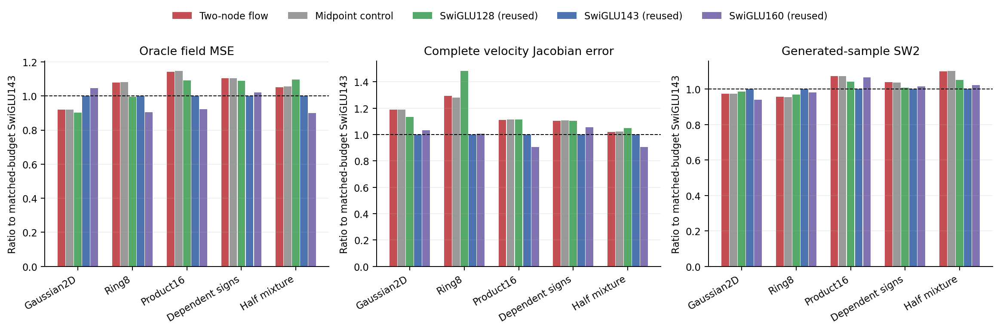
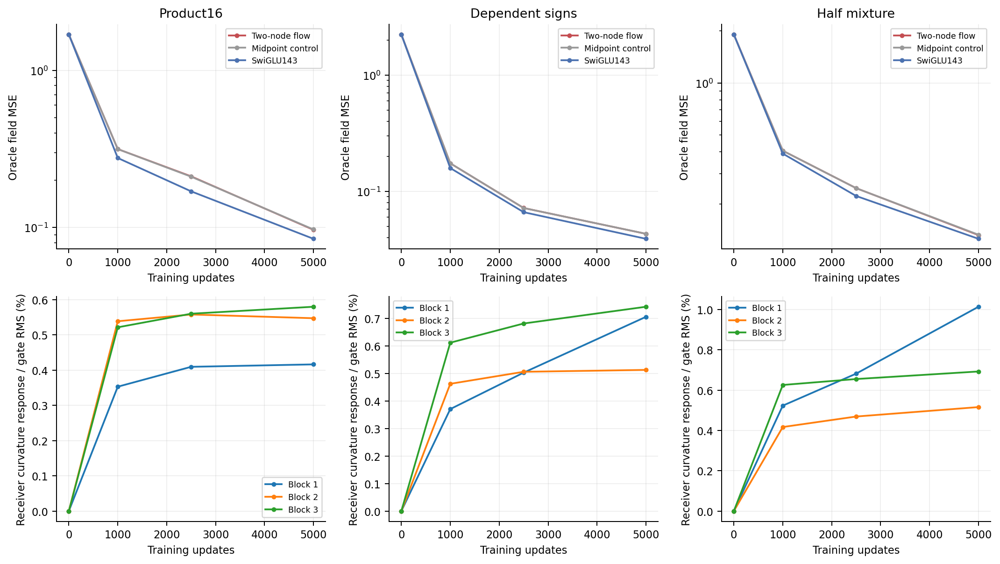

# Accurate nonlinear feature integration did not beat ordinary capacity

The two-node candidate fails its registered quality rule and is stopped. Its numerical-accuracy checks pass. The measured gap therefore does not support spending more computation on this integral. No node-count, duration, initialization or other setting rescue is selected.

## Question and controlled change

Cycle04 mixed existing activated gates. Here a square-zero operator evolves their **preactivations**, and the FFN accumulates SiLU responses along that exact affine path. A fixed two-node quadrature approximates the accumulated response. The paired single-midpoint control has the same trainable tensors and dense matrix work, but absorbs exactly into ordinary SwiGLU weights. The [derivation](design.md) and [protocol](protocol.md) were committed as5cab241 before training.

Both new16D models have89016parameters/87210dense inference MACs; Swi143 has89418/87552. The two-node model evaluates127 SiLUs per block, versus85 for midpoint. All three16D tasks and both2D controls use the same native supervision, initial common tensors, consumed batches, optimizer and5000-update budget. These are unconditional vector flow-matching tests, not JiT image or attention experiments.

| Target | Two-node flow | Midpoint control | Swi128, reused | Swi143, reused matched budget | Swi160, reused |
|---|---:|---:|---:|---:|---:|
| Gaussian2D |0.004007|0.004007|0.003927|0.004353|0.004557|
| Ring8 |0.016588|0.016631|0.015296|0.015369|0.013921|
| Product16 |0.096584|0.097085|0.092326|0.084654|0.078178|
| Dependent signs |0.043027|0.043061|0.042467|0.038973|0.039790|
| Half-mixture |0.132280|0.132941|0.138033|0.125912|0.113254|

Values are final oracle field MSE. Relative to midpoint, the candidate's16D reductions are only0.52%,0.08%,0.50%. It is13.49%,10.40%,5.06% worse than matched-budget Swi143. The registered requirement was at least10% better than every generic comparator on one16D law, with cross-task guards; none qualifies. Its half-mixture SW2 also exceeds the best ordinary control by10.06%. [All metrics](results/comparison.csv).



## Integration accuracy is a separate, passed check

With each fitted candidate frozen,32-node quadrature changes final field MSE by at most0.0176%. Across the fixed full-network Jacobian panels, its relative Frobenius RMS difference from the trained two-node model is at most0.0360%. On actual probe states the largest relative gate RMS difference is0.0169%;32-vs64-node references agree within2.41e-16 in float64. Every predeclared1% numerical gate passes.

These checks cover fixed banks and visited states, not all possible inputs. They distinguish an accurate approximation of this chosen integral from an effective task architecture. Replacing it by a more accurate integral cannot be credited as a demonstrated remedy for the much larger ordinary-baseline gap. [Numerical receipt](results/numerical-accuracy.json), [field checks](results/quadrature-fields.csv), [complete derivative checks](results/quadrature-panels.csv).

## Nonzero C mostly changes optimization coordinates in this setting



The learned C matrices are active. Final Product16 singular maxima are0.755,0.724,0.862. At the same candidate's local probe inputs, however, the two-node receiver response differs from its own midpoint by only0.42%,0.55%,0.58% RMS across blocks. Dependent-sign ratios are0.71%,0.51%,0.74%; half-mixture ratios are1.01%,0.52%,0.69%. These are local conditional gate measurements, not full prediction differences or causal attributions.

There is an exact first-order limitation at the paired initialization. For an arbitrary perturbation dC at C=0, both new operators change receiver preactivation to first order by

```text
da_left = .5*dC*(Wg_right*h+bg_right).
```

Ordinary SwiGLU produces exactly the same function tangent by setting `dWg_left=.5*dC*Wg_right` and `dbg_left=.5*dC*bg_right`. Thus the added C directions initially lie in the ordinary gate-projection tangent span. They can change the optimizer's parameter metric, but do not add a new first-order functional direction. This statement holds before the surrounding differentiable backbone by the chain rule; the formal zero output head may additionally mask backbone tangents.

The difference between two-node and midpoint begins at second order: `b²*SiLU''(c)/24`, with displacement b and centre c. The fitted local measurements and nearly overlapping curves are consistent with a small extra nonlinear response. They do not prove that initial tangent redundancy caused the final loss. Increasing C or changing its initialization would violate this screen's stop rule, so neither is proposed as a rescue.

## Verification and practical decision

All10 cold/resume checks passed. Literal values, full parameter/input/C derivatives and the analytic FFN Jacobian agree to2.78e-17 in float64. Independent augmented RK4 and64-node integration agree to2.50e-16. The joint pointwise Jacobian is cube-zero while a nonzero third time derivative confirms that the nonlinear flow series does not terminate.

Training completed in121.67s on two one-thread Mac CPU workers; peak sampled summed RSS was0.827GiB. Independent replay passed40 checkpoints,50 complete Jacobian panels,10 generated batches,25000 consumed-batch hashes,120 learned C spectra,240 pointwise field Jacobian spectra and all15 historical control streams. All466 input bindings and older seals remained unchanged. No formal rerun or tolerance adjustment was needed.

The useful-architecture objective remains open. Cycles03–05 show three distinct facts: a valid exact ODE representation can preserve SwiGLU without adding functionality; exact linear gate transport can add algebraic capacity without a practical gain; and accurately integrated nonlinear gate responses can remain inferior to ordinary extra features. None justifies calling hidden solver accuracy an FM inductive bias. Before another architecture screen, the next review must identify a task-relevant functional change beyond these redundant first-order directions and state its ordinary realization and cost. No next candidate is selected by this report.
