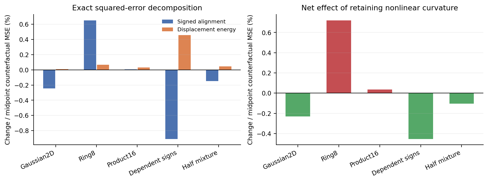

# The fitted curvature term has a small, mixed effect on full-model risk

This read-only follow-up changes no weights and nominates no architecture. Removing the nonlinear trajectory response from the fitted cycle05 model barely changes its average field error. It cannot explain away the much larger gap to ordinary SwiGLU. The complete-network tangent checks also confirm the first-order redundancy derived in cycle05.

## Fixed-weight intervention

Replace every two-node gate by its midpoint while retaining all learned C, gate/value projections and the surrounding backbone. This produces a different inference function from the independently **trained** midpoint control; do not pool those endpoints. The midpoint function absorbs into ordinary SwiGLU weights, but these absorbed weights are not the result of training the ordinary control.

| Target | Actual two-node MSE | Same weights, midpoint MSE | Relative effect of retaining curvature |
|---|---:|---:|---:|
| Gaussian2D |0.00400717|0.00401649|−0.232%|
| Ring8 |0.01658756|0.01646888|+0.721%|
| Product16 |0.09658356|0.09654807|+0.0368%|
| Dependent signs |0.04302670|0.04322262|−0.453%|
| Half-mixture |0.13227979|0.13241733|−0.104%|

Negative means the fitted nonlinear response helps the oracle field error; positive means it hurts. These full-bank risk changes are all below1%. Both functions remain worse than the matched-budget Swi143 on every16D law. The counterfactual is descriptive and does not reverse cycle05's stop decision.

The decomposition is exact. With `delta=f_two-f_mid` and `e=f_mid-oracle`, the MSE change is `2*mean(e*delta)+mean(delta²)`. On Product16 the signed alignment is+0.00000466 and displacement energy+0.00003083, giving a small adverse net change+0.00003549. On dependent signs they are−0.00039327 and+0.00019735, giving a helpful net−0.00019592. These are changes to the fitted complete function, not a causal decomposition of how its optimizer learned. [Full fields](results/field-attribution.csv), [all time panels](results/time-panels.csv).

## Case study: a small average hides mixed local effects

All three largest absolute dependent-sign case changes are adverse, despite its helpful average: the largest occurs at bank row14738, t=0.4823. Retaining curvature changes that row's per-coordinate squared error from3.31136 to3.34475. For the half-mixture, row2672 at t=0.7539 worsens from1.50273 to1.54413, while row246 at t=0.6052 improves from0.90538 to0.88163. These are the predefined largest-change cases, not a favorable selection or evidence about a specific mode mechanism. [All15 cases](results/cases.csv).

## Initial tangent redundancy holds through the whole model

Set C=0 only in copies of the fitted models, retaining their nonzero output heads. For each block separately and for all three jointly, the complete output JVP along deterministic dC matches ordinary gate-projection perturbations `dWg_left=.5*dC*Wg_right`, `dbg_left=.5*dC*bg_right`. All20 checks pass, with maximum absolute difference1.11e-16 and explicitly nonzero responses. This verifies the chain-rule identity through normalization, time conditioning, residuals and readout. It is not a tangent-rank measurement at the actual nonzero fitted C and does not prove an optimization failure mechanism.

## Evidence and next boundary

Registration0f39045 preceded these counterfactual outputs. One single-thread Mac CPU process completed in3.27s; terminal RSS0.292GiB. It replayed80000 actual field rows and25 actual complete-Jacobian panels, computed all25 counterfactual panels and verified20 complete tangent identities. The separate NumPy audit checked the saved-array risk decomposition, selected cases and counterfactual Jacobian metrics; it is not an independent second network implementation. Earlier seals and source/data bindings remain unchanged.

The next design review should ask what task-relevant function an auxiliary flow supplies efficiently beyond its ordinary realization. Exact ODE representations, small numerical error and nonzero learned matrices are now separately insufficient in the tested settings. Adding more integral points or amplifying this curvature is excluded by cycle05's stop rule. A different architecture needs independent motivation and matched ordinary controls; no new training is selected here.
