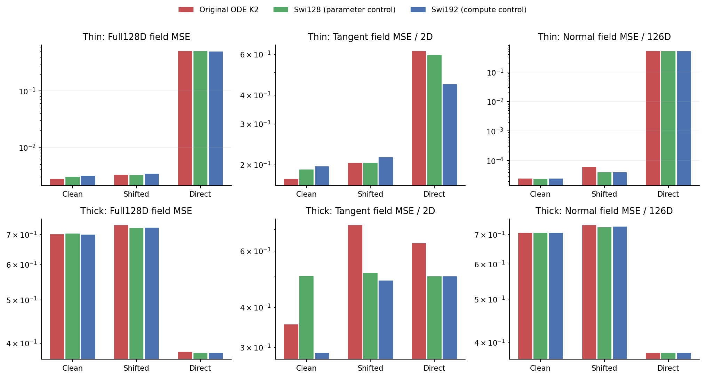
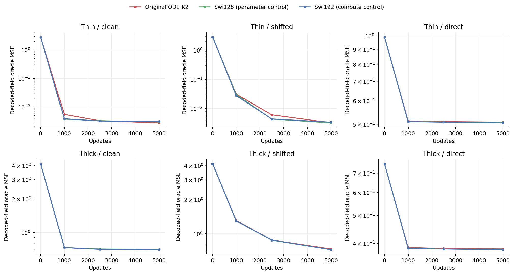
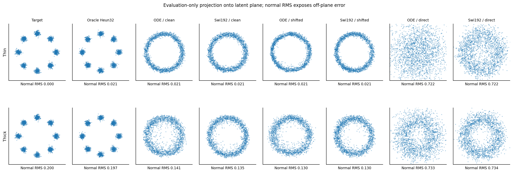
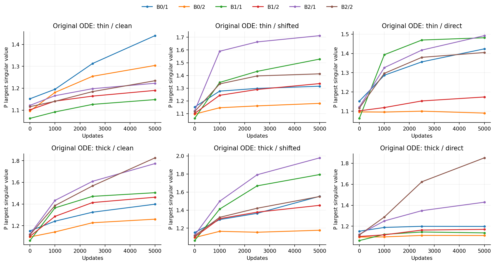

# Geometry changes the comparison, without a new ODE nominee

The unchanged professor block becomes competitive under clean prediction on the thin128D target. Its9.0% field-error advantage over the parameter control misses the registered10% criterion, and the thick-data tangent guard also fails. The screen closes without a new architecture or a head/cap/dimension rescue.

## One paired geometry and head comparison

Embed the existing2D Ring8 in an unknown128D plane. Thin data have no orthogonal target noise; thick data add variance.04 in those126 directions, retaining paired latent samples and the same basis. Numerical covariance ranks are2 and128. Models receive samples/time only. This additional benchmark follows the controlled embedding idea in JiT Section3.3; it does not replace earlier Product/dependent-sign tests.

The unchanged scalarK2 professor FFN, Swi128 and Swi192 each train under three heads. Every arm minimizes the same capped pair-field loss, delta=max(1-t,.05). Clean returns `(N-x)/delta`, shifted returns `N-x/delta`, and direct returns N. Clean/shifted share a zero-raw initial field but have different parameter-response scaling. Swi128 nearly matches parameters; Swi192 nearly matches dense matrix work. [Protocol](protocol.md), [mathematics and primary literature](theory.md).

| Geometry / head | Original ODE K2 | Swi128, parameter control | Swi192, compute control |
|---|---:|---:|---:|
| Thin / clean | **0.002729** |0.002999|0.003095|
| Thin / shifted |0.003231|**0.003215**|0.003398|
| Thin / direct |0.507919|0.506931|**0.504874**|
| Thick / clean |0.700245|0.702406|**0.698766**|
| Thick / shifted |0.733437|**0.723035**|0.724404|
| Thick / direct |0.382404|0.380134|**0.380019**|

Values are final per-coordinate128D errors for the **capped decoded field**, not the old uncapped velocity metric. Thin/clean ODE improves9.0% over Swi128 and11.8% over Swi192; its SW2 is also lower than both. But the fixed rule requires10% against each baseline. On thick/clean its tangent error is0.3531 versus0.2879 for Swi192, a22.7% regression. Neither skip head qualifies. [All18 endpoints](results/comparison.csv).

## A large generic head effect, with a proved information obstruction

Thin direct errors are around0.505 for every FFN, versus roughly0.003 under clean prediction. For the original ODE, normal error falls from0.5062 to0.0000249 per normal coordinate, while tangent error falls from0.6181 to0.1731 per tangent coordinate. Small128D averages must not hide the latter residual.

The pre-outcome input-rank argument gave a thin/direct **population** risk floor0.468229: the64D linear embedding loses at least62 normal Gaussian directions. Arbitrary hidden P computation cannot reconstruct them. Skip heads remove this particular obstruction. Every measured full-Jacobian panel also satisfies the corresponding pointwise rank bound. These results do not explain all fitting error or require finite-bank error to attain a population floor exactly.

In thick data, the field ordering reverses: clean errors are about0.70 versus0.38 for direct. Clean prediction now needs to reconstruct full-dimensional target variation. Thus data geometry, information paths and prediction space matter jointly; clean prediction is not universally easier.

Integrating the proved bounds gives uniform-time population field floors0.3513 for thick/direct and0.6200 for thick/skip. Their ordering already favors direct prediction before any optimizer or P spectrum is considered. The [bound table](results/population-bounds.csv) contains uniform-time averages; its Jacobian values must not be compared with the benchmark's five-fixed-time Jacobian average.

## Case studies prevent a misleading success claim

The projection is evaluation only. Even skip models mostly produce a continuous ring rather than all eight separated clusters. Thin/clean ODE has128D SW2=0.0297 but tangent-only SW2=0.2498; the ambient average can conceal unresolved structure. A local field advantage is not successful distribution recovery.

On thick data, direct has lower field error yet much worse generation: ODE SW2=0.4647 under direct versus0.0593 under clean. Normal sample RMS is about0.733 versus0.141, against target0.200. Both observations remain explicit rather than selecting the favorable metric.

The sampler integrates the capped decoder, not the exact uncapped probability-flow field. Even the exact thin oracle has normal RMS≈0.0212 under Heun32, against zero target normal variance; continuous capped dynamics would give.05/e≈0.0184. Oracle-sampler SW2 is0.0216. It still resolves eight clusters, so the decoder/solver floor does not explain the models' continuous rings. No extra-step rescue is selected.

## What P learned

All144 matrix snapshots and9216 singular values are retained. In thin/clean, the six final largest singular values range1.15–1.44, singular-value coefficients of variation0.62–0.66, and mean clocks0.607–0.746. In thin/direct the first two mean clocks instead approach0.223 and0.208. These are conditional observations, not complete-map stability guarantees or evidence for flattening singular values. [Spectra](results/P-singular-values.csv), [matrix statistics](results/P-trajectories.csv), [clocks](results/clocks.csv).

A post-outcome descriptive input-row-space check gives latent-plane capture0.99860 for thin/clean ODE and0.99798 for Swi128. Both nearly preserve the plane. Capture alone neither quantifies conditional posterior error nor explains the9% difference. It was never used for training or model selection.

## Verification and next boundary

Registration b19bcb8 preceded data preparation/outcomes. Independent dense128D Gaussian conditioning and full AD Jacobians match the efficient oracle to4.89e-14/1.48e-13. All18 initial-state/resume checks pass. A subsequent full-native nonzero-head JVP audit verifies decoder scaling for all three FFNs exactly on its probes.

Training completed in331.57s on two one-thread Mac CPU workers, peak sampled summed RSS1.314GiB. Independent replay completed in34.51s:72checkpoints,90complete-Jacobian panels,18generated batches,10000batch hashes,144P spectra and two oracle samplers. All65 bindings and earlier seals match. Private runtime storage is about1.4GiB. Lenovo SSH still timed out; no GPU, MBP or torch execution occurred.

The useful progress is a context-dependent comparison and an architecture-wide bottleneck bound. Older negative evidence remains valid. No useful new ODELayer is established. The [next read-only review](../readout-flow-invariant.md) concerns an exact sampling restriction from the fixed final readout, without selecting a learned skip, wider head or renewed training.
