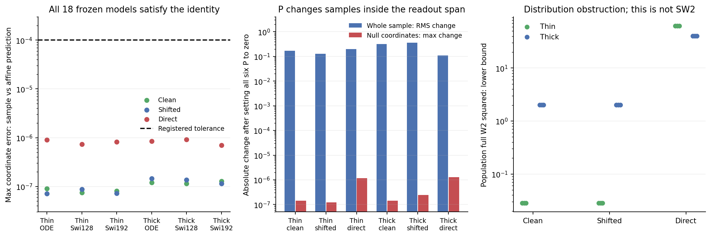

# Part of the generated state is fixed by the output layer

Changing the hidden ODE matrices cannot change every direction of a generated sample in the128D benchmark. All18 fitted models satisfy an exact affine sampling law outside their final readout span. Setting all six P matrices to zero changes the samples substantially but leaves that law intact. This is a limitation shared with SwiGLU, not evidence for a better ODE block.

## Purpose and prediction

Cycle07 compared a128D target with hidden width64. Final LayerNorm centers those64 hidden coordinates. The subsequent linear output therefore spans at most63 directions, leaving at least65 directions in which the raw prediction is constant. The constant depends on learned biases, but cannot depend on the input or time. The [proof](proof.md) derives this statement for arbitrary hidden nonlinear computation; the [protocol](protocol.md) fixes the verification cohort and tolerances before fitted projection outcomes.

Let L contain orthonormal basis vectors for these output-null directions. In row-vector notation, every generated sample must obey

```text
generated @ L = R * (initial_noise @ L) + d * (output_bias @ L).
```

Here output_bias includes the LayerNorm shift. The32-step Heun coefficients are fixed by the decoder, not fitted to samples:

| Decoder | R, retained noise standard deviation | d, bias multiplier |
|---|---:|---:|
| Clean |0.0211639404|0.9788360596|
| Shifted |0.0211639404|0.0913168539|
| Direct |1|1|

Direct prediction retains all initial Gaussian variance in these directions. Both skip decoders suppress it by the same factor, despite different hidden computations and bias responses. The continuous-time skip factor is0.05/e=0.0183939721; the stated discrete factor is specific to the unchanged Heun32 sampler and cap. No extra-step evaluation or solver rescue was performed.

## Frozen models and P interventions

All18 readouts have rank63, a65D null space and a63D intersection with the target-normal space. Across2048 source/sample pairs per model, the largest coordinate discrepancy from the predicted identity is9.21e-7. The maximum relative covariance discrepancy is2.29e-7 when compared with R squared times the covariance of the same source batch. Finite empirical covariances were not assumed to equal population identity matrices.

For each original-ODE endpoint, only its six P matrices were zeroed. Clocks, normalization, output weights, biases and buffers stayed fixed. The intervention was sampled using the same sources and Heun32 rule; it was neither trained nor ranked by distribution quality.

| Data / head | Whole-sample RMS change | Largest change in output-null coordinates |
|---|---:|---:|
| Thin / clean |0.1678|1.41e-7|
| Thin / shifted |0.1297|1.22e-7|
| Thin / direct |0.1978|1.18e-6|
| Thick / clean |0.3181|1.43e-7|
| Thick / shifted |0.3546|2.47e-7|
| Thick / direct |0.1084|1.30e-6|

All interventions are nonvacuous. P affects the samples, while the fixed output layer prevents those effects from reaching the null directions. These checks do not show that P is unnecessary, nor whether the zero-P samples are better or worse. [Full interventions](results/P-interventions.csv), [all models](results/invariants.csv).



## A population consequence, with a dimension boundary

The target is Gaussian in directions normal to its hidden2D plane: standard deviation0 for thin data and0.2 for thick data. In the63D common normal/null space, generated coordinates are Gaussian with standard deviation abs(R) and a known mean. Their exact projected squared Wasserstein distance is

```text
squared_mean_displacement + 63 * (abs(R) - target_std)^2.
```

Projection makes this a lower bound on full population W2 squared. The ranges across the three fitted families are:

| Data | Clean | Shifted | Direct |
|---|---:|---:|---:|
| Thin |0.02822|0.02822|63.00089–63.00097|
| Thick |2.01526–2.01832|2.01496–2.01498|40.32060–40.32062|

These are unnormalized population W2 squared bounds, not the benchmark's empirical finite-direction SW2. They cannot be used as numerical bounds on that reported SW2. They also do not explain the unresolved eight-cluster structure inside the target plane.

The two earlier actual SwiGLU readouts have full row rank:2 for Ring2D and16 for Product16. Their null dimensions are zero. This theorem therefore does not explain away those older negative ODE experiments. [Dimension controls](results/dimension-controls.csv).

## What this changes about the next experiment

The128D normal-space result is governed partly by input/output information paths. More elaborate P spectra or internal ODE solvers cannot remove the output obstruction. The candidate-sensitive evidence remains the tangent field and recovery of the separated clusters; cycle07 did not pass its fixed criteria there. No new P constraint, learned skip, wider head or head-training rescue is nominated.

Before training another ODE block, quantify how much of its remaining fitted error comes from information lost by the learned input projection, and how much remains after conditioning on that projection. The known Gaussian-mixture target permits an exact conditional-mean calculation at fixed weights. A bounded read-only decomposition would distinguish representation loss from fitting error without adding a trick or selecting another architecture. That calculation has not been run in this cycle.

## Verification and execution

Registration f752525 preceded the new fitted projections. Float64 nonlinear fixtures pass to5.78e-15. The formal run completed on one Mac mini CPU thread in6.57s, PID40649, with peak sampled RSS0.269GiB. There was no new training or GPU allocation.

An independent audit reconstructed the centered output space through Householder/QR algebra, obtained sampler coefficients using scalar Heun steps, replayed90 raw-output panels and regenerated all six interventions bitwise. Its terminal log and receipt report PASS after6.00s; no audit process remains. The original tool handle was lost during output truncation, so an audit exit code is not asserted. Projector constructions differ by at most2.51e-11. All32 formal files remain unchanged. [Audit](results/audit.json), [execution receipt](results/receipt.json).

Only code, tables, a figure and verification summaries are versioned. Raw arrays, source/sample batches and logs stay in the private runtime. Report1, existing models, data, samplers, training and earlier sealed evidence remain unchanged. Lenovo SSH still times out and local GitHub authentication is absent; neither remote execution nor publication is claimed.
