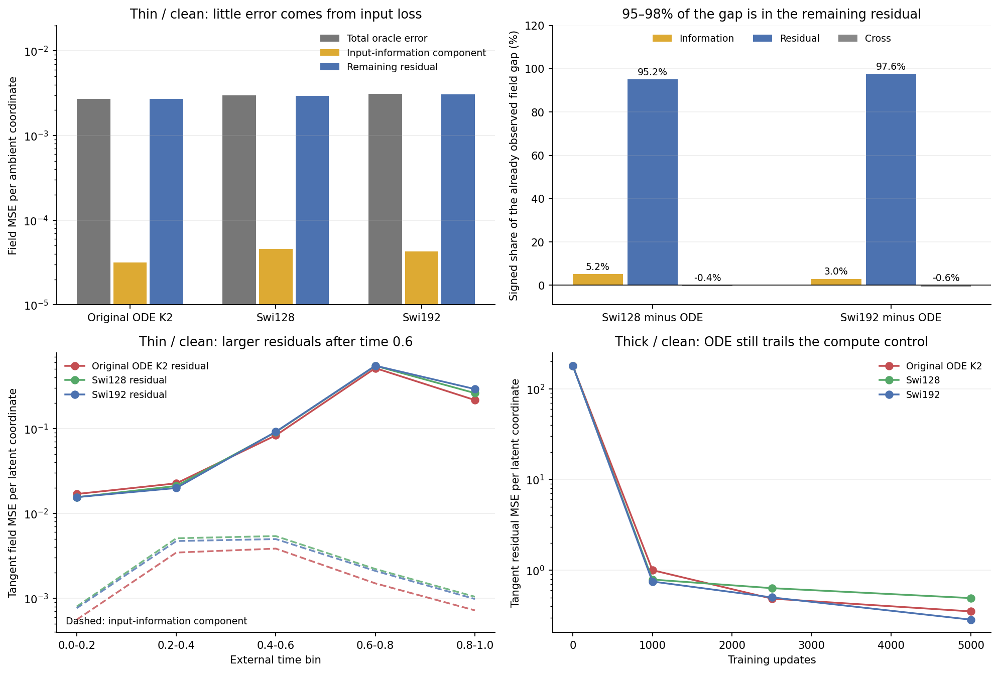

# The thin-data gap mostly survives conditioning on the learned input

The original ODE's small thin/clean advantage is mostly in the error remaining after its input projection, rather than in better preservation of input information. The signed residual contribution explains95.2% of its gap to Swi128 and97.6% of its gap to Swi192. This narrows the next question but does not turn cycle07's failed screen into a successful method.

## Purpose: distinguish information loss from the remaining error

The128D models first project a noisy sample to64 hidden coordinates. An input-rank bound says information is lost, but not how much the particular learned projection loses. We use the known eight-component Gaussian mixture to compute the exact best prediction from each learned projection and time. Target-plane information is used only by this evaluator.

For every saved checkpoint, compare three fields: the actual prediction, the full-input oracle, and the conditional optimum given its learned input projection. Their squared errors obey

```text
total error = input-information component + remaining residual + cross term.
```

The population cross term is zero by conditional expectation. The finite-bank cross term is measured and retained. The residual includes final-output restrictions, function approximation and optimization. It is not a direct measure of the FFN alone and does not identify a causal effect of P. [Derivation](theory.md), [registered cohort and attribution rule](protocol.md).

We include all72 saved cycle07 checkpoints across all three heads, both geometries and four training times. No model, objective, time distribution, sampler or training budget changes. Each calculation uses its existing20000-row field bank and saved predictions.

## Thin/clean: input loss is a small part of the fitted error

Final values are decoded-field MSE per ambient coordinate, measured against the full-input oracle:

| Model | Total | Input information | Remaining residual | Cross |
|---|---:|---:|---:|---:|
| Original ODE K2 |0.00272857|0.00003165|0.00269295|0.00000397|
| Swi128 |0.00299853|0.00004569|0.00294985|0.00000298|
| Swi192 |0.00309514|0.00004255|0.00305084|0.00000174|

ODE does retain slightly better input information. That difference explains only5.2% of its gap to Swi128 and3.0% of its gap to Swi192. The residual explains95.2% and97.6%; cross-term differences contribute-0.4% and-0.6%. These signed shares sum to100% and satisfy the predeclared predominantly-residual rule for both controls. [Exact signed differences](results/decision.json).

This is a decomposition of an already observed gap, not a second architecture acceptance test. The original9.0% improvement over the parameter control still misses cycle07's10% requirement. Retraining a different input matrix or modifying a stopped head setting is not justified by this result.



## A time-bin case study

The remaining error on the actual target plane is much larger than the input-information component. Thin/clean final tangent errors are0.1731 for ODE,0.1904 for Swi128 and0.1966 for Swi192 per latent coordinate. After subtracting conditional input limitations, their residuals remain0.1708,0.1873 and0.1937.

| External time bin | ODE tangent residual | Swi128 tangent residual | Swi192 tangent residual |
|---|---:|---:|---:|
|0.0–0.2|0.01691|0.01550|0.01553|
|0.2–0.4|0.02258|0.02101|0.01989|
|0.4–0.6|0.08297|0.09072|0.09155|
|0.6–0.8|0.51369|0.54631|0.54832|
|0.8–1.0|0.21603|0.26094|0.29112|

ODE is worse in the first two bins and better later. All three have their largest residual in0.6–0.8. For ODE in that bin the information component is only0.00150, against residual0.51369. Thus the late-time difficulty is not principally explained by its64D input projection. These are fixed-bin observations, not proof of a particular dynamical failure, permission to alter the loss, or a causal explanation for the unresolved eight-cluster generation.

## Thick data keep the transfer failure visible

Thick/clean ODE has full error0.70025, of which0.66567 is the measured input-information component. The dominant ambient component is qualitatively different from thin/clean. However, its tangent residual is0.35134, against0.28473 for the compute-matched Swi192. Their tangent information components are0.00186 and0.00285: the ODE's worse tangent fit cannot be excused by greater input loss there.

Other heads remain in the published table. Thin/direct models have information components around0.4833–0.4835 of total errors0.5049–0.5079. Thick/direct components are around0.3626–0.3628 of total0.3800–0.3824. These fitted conditional calculations sharpen the earlier universal rank bounds without replacing the original metric or reopening head training. [All steps, heads, geometries and fixed bins](results/decomposition.csv).

## What should change in the research direction

Do not increase the input width to explain the thin/clean gap, or treat the high-dimensional ambient head comparison as evidence for a better ODE solver. The useful unresolved question is whether the original block can represent the late-time tangent field more accurately at matched cost, while retaining the thick-data control. The current evidence does not yet choose a new architecture.

A P-only spectral argument is insufficient. For one original K2 layer, at fixed external time, with scalar state clock s(x),

```text
F(x) = x + s*P*x + (s^2/2)*P^2*x
J_F = I + s*P + (s^2/2)*P^2 + (P*x + s*P^2*x)*grad(s)^T.
```

The last term survives even when P has a well-behaved spectrum. The complete FFN also composes a second such layer and SiLU; the network adds normalization, residuals and readout. Any proposed constraint must therefore explain a specific complete-predictor error, not only make P eigenvalues look nicer. Previous spectral, gate and solver stop rules remain intact.

The next mathematical review should compare complete field derivatives with the **conditional** oracle in the existing late-time panels. Comparing only to the full-input oracle can incorrectly penalize structure forced by information loss. That review is not run or selected as an architecture experiment here. A new candidate still needs an ordinary realization/control, fixed-cost training and successful generation on the existing tasks.

## Verification and limits

Source registration21e8204 preceded all fitted conditioned-oracle outputs. Independent dense Gaussian conditioning agrees to9.06e-14; full-observation fixtures agree with the existing native oracle to1.78e-14. The formal run completed72checkpoints in14.15s on one Mac mini CPU thread, PID41562, exit0, peak sampled RSS0.408GiB.

Audit-v2 uses QR row spaces and2D Woodbury solves instead of the formal SVD calculation. All72 conditional fields agree to1.13e-13; all1296 summary rows and privately saved per-row components pass, and all18 native endpoint predictions replay bitwise. It exits0 after17.73s, preserving78formal files. Audit-v1 caught its own normal-coordinate denominator error (128 instead of126); the original source/log remain private. V2 fixes only that audit calculation, with unchanged tolerances and formal results. [Audit](results/audit.json), [preflight](results/preflight.json), [execution receipt](results/receipt.json).

The conditional optimum is over arbitrary measurable raw functions after a frozen input map; the actual finite network need not realize it. The split therefore does not distinguish approximation from optimizer behavior, prove an ODE-specific advantage, or predict image-generation performance. The useful-successor objective remains open. Existing training, source snapshots, Report1 and all older sealed evidence are unchanged. No GPU was allocated; Lenovo SSH remains unavailable and local GitHub publication still requires authentication.
