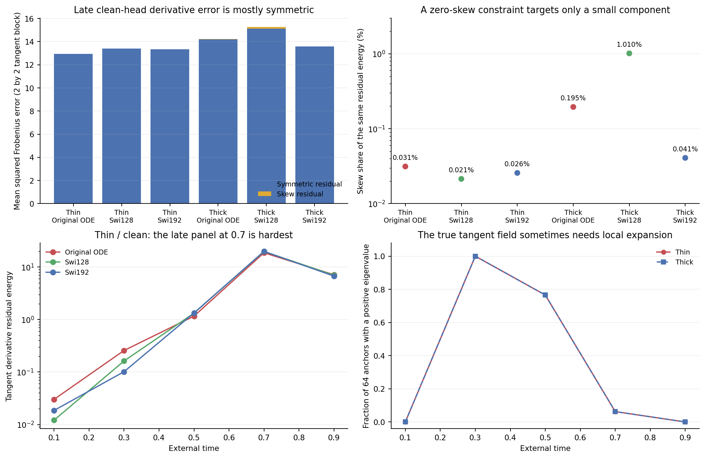

# A symmetry-only explanation does not fit the measured derivative error

The original ODE's late-time tangent derivative residual is99.97% symmetric on thin data and99.81% symmetric on thick data. All six clean-head model/law comparisons meet the registered symmetric-dominant criterion. The evidence argues against making a zero-curl constraint the next experiment. It does not establish a successful replacement for the ODELayer.

## Purpose and the correct reference

Cycle09 showed that most of the small thin/clean gap remains after conditioning on the learned input projection. Here we differentiate that conditional field exactly and compare it with the complete fitted model. The native derivatives include state-dependent clocks, all P terms, both ODE layers, intermediate activations, normalization and time conditioning.

The full-input posterior-mean derivative is symmetric positive semidefinite. After observing only Bx, however, its derivative is proportional to `Cov(Y|Bx,t) * (B^T B)`. A covariance and a projector need not commute. The optimal compressed-input prediction can therefore have a nonzero skew component even before fitting error. We compare the model with that conditional reference, rather than assuming every departure from the full oracle is avoidable. [Derivation](theory.md), [registered checks and classification](protocol.md).

This reference minimizes field-prediction risk over arbitrary functions after a frozen input projection. It is not asserted to minimize Jacobian risk. We retain the signed derivative cross term; the population orthogonality from cycle09 cannot simply be differentiated.

## All late-time clean comparisons

The following values average the existing.7and.9panels,128anchors per row. Energies are squared Frobenius norms of the2-by2 tangent-to-tangent derivative residual, without ambient normalization.

| Data / model | Residual energy | Symmetric share | Skew share |
|---|---:|---:|---:|
| Thin / original ODE |12.9355|99.9687%|0.0313%|
| Thin / Swi128 |13.4106|99.9786%|0.0214%|
| Thin / Swi192 |13.3291|99.9743%|0.0257%|
| Thick / original ODE |14.2298|99.8050%|0.1950%|
| Thick / Swi128 |15.2819|98.9898%|1.0102%|
| Thick / Swi192 |13.5848|99.9592%|0.0408%|

The symmetric part describes errors in local stretching/compression and their axes; the skew part describes local rotation. These are matrix components of the residual, not percentages of sample-quality failure. A small skew share does not prove a skew penalty cannot affect training indirectly. It does show that a skew-only account misses almost all measured late-time tangent derivative error. [Exact late summaries](results/late-summary.csv).

## Two cases prevent a broad ODE success claim

At thin time.7, ODE tangent derivative residual is18.7312, versus19.8243 and19.9302 for the two Swi controls. At time.9 the ordering reverses: ODE7.1397, Swi1286.9968, Swi1926.7279. Thus the small late-panel average advantage is not uniform in time and is not a complete derivative improvement.

On thick data the late average is14.2298 for ODE against13.5848 for Swi192. This agrees with keeping cycle07's failed transfer criterion. The separate field errors and generation failures remain unchanged; a derivative diagnosis is not another quality-selection opportunity.

The derivative decomposition also demonstrates why its cross term must be retained. For thin/clean ODE at time.7, total error to the full oracle is18.6561, conditional-reference displacement0.02259, remaining residual18.7312 and cross-0.09775. Summing only the two squared components would give the wrong total. [All90panels, including other heads](results/panels.csv).

## Expansion is sometimes part of the target

The true tangent field has at least one positive symmetric-Jacobian eigenvalue at64/64anchors at time.3,49/64at.5and4/64at.7. It has none in these panels at.1or.9. Thin and thick share this tangent pattern. These are fixed-panel counts, not population probabilities.

The source must separate into modes; local expansion at some states is compatible with that transport. A proposal that treats all positive outer-field eigenvalues as instability would conflict with these actual oracle panels. This does not directly rule out a particular hidden-P constraint: hidden P and the complete decoded field are different operators, and a constrained P can still produce nonlinear expansion through clocks and the rest of the network.

## Consequence for the next design

Do not prioritize symmetry alone, flatten all singular values because of a series-expansion argument, or force the entire outer field to be contractive. None addresses the observed late-time symmetric response error by itself. The current diagnosis calls for accurate state-dependent local stretching and compression, with the thick-data control retained.

The older [clock-response bound](../../research-architecture-search/clock-response-bound.md) already found that varying scalar-clock derivatives inside a fixed trained response frame cannot remove much of the Product16 derivative error. Together, these results make the **response directions and magnitudes of the complete predictor** a better target for a design review than clock saturation or rotation alone. They do not prove P is the sole bottleneck. Vector clocks, range changes and earlier stopped candidates are not reopened by this argument.

Any proposed successor must explain which functional restriction it removes, show whether an ordinary FFN can implement the same computation, and face matched parameter/work controls before training. This cycle selects no new block, penalty, head or sampler. The useful-ODE successor objective remains open.

## Execution and verification

The initial preparation/preflight under5af02d7 was preserved without running fitted panels. Before outcomes, code review caught the difference between decimal panel labels and the actual stored float32 times. Registration9517070 corrects references to the stored times; the formal run uses a separate immutablev2snapshot. No hypothesis, tolerance, input bank or prior artifact changed.

Float64 analytic/dense-AD fixtures agree to1.05e-12, finite differences to7.55e-9, full-observation/native-oracle Jacobians to3.30e-12 and the covariance commutator identity to4.45e-16. The formal90-panel run exits0 after34.22s, PID42271, peak sampled RSS0.410GiB, on one Mac mini CPU thread.

Independent audit exits0 after17.95s. All5760 native model Jacobians and predictions replay bitwise at their original batch size. Independent dense-conditioning automatic differentiation checks the first two anchors of every panel,180conditional Jacobians, agreeing to2.49e-14; a separate conditional-field formula agrees to6.27e-14. Every saved per-anchor diagnostic and all panel summaries pass, preserving96formal files. AD coverage is180anchors, not all5760. [Audit](results/audit.json), [fixtures](results/preflight.json), [receipt](results/receipt.json).

Only code, small audited tables and the figure are versioned. Matrix arrays and logs remain private. No training or GPU allocation occurred. Existing data, models, samplers, Report1 and older sealed evidence are unchanged. Lenovo SSH still times out; local GitHub authentication is absent, so remote execution and publication are not claimed.
