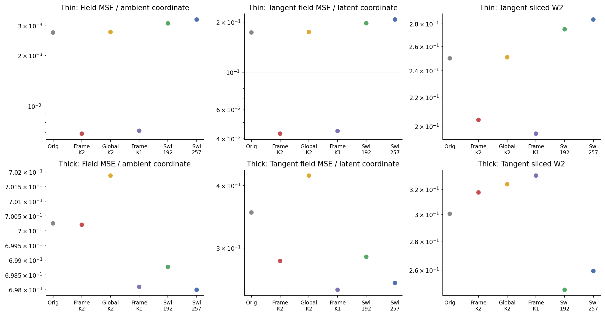
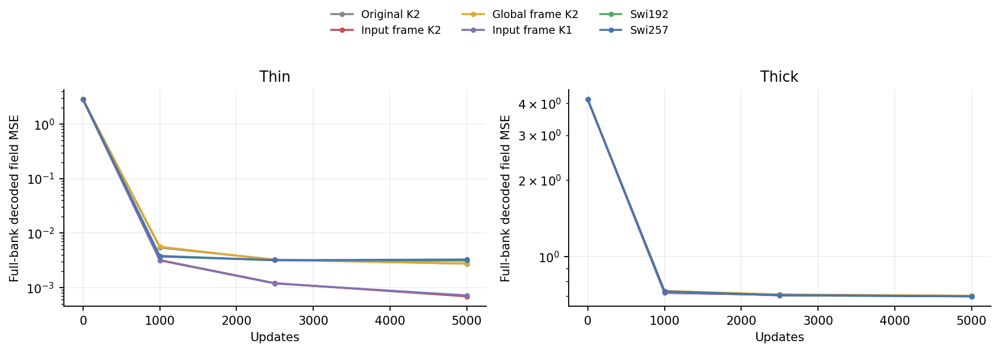
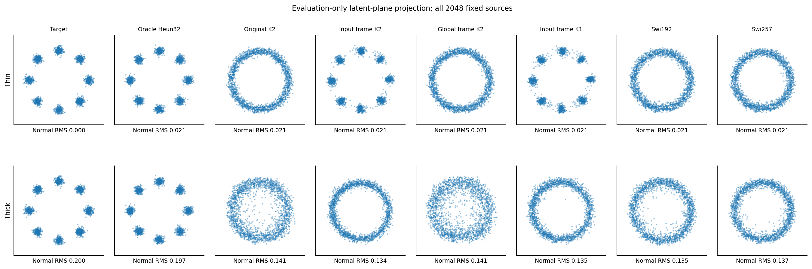
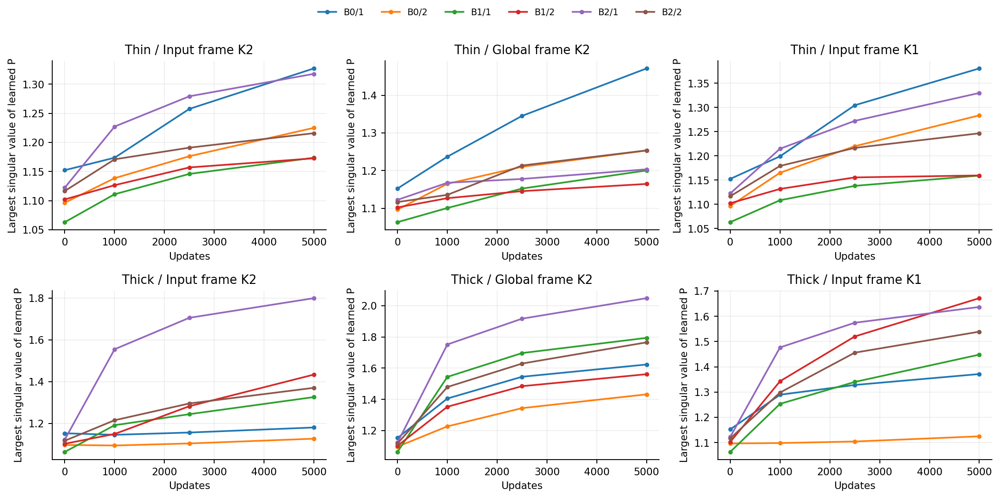

# Input-dependent directions recover thin-data modes, without a K2 win

Changing the directions of P's action produces a substantial thin-data improvement: field MSE falls from0.002729 for the original block to0.000685, and generated samples form eight visible clusters instead of a continuous ring. However, the K1 control nearly matches this gain and thick-data generation regresses. The registered K2 candidate fails; this setting stops without historical-task expansion or a new architecture nomination.

## One change to the original layer

The original scalar-clock layer uses `I+sP+s²P²/2`. We retain P, its scalar clock, the two independent layers and their middle SiLU, but choose an input-dependent orthogonal frame Q:

```text
F(x) = Q(x) * [I+s(x)P+s(x)^2 P^2/2] * Q(x)^T * x.
```

Q is a pair of Householder reflections built from the existing controller features and one additional affine output. It starts exactly at identity, with no new RNG draw. For a frozen input, QPQ^T has the same eigenvalues and singular values as P. All state derivatives of Q and the clock remain in backpropagation. This is conditional operator adaptation, not a more accurate autonomous ODE solve or a full-map stability guarantee. [Mathematics and primary literature](theory.md), [source](../../../synthetic/conditional_frame.py).

The local response witness adds directions unavailable to a scalar clock when other weights are held fixed. It does not prove a strict full-network capacity advantage. Orthogonal adaptation and input-conditioned reflections have existing prior art; no ODE-specific novelty is established.

## Fixed controls and unchanged training

Eight new cold trajectories cross thin/thick data with input-frame K2, global-frame K2, input-frame K1 and Swi257. Four sealed original-K2/Swi192 trajectories supply references. All use the same clean head,128D banks, hidden width64, depth3,5000updates, seed0 and training stream. No oracle labels, basis information, new objective or sampler enter training.

The global frame has the same added tensors and inference work but is input-independent and absorbable into P. It controls for redundant parameterization, with lower backward work and a different parameter kernel explicitly retained. Input-frame K1 is an ordinary gated-residual realization with the same parameters. Swi192 nearly matches parameters; Swi257 nearly matches executed dense inference and forward/backward work. [Protocol and measured budgets](protocol.md).

## Thin data: a clear improvement with the right attribution limit

| Model | Field MSE / ambient coordinate | Tangent MSE / latent coordinate | Complete Jacobian error | Tangent SW2 |
|---|---:|---:|---:|---:|
| Original K2 |0.002729|0.173062|5.8754|0.24985|
| Input-frame K2 |**0.000685**|**0.042803**|**1.8482**|0.20410|
| Global-frame K2 |0.002748|0.174177|5.9265|0.25072|
| Input-frame K1 |0.000713|0.044408|1.9658|**0.19501**|
| Swi192 |0.003095|0.196558|5.9907|0.27486|
| Swi257 |0.003260|0.206887|5.9471|0.28381|

Input-frame K2 reduces field error77.9% relative to the parameter-matched Swi192 and78.2% relative to the better tangent-error Swi reference. Its Jacobian error is68.9% lower than the better Swi. The global-frame control remains close to the original, so extra parameterization alone does not reproduce this result in the measured runs. That comparison does not isolate every optimization or backward-work difference.

The K2 field advantage over the same-frame K1 is only3.93%, below the registered5% mechanism threshold. K1 has better thin tangent SW2 and uses substantially less work. Thus the data support the importance of this input conditioning in the thin setting; they do not attribute its gain to the second-order term.





[Training telemetry](results/training-telemetry.csv) retains all132logged loss/gradient/clipping rows. Those logged update statistics are preserved and checked for consistency; the audit independently replays the held-out checkpoint predictions, rather than rerunning every optimizer update.

## Case study: actual cluster recovery, with remaining defects



Both input-frame models form eight visible thin-data clusters, with residual bridges and imperfect cluster shapes. Original K2, global-frame K2 and the Swi controls still resemble continuous rings. All panels use the same2048initial sources; the target plane is evaluation only.

Thin normal sample RMS remains about0.021 for every model, consistent with the existing capped-Heun limitation rather than zero target variance. Full SW2 improves from0.02966 for the original to0.02371 for input-frame K2, but its tangent SW2 remains0.20410. The plot and both metrics are retained; a small ambient average is not complete distribution recovery.

## Thick data prevent a robust-method claim

| Model | Full field MSE | Tangent MSE | Full SW2 | Tangent SW2 |
|---|---:|---:|---:|---:|
| Original K2 |0.700245|0.353135|0.05928|0.30034|
| Input-frame K2 |0.700198|0.282518|0.06366|0.31734|
| Global-frame K2 |0.701870|0.418469|0.06059|0.32412|
| Input-frame K1 |0.698089|**0.247406**|0.06289|0.33137|
| Swi192 |0.698766|0.287896|**0.05484**|**0.24708**|
| Swi257 |**0.697991**|0.255320|0.05733|0.25933|

Against the better Swi references, input-frame K2 is10.65% worse in tangent field error,16.08% worse in full SW2 and28.43% worse in tangent SW2. Its large ambient field error changes little. The thick generated plane remains a ring; the oracle sampler resolves the clusters. K2 is also slightly worse than K1 in thick field error. These observations fail the predefined transfer, generation and mechanism guards. [Every decision check](results/decision-checks.csv), [decision](results/decision.json).

No more reflections, changed frame scale, width, initializer, clock range, time weighting or solver stage will be tried as a rescue of this setting. The historical-task confirmation wave is not triggered.

## What P and the frame learned



For input-frame K2, the six final P largest singular values range1.173–1.327 on thin data and1.126–1.800 on thick data. Singular-value coefficients of variation remain0.614–0.656 and0.623–0.689 respectively. There is no observed flattening certificate or complete-network stability inference. The state-dependent similarity preserves each frozen P's singular values; it does not make different trained models share P.

Final frame-output sample standard deviations range0.098–0.272 across thin layers and0.037–0.177 across thick layers, so the learned input frame is active. All144P snapshots and9216singular values are retained. [P summaries](results/P-history.csv), [full spectra](results/P-singular-values.csv), [clocks and frame diagnostics](results/clocks.csv).

At final fixed weights, zeroing only the input-frame parameters moves field predictions by0.364RMS on thin K2 and1.303RMS on thick K2. Field MSE rises to0.13168 and2.36076 while every P and other tensor stays fixed. This confirms dependence on the learned frame after joint adaptation; it does not estimate retraining without it or nominate the zero-frame replay. [All four interventions](results/zero-frame.csv).

## Execution, checks and cost

The final equivalent-arithmetic source registration is270c1d0, before all fitted outcomes. Earlier preparatory failures are preserved: cache-directory hashing, prior-module namespace collision, and tiny identity-backward cancellation. The last was resolved by writing the same orthogonal map as I plus its exact rank-two update; the bitwise gradient gate was not relaxed.

Preflight verifies bitwise complete-model initial outputs/inherited gradients, unchanged tensors/buffers/RNG and exact resume for all8cells. Independent dense-frame active derivatives agree to5.11e-15, conjugated eigenvalues to2.34e-15 and the complete commutator differential to1.78e-15. Additional frame tangents and the K1 initial-hidden-feature difference remain explicit.

The monitored formal process PID43415 exits0 after284.07s on two one-thread Mac CPU workers. Peak sampled total RSS is1.349GiB; no GPU was allocated. Input-frame K2 cells take75.5s/84.3s versus37.2s/46.1s for Swi257, including checkpoint evaluation and generation. Matched dense work therefore does not imply equal CPU wall time; pointwise/frame overhead is material.

Audit-v2 exits0 after38.56s, preserving235formal files. It replays32new and16reference checkpoints,40new and20reference complete-Jacobian panels,8new and4reference samplings,10000stream batches and144P snapshots. Native predictions/Jacobians/samples replay bitwise. Thirty-six fitted layer checks at two anchors each independently compare dense-Q outputs and spectrum preservation. Audit-v1 computed a legacy float32 RMS statistic in float64; its source/log remain preserved, while v2 restores the original dtype without changing tolerances or scientific thresholds. [Audit](results/audit.json), [preflight](results/preflight.json).

## Next question

The thin-data improvement is useful evidence, but the K2 candidate is stopped. A separate read-only question is why better field fitting does not yield better thick-data sampling. The next review should examine errors along actual generated trajectories and their propagation through the fixed oracle sampler, with the same time grid and frozen models. It must retain signed interactions and distinguish the capped-oracle reference from the true target. No additional training or architectural rescue is selected here. Report1, older models, datasets, evaluators and sealed evidence are unchanged; GitHub publication still needs local authentication.
