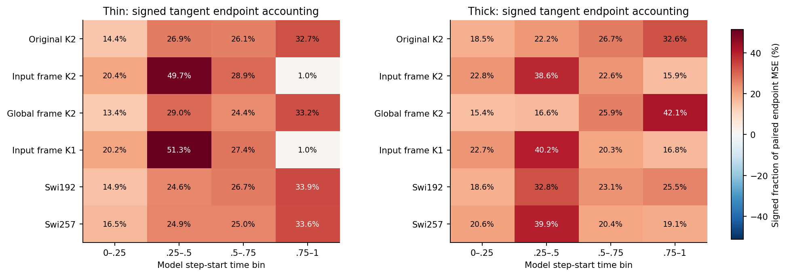
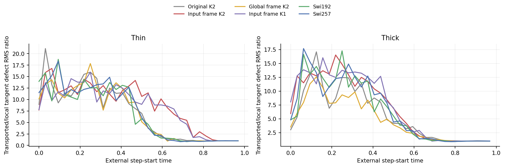
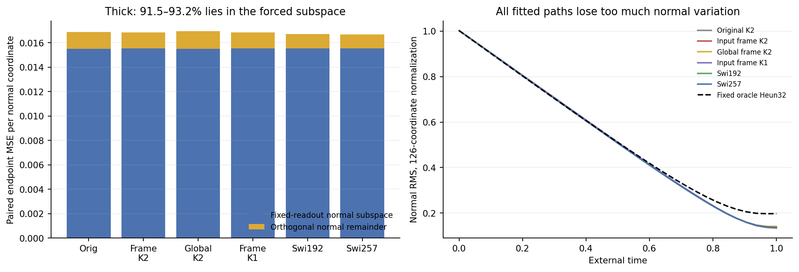
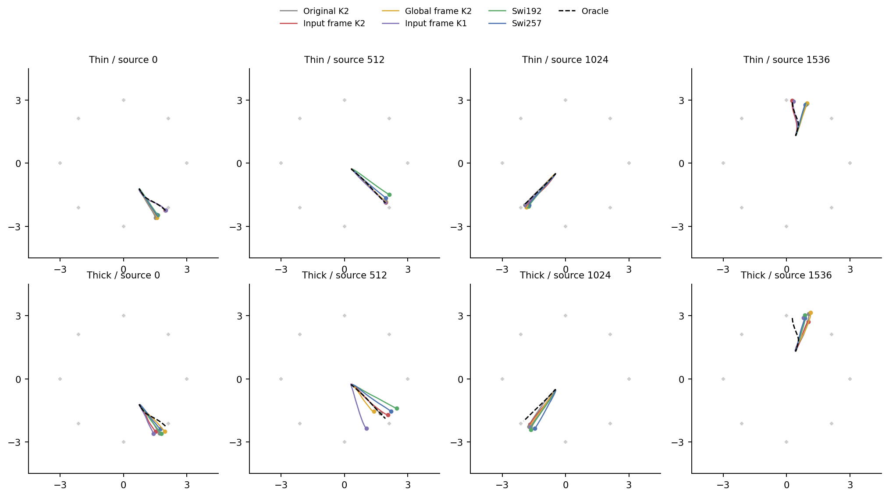

# Where do the sampling errors accumulate?

The frozen-path study changes two parts of our diagnosis. The input-frame model's thin-data sampling discrepancy is mostly accumulated before the last quarter, despite large late field errors. On thick data, most normal-space paired error belongs to a fixed-readout restriction shared by every architecture. Neither observation establishes a better ODE block or reverses cycle11's failed K2 screen.

## Question and evidence

We inspect all twelve final clean-head models from [cycle11](../cycle11-conditional-frame/analysis.md): original K2, input-frame K2, global-frame K2, input-frame K1, Swi192 and Swi257 on both thin and thick 128D laws. Each model uses the same 2,048 saved Gaussian sources, capped field and native 32-step Heun sampler. There is no new training, sampler search or checkpoint selection. The [protocol](protocol.md) was committed at `7a6c2db` before fitted path outcomes.

For a source, let `x_i` be its learned trajectory and `S_i` the remaining oracle Heun steps. Set `p_i = S_i(x_i)`. Then `p_0` is the oracle endpoint, `p_32` is the learned endpoint and

```text
E = p_32 - p_0 = sum_i Delta_i,    Delta_i = p_(i+1) - p_i
mean ||R E||^2 / dim(R) = sum_i mean <R E, R Delta_i> / dim(R).
```

Here R selects full, tangent or normal space. The terms are signed: they account for alignment and cancellation with the final error. They are not independent step losses or causal effects of retraining one interval. The derivation and the readout-subspace identity are in [theory.md](theory.md).

The formal run finished in 126.32 seconds with peak sampled RSS 1.340 GiB on one Mac CPU thread. The 61.88-second audit replayed all native endpoints, 384 learned steps and 396 suffix branches bitwise; it independently recomputed signed projections and the output-null projector. The nonlinear oracle implementation remains shared ground truth. Maximum normal-propagation error was `6.41e-7`; the analytic readout-bridge prediction error was at most `2.89e-7`. See [audit checks](results/independent-checks.csv) and [statistical details](stats-appendix.md).

## Late field error does not locate endpoint error



The four time bins were fixed before outcomes. For input-frame K2, the signed tangent shares are:

| Law | 0–0.25 | 0.25–0.5 | 0.5–0.75 | 0.75–1 |
|---|---:|---:|---:|---:|
| Thin | 20.38% | 49.69% | 28.92% | 1.01% |
| Thick | 22.83% | 38.61% | 22.63% | 15.93% |

Thin frame K2 accumulates 70.07% in the first half. Original K2's last-quarter share is 32.68%. Thus the previous uniform-time field/Jacobian findings do not justify focusing a new method only on late-time fitting. These percentages describe the specified model/oracle coupling, not a decomposition of SW2 or of an architecture advantage.



The transported/local tangent defect RMS ratio reaches 16.77 for thin frame K2 and 16.52 for thick frame K2. Earlier displacements can matter after a long nonlinear suffix. These are finite gains for the observed defects; they neither bound arbitrary perturbations nor prove unstable hidden P eigenvalues. In particular, the external sampler's propagation is different from repeating an internal Taylor generator.

## A shared normal-space restriction

Let `B = W diag(gamma) C` be the centered final readout, and let T project onto the intersection of its output-null space and the target-normal space. All twelve fitted T subspaces have dimension 63. With the readout fixed, changing hidden P or the frame cannot change the projected clean-head field `(c0*T - x*T)/delta`.

Its Heun homogeneous endpoint factor is `0.02116394`, whereas the thick oracle's normal factor is `0.19701598`. The exact formula predicts every suffix bridge in T from the source and the readout bias, without evaluating the hidden block. Projecting normal error onto T and its orthogonal complement gives:

| Thick model | Normal paired MSE | Share in T |
|---|---:|---:|
| Original K2 | 0.016880 | 91.88% |
| Input frame K2 | 0.016859 | 92.10% |
| Global frame K2 | 0.016949 | 91.53% |
| Input frame K1 | 0.016834 | 92.18% |
| Swi192 | 0.016700 | 92.95% |
| Swi257 | 0.016678 | 93.15% |



This is a large shared component, not an explanation for every model difference. T's orientation and bias can change during whole-network training. Its projected dynamics are forced only at the specified frozen readout. The result does not imply all 126 normal directions have standard deviation 0.021, and it does not excuse frame K2's worse tangent generation. On thin data the analogous forced endpoint energy is tiny because the oracle uses the same zero-normal-variance dynamics and cap.

## Paired endpoint MSE is not sample quality

| Thin model | Tangent paired MSE | Existing tangent SW2 | Source-wise centroid disagreement |
|---|---:|---:|---:|
| Original K2 | 0.158101 | 0.249849 | 8.45% |
| Input frame K2 | 0.165753 | 0.204103 | 11.72% |

Frame K2 has better tangent SW2 and visible eight-cluster recovery in cycle11, yet larger common-source endpoint MSE here. Matching each source to one oracle endpoint is a particular coupling; distribution metrics allow reassignment. The differing centroid assignments expose this sensitivity but do not prove that reassignment explains the entire MSE difference. We must not turn this diagnostic into a new training objective or select a model by the smallest paired endpoint error.



These examples use source indices 0, 512, 1024 and 1536, chosen in the protocol. They display actual learned and oracle trajectories in the target plane, not the diagnostic prefix/suffix branches as candidate samplers. Four examples do not estimate mode coverage; the aggregate comparisons use every source.

One visited-state case is also informative. At `t=0.875`, thick frame K2's first-stage tangent field defect is 1.57415 on its learned path versus 0.31601 on the oracle path at the same time. Its normal RMS is 0.17595 versus the oracle's 0.21601. The field error depends on which states are visited. This comparison does not isolate a causal distribution-shift effect: approximation error and state differences occur together.

## What this changes

Keep the cycle11 stop. Input-dependent directions helped thin-data mode formation, but K1 nearly matched K2 and the thick-data generation guards failed. This study gives no basis for more frame variants, a new loss, a head/cap adjustment, different solver resolution or selecting a prefix/suffix hybrid.

The next design review must answer a narrower functional question before another training screen: what does an internal ODE computation supply that an ordinary input-conditioned K1 map lacks? The current evidence supports neither a Taylor-order advantage nor a hidden-eigenvalue explanation for the shared normal collapse. Any future P-specific claim must distinguish tangent behavior from the proven output restriction and keep strong ordinary controls. No new architecture is nominated here.

## Claim candidates

- **Claim:** Large late-time field errors need not dominate the final paired tangent discrepancy.
  - Source evidence: [bins.csv](results/bins.csv), [steps.csv](results/steps.csv), first two figures.
  - Allowed wording: Thin input-frame K2 has a 1.01% last-quarter signed share under the frozen Heun/oracle coupling.
  - Forbidden stronger wording: Late-time accuracy is irrelevant, or early-time training will improve SW2.
  - Uncertainty: Diagnostic coupling and signed interactions; no intervention on training intervals.
  - Next check: A future operator hypothesis must explain its actual path response, rather than only uniform-time field error.
  - Decision: keep.
- **Claim:** A fixed-readout restriction accounts for most thick normal paired error in every compared model.
  - Source evidence: [endpoints.csv](results/endpoints.csv), [normal-gains.csv](results/normal-gains.csv), independent QR checks and [theory.md](theory.md).
  - Allowed wording: The 63D forced subspace contains 91.53–93.15% of the measured normal paired error at these frozen readouts.
  - Forbidden stronger wording: P cannot improve generation, or this restriction explains all relative frame/SwiGLU differences.
  - Uncertainty: Subspace orientation and bias depend on the fitted model; paired error is not a distribution distance.
  - Next check: Enforce this scope in future P interpretations; no readout rescue is selected.
  - Decision: keep.
- **Claim:** Common-source endpoint error and distribution quality can rank these fitted maps differently.
  - Source evidence: Thin original/frame K2 rows in [endpoints.csv](results/endpoints.csv) and cycle11's sample comparison.
  - Allowed wording: Thin frame K2 improves tangent SW2 while its paired tangent MSE increases by 0.007652.
  - Forbidden stronger wording: All of that difference is harmless mode permutation, or paired MSE is an alternative primary quality metric.
  - Uncertainty: Centroid disagreement diagnoses assignments, not the cause of every discrepancy.
  - Next check: Retain field, derivative and distribution diagnostics as separate quantities.
  - Decision: keep.
- **Claim:** Large finite propagated defects identify a need to constrain the eigenvalues of hidden P.
  - Source evidence: Observed tangent RMS gains reach about 17, but measure the external oracle suffix.
  - Allowed wording: Some finite early-step defects have a larger endpoint displacement after this suffix.
  - Forbidden stronger wording: These gains prove repeated hidden-P amplification or a worst-case stability bound.
  - Uncertainty: Different map, perturbation direction and conditioning variables; no spectral intervention here.
  - Next check: A future stability proposal needs a complete-map derivation and a matched ordinary control.
  - Decision: discard the proposed eigenvalue inference.

The submitted Report1, learned tensors, production model source and registered evaluators remain unchanged. Raw arrays and logs stay outside Git. Figure definitions are in [figure-catalog.md](figure-catalog.md).
