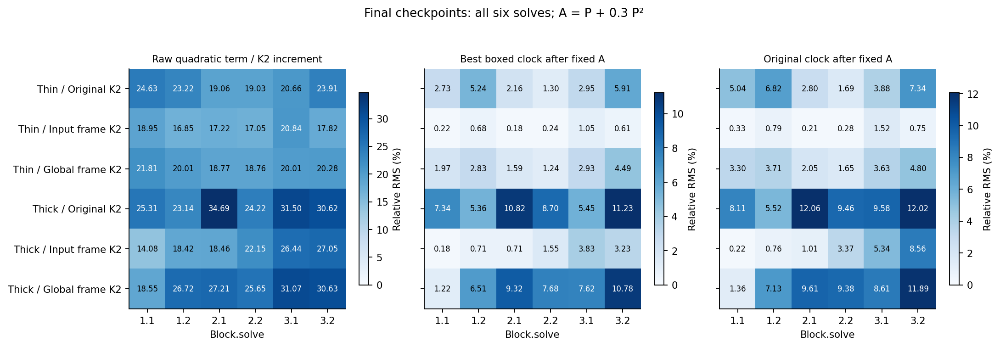
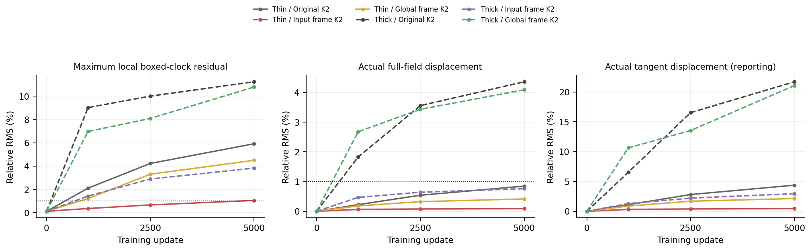
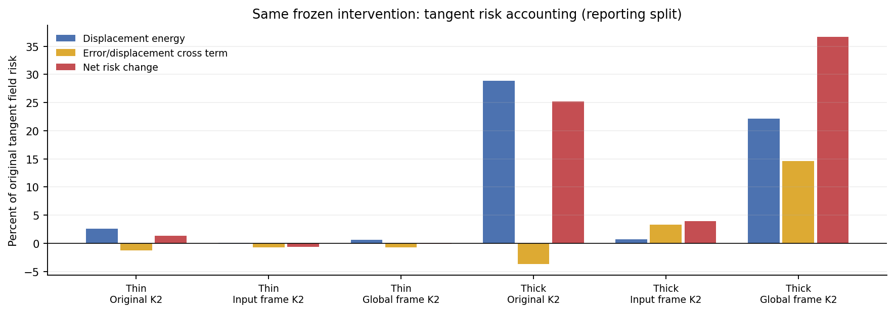

# What the trained quadratic term actually adds

The K2 term is not uniformly redundant. Part of its action can be absorbed into one fixed matrix, especially in the input-frame model, but that approximation changes the thick original model's tangent field substantially. This does not establish a K2 advantage after retraining: the separately trained K1 control remains strong. It rules out both shortcuts, “the second term is large, therefore useful” and “K1 trained well, therefore the second term does nothing.”

## Question and calculation

Use all 24 original/input-frame/global-frame K2 checkpoints on the two clean laws, steps 0/1000/2500/5000. Each checkpoint uses all 20,000 existing field-bank states. Six solve inputs are captured during unchanged native inference in 1,024-row batches. No optimizer, sampler, cap, head, data bank or model tensor is changed. Source was registered at `35cba88` before fitted envelope outcomes; see [protocol](protocol.md).

In a layer's conditional frame, set `u=Pz`, `w=P²z` and `d=s*u+.5*s²*w`. The best scalar approximation `r*u` uses `r=<u,d>/||u||²`, clipped to [.2,1] for the bounded version. This measures what cannot be represented by a duration change at that fixed P and input. It relaxes the finite learned controller and does not predict a trained K1 model.

At the original clock centre c=.6, one fixed matrix absorbs a large part exactly:

```text
A = P + .3 P²
d = s*A*z + .5*s*(s-.6)*P²*z.
```

We also compute the best scalar approximation along A*z and the actual remainder using the unchanged clock s. Conditional frame rotations preserve these local norms. A separate frozen intervention replaces all six solves by the same-clock centred expression; it recomputes clocks/frames at its own actual inputs. Its complete effect is measured, not inferred from local errors. [theory.md](theory.md) includes derivatives and spectral qualifications.

## Raw term size is not the remaining new action



At final checkpoints, raw quadratic RMS is 14.08–34.69% of K2 increment RMS. With P unchanged, even the best bounded scalar clock leaves 12.27–33.85% residual. Thus simply treating P²z as a rescaled Pz is inaccurate here.

After the fixed matrix reparameterization, the picture differs. Thin input-frame K2 has five of six solves below the prespecified 1% local residual flag; its remaining solve is 1.05%. Thick original K2 has residuals 5.36–11.23%, and thick global-frame K2 has 1.22–10.78%. Only eight of the 36 final solve/checkpoint pairs meet the 1% flag. Every layer and all four time bins are retained in [local.csv](results/local.csv); this is not a selected-layer claim.

The relaxed clock need not be the original s. The figure's right panel therefore also shows the same-clock remainder. Low relaxed error alone is not permission to delete a controller or replace it by an oracle coefficient.

## The complete effect depends on the subspace



The table reports the one actual same-clock frozen intervention at update 5000. “Local residual” is the maximum over six pooled bounded-clock residuals after fixed A; complete displacement uses the actual changed network. The tangent split is a reporting addition after registration, with no new intervention, threshold or acceptance decision.

| Law | Model | Max local residual | Full-field displacement | Tangent displacement | Tangent risk change |
|---|---|---:|---:|---:|---:|
| Thin | Original K2 | 5.91% | 0.85% | 4.38% | +1.35% |
| Thin | Input frame K2 | 1.05% | 0.09% | 0.44% | −0.62% |
| Thin | Global frame K2 | 4.49% | 0.42% | 2.14% | −0.14% |
| Thick | Original K2 | 11.23% | 4.36% | 21.71% | +25.17% |
| Thick | Input frame K2 | 3.83% | 0.76% | 2.96% | +3.98% |
| Thick | Global frame K2 | 10.78% | 4.09% | 21.07% | +36.69% |

Displacements are RMS normalized by the original predicted field in the indicated space. Risk change is relative to the original oracle MSE in that space. These denominators are different. Neither quantity is a sampling distance or FID/SW2.

**Case: thick original K2.** Full oracle MSE rises only 0.40%, which could look negligible. Tangent MSE rises 25.17%, and the tangent output changes 21.71% RMS. Strong shared normal components mask the tangent change in the full aggregate, consistent with cycle12's output restriction. A claim that this frozen K2 function has been preserved would be false.

**Case: thin input-frame K2.** The same-clock intervention changes the tangent field by 0.44% RMS and lowers its measured tangent risk 0.62%. Its raw quadratic terms were 17–21% of increment RMS. Much of their finite action is absorbed by A at these weights. We do not infer preserved sampling quality: no new sampler was run. The small finite-bank improvement is not a new model nomination or an ODE-specific gain.



For original error e and prediction displacement delta, `new risk - old risk = E||delta||² + 2E<e,delta>`. The cross term can offset or reinforce the displacement. This is why term energy alone cannot allocate useful prediction quality. All 72 full/tangent/normal accounting rows are in [intervention-parts.csv](results/intervention-parts.csv).

## What this says about constraining P

The [checked two-dimensional witness](results/preflight.json) gives identity and 90-degree rotation matrices with identical flat singular values. For one input, the first has no quadratic direction outside Pz; the second has a fully orthogonal P²z direction. Singular-value flatness and directional redundancy are therefore different properties.

For symmetric P with eigenvalues within epsilon of lambda, `||(P²-lambda*P)z|| <= epsilon*||Pz||`. Narrowing that particular eigenvalue spectrum can suppress the quadratic directional contribution. It is a mathematical tradeoff, not an empirical recommendation to keep spectra broad. Equal eigenvalues without normality and equal singular values do not imply that bound. No spectral intervention was performed.

## Decision for the next design

Keep every previous stop, including cycle11. This diagnostic supports three requirements for a future proposal:

1. An order-specific claim must survive a fixed-matrix reparameterization control, not only deletion of P² with P held unchanged.
2. The practical comparison must still use retrained K1 and strong ordinary FFNs. A frozen higher-order dependence is not evidence that K1 cannot compensate during training.
3. Judge tangent behavior separately from the shared normal restriction. A small full-field percentage cannot establish task-relevant preservation.

The earlier nonlinear-field, midpoint and recurrence screens also remain stopped; this result does not license a renamed integration or order rescue. No new architecture is selected. The unresolved question is how to create useful task-dependent action at matched cost, beyond a static matrix and an ordinary adaptive map.

## Verification and claim scope

Formal computation: 78.04 seconds, one Mac CPU thread, peak sampled RSS 0.768 GiB. Independent audit: 58.67 seconds, peak 0.848 GiB. It replays native fields/hidden inputs and substituted fields bitwise, reconstructs all controls and dense frame matrices in float64, and verifies every per-input/bin statistic. The maximum independent sample discrepancy is `1.14e-12`. The 56 formal files remain unchanged. [Statistics](stats-appendix.md) and the [figure catalog](figure-catalog.md) state units and reporting limits. The nonlinear FM oracle/checkpoint semantics remain shared ground truth.

### Claim candidates

- **Claim:** Static matrix freedom accounts for much of the raw quadratic action in some fitted layers.
  - Source: local.csv, exact centre identity, first figure.
  - Allowed: thin input-frame K2 has five of six centred bounded-clock residuals below 1% at update5000.
  - Forbidden: K2 is globally equivalent to K1, or all second-order terms are useless.
  - Uncertainty: fixed matrices/inputs, relaxed arbitrary scalar clock and reused field bank.
  - Next check: require an ordinary reparameterized control in any future order-specific proposal.
  - Decision: keep with this scope.
- **Claim:** Small full-field change can hide a material tangent change.
  - Source: complete.csv and reporting-only intervention-parts.csv, thick original/global cases.
  - Allowed: thick original's same-clock substitution raises tangent risk25.17%, versus full risk0.40%.
  - Forbidden: this proves better generation for K2 or explains its gap against SwiGLU.
  - Uncertainty: one frozen intervention; no training or sampling comparison.
  - Next check: preserve subspace diagnostics rather than introduce another centre/order sweep.
  - Decision: keep.
- **Claim:** Equal singular values remove K2's new direction.
  - Source: verified identity/rotation counterexample.
  - Allowed: flat singular values alone do not determine whether P²z leaves span(Pz).
  - Forbidden: a flat spectrum must help/hurt training, or the symmetric-eigenvalue bound applies to arbitrary nonnormal P.
  - Uncertainty: no learned spectral constraint was tested here.
  - Next check: any proposed constraint must state its matrix class and functional consequence.
  - Decision: discard the original implication; keep the counterexample.

Production model code, registered data/evaluation, checkpoints and submitted Report1 are unchanged. The diagnostic is a new measurement, not a useful-successor completion claim.
