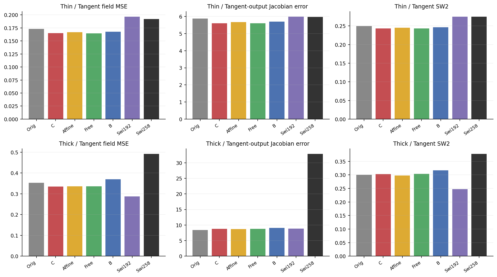
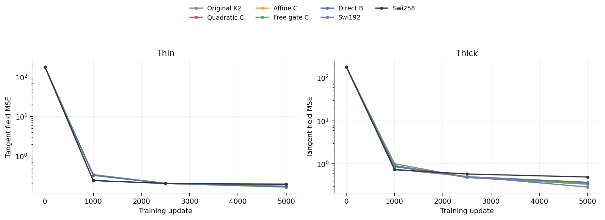
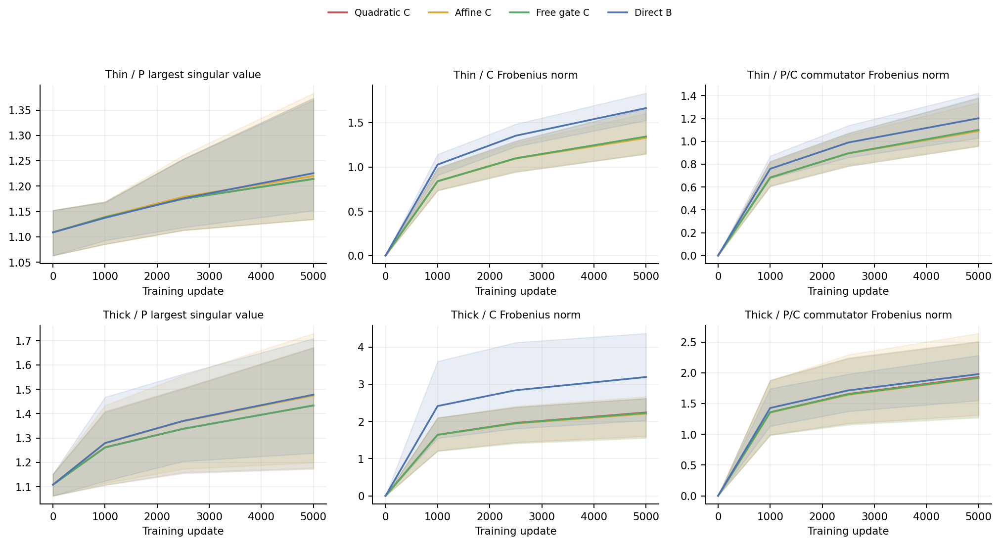
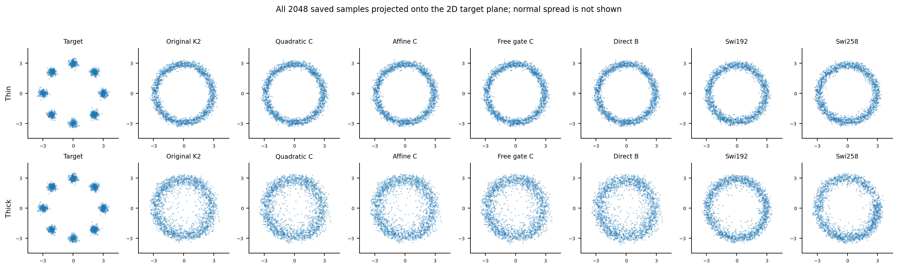

# Independent second coefficients: a modest gain, failed continuation

The independent-C layer improves thin fitting, but the fixed screen stops. On thick data its tangent field error is 16.27% above Swi192 and tangent SW2 is 22.54% worse. Its cross-law tangent advantage over the affine/free-gate controls is below 1%, missing the 5% mechanism condition. Neither proposed parameterization qualifies for confirmation.

## Purpose and setup

Cycle13 showed that fitted quadratic action cannot always be reduced to a scalar clock and one fixed matrix. This does not imply that binding the second coefficient to P² is useful. Here we test that binding directly, retaining the original K2 solve, both solves around SiLU, scalar clocks and complete clean-prediction backbone:

```text
original:     x + s*P*x + .5*s²*P²*x
quadratic C:  original + .5*s²*C*x
```

C starts at zero. The expression is the second Taylor jet of the internal nonautonomous equation `z'=(P+u*C)z`. The hidden duration u is distinct from external FM time. This is a changed learned feature family, not a higher numerical order or an exact solve. The [derivation](theory.md) and [registered protocol](protocol.md), commit 19af9a8, preceded candidate outcomes.

We trained quadratic C, affine C, free-gate C, direct B and Swi258 on both unchanged thin/thick laws. All use model seed 0, 5,000 updates and the same source/target/time stream; original K2 and Swi192 are sealed references. Heads, caps, loss, evaluator and Heun32 stay unchanged. The [protocol cost table](protocol.md#measured-costs-before-outcomes) records actual parameter and dense-work counts rather than assuming that equal parameter counts mean equal work.

## Experiment1: does the new coefficient improve the complete task?

| Model | Thin field MSE | Thin tangent SW2 | Thick tangent MSE | Thick tangent SW2 |
|---|---:|---:|---:|---:|
| Original K2 | 0.0027286 | 0.249849 | 0.353135 | 0.300341 |
| Quadratic C | 0.0025979 | 0.243358 | 0.334741 | 0.302783 |
| Affine C | 0.0026317 | 0.245057 | 0.336520 | 0.298179 |
| Free-gate C | 0.0025970 | 0.243298 | 0.336504 | 0.304203 |
| Direct B | 0.0026416 | 0.246305 | 0.370275 | 0.316624 |
| Swi192 (reused) | 0.0030951 | 0.274863 | 0.287896 | 0.247082 |
| Swi258 (fresh) | 0.0030242 | 0.274646 | 0.492606 | 0.377977 |



Quadratic C cuts thin full-field MSE by 14.10% relative to fresh compute-control Swi258 and 16.06% relative to Swi192. Relative to the unchanged original K2 it improves only 4.79%. The thick tangent regression against Swi192 violates the 5% guard, and its tangent SW2 violates the 10% guard. Full128D error alone would obscure much of that failure; the tangent diagnostics were registered before these outcomes.

**Ordinary-control case.** On thick data, fresh Swi258 has tangent MSE 0.492606 while the cheaper, reused Swi192 has 0.287896. Larger nominal width did not make it a stronger fitted reference here. Comparing only to Swi258 would miss the relevant failure. The previously audited Swi257 also has thick tangent MSE 0.255320, retained as [historical context](results/historical-swi257-context.csv), not a new post-result acceptance rule. The fixed decision already fails without that extra context.



Every saved checkpoint is shown; the endpoint is fixed at5000updates. No longer training, width selection or checkpoint rescue is inferred from a slope in this figure.

## Experiment2: is quadratic clock coupling doing more than another branch?

The affine control adds `.3*s*C*x` with exactly the same parameters and dense work as quadratic C. The free control adds `.5*s*r*C*x`, with a separate final gate head initially copied from s. It begins with the same original function and common C tangent, while allowing the second gate to adapt.

The registered geometric-mean tangent-risk ratios, quadratic C divided by each control, are:

| Control | Ratio | Required | Outcome |
|---|---:|---:|---|
| Affine C |0.990919|<=0.95|fails|
| Free-gate C |0.997564|<=0.95|fails|

This is less than 1% improvement, not the required 5%. The free gate actually changes: its final probe RMS difference r−s ranges 0.003–0.033 across thin solves and 0.032–0.093 on thick solves. The near-tie is not an assumption that the two clocks remain numerically identical. It provides no support for advancing this quadratic coefficient as an ODE-specific mechanism.

## Experiment3: ordinary direct coefficients and optimization coordinates

Setting B=P²+C is a bijection, so `x+sP*x+.5*s²*B*x` with independent P/B has the same real-arithmetic class. It uses 121,280 inference MACs versus 145,856 for C, with the same 122,886 parameters. This direct B control is worse than C at the fixed endpoint: thin field MSE 0.0026416 versus 0.0025979, thick tangent MSE 0.370276 versus 0.334741. It also fails the continuation gates.

A class-equivalent implementation learning differently is not an expressivity theorem. Their parameter gradients differ; native float32 initial value/head-gradient differences are explicitly recorded in preflight. The [post-result coordinate-metric addendum](coordinate-metric-addendum.md) derives the different coupled P/B gradient flow induced by C coordinates and verifies it on an independent small fixture. Adam/clipping is not that gradient flow, so this algebra does not uniquely explain the observed difference or select an optimizer rescue.

## Experiment4: what happened to P and C?



For quadratic C, final P largest singular values across the six solves are 1.135–1.374 on thin data and 1.173–1.672 on thick data. Singular-value CV ranges 0.614–0.657 and 0.634–0.711. No spectral cap or flattening was applied. These are hidden matrices, not full-field Jacobian eigenvalues.

C is active. Its final Frobenius norms are 1.146–1.659 on thin data and 1.604–2.622 on thick data. The added branch RMS is 4.0–18.7% of input RMS on thin probes and 8.6–53.5% on thick probes. P/C commutators are nonzero. Extra directions and a noncommuting conditional family were therefore learned, but that activity does not establish useful FM quality. All 192 checkpoint/layer spectra for P, reference B and C are [published in a wide table](results/coefficient-singular-values.csv), with [windowed training telemetry](results/training-telemetry.csv). The reference B for affine/free controls is explicitly not their actual input-dependent coefficient.



**Generation case.** The thin target has eight compact clusters. The new coefficient variants still produce a largely continuous annulus in this projection. Their lower thin SW2 does not amount to the visible cluster recovery seen in cycle11's different input-frame model. That frame setting also remains stopped. The figure uses all 2,048 saved samples per model; normal-space spread is not visible in it.

## Decision and next requirement

Stop this fixed independent-coefficient setting. No older-law wave, coefficient-scale/degree/rank/clock/initializer/width/head/solver/optimizer rescue is selected. A valid nonautonomous Taylor derivation and more conditional matrix directions have not supplied a useful successor at this budget.

The next architectural review must identify task-dependent computation that ordinary gating and static matrix freedom do not already explain. This result does not justify another polynomial coefficient or an extra internal integration stage. It also does not prove that all nonautonomous ODE architectures fail. The useful-successor objective remains open; there is no new nominee.

## Verification and claim candidates

Training finished on Mac mini in 234.80 seconds with two one-thread CPU workers; peak sampled combined RSS was 1.240 GiB. The 44.13-second audit replays every new/reference field, Jacobian panel and sample batch bitwise and checks paired streams, optimizer states, P/coefficient spectra and clocks. Independent dense local checks include all 6,144 fitted input-Jacobian anchors and parameter routes; maximum errors are 3.56e-15 for values, 1.00e-15 for input Jacobians and 1.07e-14 for P gradients. All 293 formal files remain unchanged. See [statistical scope](stats-appendix.md), [audit](results/audit.json) and [figure catalog](figure-catalog.md).

- **Claim:** Quadratic C improves thin fitting but fails the fixed cross-law screen.
  - Evidence: comparison.csv, decision-checks.csv, all final panels/samples.
  - Allowed: thin field error improves 14.10% versus Swi258; thick tangent risk/SW2 regress 16.27%/22.54% versus Swi192.
  - Forbidden: a useful or image-generation ODE method is established.
  - Uncertainty: reused screening banks and this declared configuration/budget; no confirmatory holdout was used.
  - Next check: none for this stopped setting; a different proposal needs its own functional rationale.
  - Decision: keep.
- **Claim:** Quadratic coupling materially beats ordinary added directions.
  - Evidence: registered geometric-mean ratios 0.990919/0.997564 against affine/free controls.
  - Allowed: its measured advantage is below 1%, failing the 5% condition.
  - Forbidden: more C activity or a nonzero commutator proves a mechanism gain.
  - Uncertainty: this is a finite-budget comparison, not a universal function-class lower bound.
  - Next check: preserve ordinary controls in future architecture tests.
  - Decision: discard the material-gain claim.
- **Claim:** C and direct B differ in capacity.
  - Evidence: exact B=P²+C bijection; direct B's measured cost and endpoint errors.
  - Allowed: the class-equivalent parameterizations train differently here.
  - Forbidden: the result proves an ODE expressivity or integration-order advantage, or gradient flow uniquely explains Adam's trajectory.
  - Uncertainty: optimizer coordinates, native roundoff and finite training path are not isolated causal effects.
  - Next check: use the algebra to interpret, not tune, the stopped comparison.
  - Decision: revise to a parameterization observation.

Only the new experimental helper [coefficient_jet.py](../../../synthetic/coefficient_jet.py) was added to production source. Existing model/evaluation code and submitted Report1 remain unchanged. Raw data, checkpoints and logs stay outside Git.
