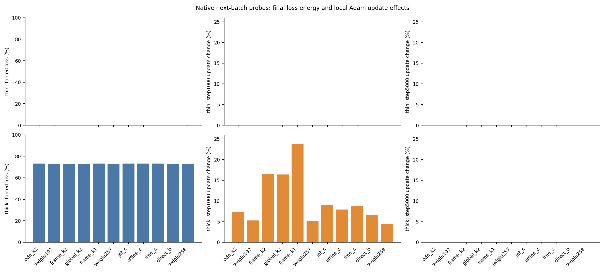
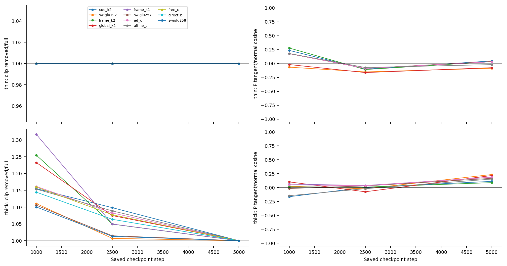

# What actually drives P on the high-dimensional tasks?

The large normal error cannot be treated as a large gradient on P. At a
fixed final readout, one normal component has exactly zero pullback to every
hidden parameter. All88saved-checkpoint probes satisfy this identity.
It can still change a hidden update indirectly through global clipping.
That effect is visible at intermediate thick-data checkpoints, but absent
from the particular final next batch. No architecture is selected here.

## Purpose and setup

Cycle08 found a fixed affine readout restriction shared by ODE and SwiGLU;
cycle12 located much thick-data sampling error in its normal subspace.
Neither established how that error affects training. This study asks about
**training gradients**, using the paired noisy FM label rather than an oracle.

The cohort contains all11unique clean model families from cycles07/11/14,
both thin/thick laws and steps0/1000/2500/5000. Each native model first
reproduces all20000saved field predictions bitwise. We then clone its saved
data RNG and draw the next native512-row batch. The final probe is the
unexecuted batch5001. There are no fitted updates, new seeds or changed labels.
The [protocol](protocol.md) was committed as18d08bf before these outcomes.

## 1. Separate error energy from its parameter gradient

The [derivation](theory.md) writes the centered final readout as Bz+c0.
Let T project onto its output-null space intersected with the target-normal
space. Hidden derivatives lie in range(B), so J_hidden^T*T*e=0 for any error e.
Final LayerNorm scale/bias belong to the readout group, not hidden parameters.
All hidden clocks and frame responses remain live in differentiation.

We split errors into tangent, forced-normal T and remaining-normal parts.
Their loss energies add. Their parameter gradients generally do not have
orthogonal directions, so we retain every cross inner product.

At step5000 on the thick next batch, the forced part accounts for
**72.79–73.13% of paired training loss** across all11families. Yet its hidden
gradient norm is numerically zero: the maximum across all88probes is6.20e-16.
The thin final fraction is below6.44e-10. The73% figure concerns this training
batch, not the91–93% normal sampling-error fraction in cycle12; those have
different denominators and are not interchangeable.

The left column shows final loss fractions. The middle column shows the
step1000hidden-update counterfactual; the right shows step5000. Near-zero
updates below1e-12are drawn as zero; CSV values are retained. Empty bars
mean zero on these axes, not missing probes. There are no uncertainty bars.

## 2. Check the indirect clipping route with saved Adam moments

Removing the forced cotangent leaves the hidden **raw gradient** unchanged,
but changes the total gradient norm through the readout. We compute the
resulting one-step Adam prediction in promoted float64 using actual saved
moments, without executing optimizer.step on a fitted model.

On thick data at step1000, full clip factors range0.7595–0.9088; removing the
forced route makes every factor1. The relative hidden-update difference is
4.44–23.77%, with direction cosines0.98763–0.99927. At step2500the difference
is0.41–5.45%. At step5000the next batch never clips for any family, and both
predictions agree to roundoff. This does not contradict high clipping rates
in prior500-update windows: one shared next batch is not a window average.
Thin trained probes do not clip, so there is no measured indirect effect.

Two cases illustrate the distinction. At step1000, frameK1has the largest
hidden-update difference,23.77%; frameK2has16.49%. OriginalK2has7.30%, and
Swi192has5.27%. These local magnitudes do not establish which model would
improve under different training. At step5000all four differences vanish
on the next batch despite the large thick forced loss.

## 3. Is the remaining normal gradient fighting the tangent gradient?

For the eight P-bearing families, final thick tangent/remaining-normal
P-gradient cosines are **positive**,0.089–0.234. The squared-norm cancellation
ratio is1.087–1.233, indicating reinforcement on these probes. Thin final
normal P gradients are much smaller; ratios remain0.99977–1.00020.
Some intermediate thick probes have negative cosines, but the smallest
measured ratio is0.872, not near-total cancellation. The evidence therefore
does not support a persistent severe tangent/normal cancellation explanation.
SwiGLU has no P and is omitted only from that panel.

## Verification and limits

Formal execution completed in35.58s on one Mac CPU thread, sampled peak
RSS0.429GiB. Independent QR/projected-loss differentiation replayed all88
native fields and264gradient routes in29.95s. Maximum independent gradient
difference is1.26e-15; projector difference9.06e-12. All181formal files are
unchanged. The [audit receipt](results/audit.json), [full group table](results/gradient-groups.csv),
[checkpoint table](results/checkpoints.csv) and [final numeric table](numeric-table.md)
provide the complete cohort.

Audit-v1 stopped on an ill-conditioned cold thin cosine whose normal route
has norm4.92e-15. Its source/log remain preserved. Audit-v2keeps the original
raw-gradient tolerances, independently validates routes and checks ratio
arithmetic on saved vectors. No formal output, scientific threshold or
registered source binding changed. Such cold near-zero directions are not
interpreted. Native/promotion total gradient norms differ by at most3.75e-6;
the promoted Adam formula is not a native float32 kernel replay.

## Decision and claim boundary

- **Keep:** the null-cotangent theorem and its complete-model verification.
  Allowed claim: this forced component has no direct hidden gradient at fixed
  readout. Evidence: [theory](theory.md) and all88audited probes. It does not
  imply that all normal errors have zero gradient.
- **Keep, local only:** an indirect clipping route exists at some saved thick
  checkpoints. Evidence: saved moments and fixed next-batch comparisons.
  Do not claim a causal explanation of endpoint quality or an improved optimizer.
- **Reject as a supported explanation:** a large forced loss necessarily
  overwhelms P, or final P gradients suffer severe tangent/normal cancellation.
  These probes contradict those particular descriptions; they do not settle
  every earlier training batch.

Do not reopen stopped models with a head, loss, clipping or optimizer change.
A next ODELayer design still needs a functional advantage over retrained K1
and strong SwiGLU, especially on thick tangent fitting. A valid ODE
interpretation and an active extra matrix have already proved insufficient.
