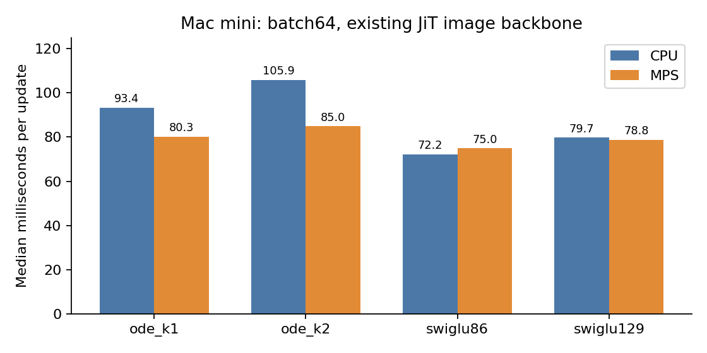
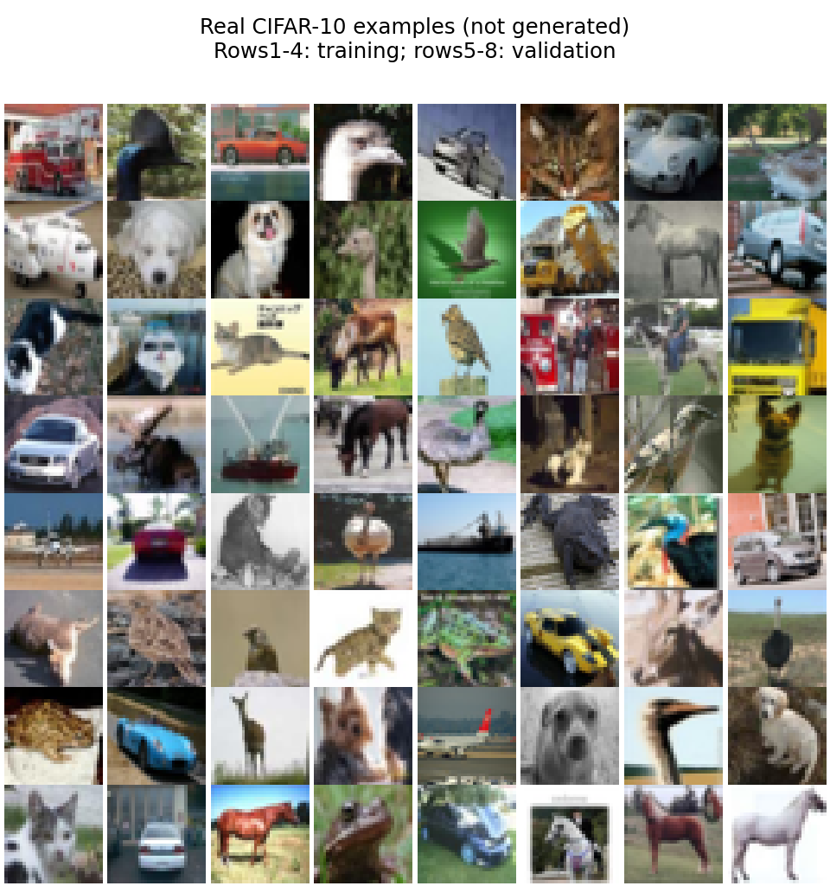

# A literal ODELayer image baseline is now ready for a controlled screen

Official CIFAR-10 and a separate image environment are prepared. The
professor's input-clock K1/K2 run inside the existing JiT token/attention
backbone, alongside two ordinary SwiGLU controls. Mathematical, data and
checkpoint checks pass. **No image quality training has started and no new
architecture is nominated.**

## The clock input changes the operator

The current image entry point adds t_embed_dim for ODE FFNs. Its local clock
then reads the shared conditioning embedding c. This differs from the
professor's t_func(h), which reads each token's current feature.

For K2 with a feature clock,

    F(h) = h + s(h)Ph + .5*s(h)^2*P^2h
    J_F = I+sP+.5*s^2*P^2 + (Ph+sP^2h) outer grad_h(s).

For a clock reading only c, the last term vanishes when differentiating the
local FFN with c held fixed. Both versions still contain the middle SiLU,
and the complete JiT retains other time-conditioning routes. They should
not be described as the same local architecture.

The [numerical witness](results/semantics.json) changes c while holding the
local feature fixed. Legacy ODE output changes by 0.03707; its input-clock
controller is unused. The professor adapter changes by exactly zero and
has nonzero input-controller gradients. This concerns the current source;
it does not establish which source produced any historical image checkpoint.
No legacy file was edited to change its behavior.

There is a second shape-dependent issue: when token count and hidden width
both equal 64, a Bx64 condition is parsed as Bxtoken scalar times, bypassing
both controller MLPs. The [separate witness](results/shape-semantics.json)
reproduces that gate formula bitwise. The adapter passes no external time
to the local layer, avoiding this ambiguity. This is current-source behavior,
not an attribution to an old training run.

## Fixed baseline shapes and actual FFN cost

All models use 32x32 RGB images, 4x4 patches, 64 tokens, hidden width 64, three
JiT blocks, four attention heads and a 32D input patch bottleneck. A constant
class index supplies no image-class information; labels are discarded.
Only each FFN changes. K1/K2 initial tensors are identical. All four models
have bitwise-identical surrounding tensors and buffers.

| FFN | Whole trainable parameters | FFN parameters/block | Dense FFN MACs/token/block |
|---|---:|---:|---:|
| Original K1 |211094|16642|16512|
| Original K2 |211094|16642|24704|
| SwiGLU,86 actual channels |211412|16748|16512|
| SwiGLU,129 actual channels |236438|25090|24768|

Swi86 covers ODE parameters and K1 matrix work; Swi129 covers K2 executed
matrix work. Attention/backbone shapes are identical. These counts exclude
pointwise work and are not full-model FLOP or latency equality claims.

Unlike the earlier 128D global vector readout, the patch decoder can have
full row rank 48 from 64 hidden coordinates. No output-null direction is forced
by those dimensions. This distinction motivates the image bridge; it does
not prove that images will favor ODE, or remove all input-bottleneck effects.

## CPU/MPS feasibility

Median update time at batch 64, after 10 warmup updates and over 25 measured
updates on **random synthetic image tensors**, not CIFAR training:

| FFN | One-thread CPU,ms | MPS,ms |
|---|---:|---:|
| Original K1 |93.37|80.25|
| Original K2 |105.94|84.98|
| Swi86 |72.17|75.00|
| Swi129 |79.74|78.82|

MPS reduces K2 update time by about 20% in this pass. Timing is descriptive, without
independent repetitions or confidence intervals. It excludes validation,
checkpoint and FID costs. Serial 5000-update MPS projections are approximately
6.25–7.08minutes per model; these are estimates, not completed runs.
Sampled MPS tensor allocation is 0.06–0.10 GiB. It is not GPU utilization or
total driver memory. No MPS determinism/resume claim follows from CPU checks.

The preflight completed in 31.13 seconds. Local Jacobians agree to 2.22e-16.
All four native CPU model/optimizer resume histories are bitwise identical.
An independent audit reproduces the literal FFN in float32 and activates the
complete image model to verify all six P matrices receive finite nonzero
gradients in both ODE arms.

## Data and environment

The [official CIFAR page](https://www.cs.toronto.edu/~kriz/cifar.html) provides
50,000 training images and 10,000 test images. The 170,498,071-byte Python archive
matches its published MD5 c58f30108f718f92721af3b95e74349a. Only the five
training batches were decoded; the official test batch is not used.

A fixed default_rng(0) permutation splits 45,000 training and 5,000 validation
images. Independent tar decoding reproduces every stored training pixel;
the split is disjoint and covers all 50,000 rows. The proposed normalization
is image/127.5-1 without augmentation. No image class enters the model.

These are real training/validation images, not generated outputs. The data
live in `/Users/mr.z/ode-workspace-prep/image-bridge-data/cifar10-v2/`.
The new environment is `/Users/mr.z/ode-workspace-prep/.venv-image-bridge/`;
the synthetic environment was not modified. Main package versions and all
transitive dependencies are recorded in the curated lock file.

The first serial download was intentionally stopped for throughput; its
partial file is preserved. The range downloader reused that prefix and
verified the final full archive hash. The first preflight stopped before
timing due to a variable-name collision; its immutable source/log/bindings
are preserved. A new v2 snapshot contains the correction. Neither incident
restarted or altered a quality-training result.

## Next required work

Fix the image training, validation, sampling and feature-metric protocol
before a quality run. Image observations cannot be called oracle field MSE;
small-sample FID cannot be compared with FID-50K results. A new ODE method
still needs an ordinary-control advantage and the earlier synthetic guards.
This baseline bridge does not override any stopped operator family.
