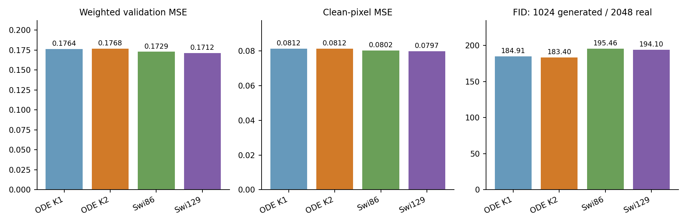
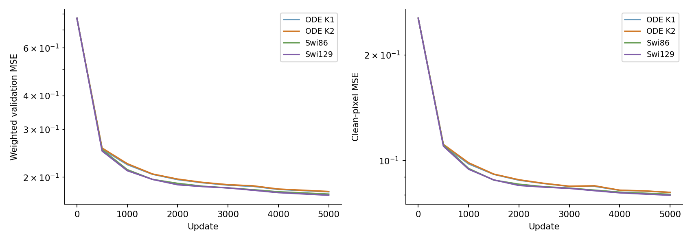
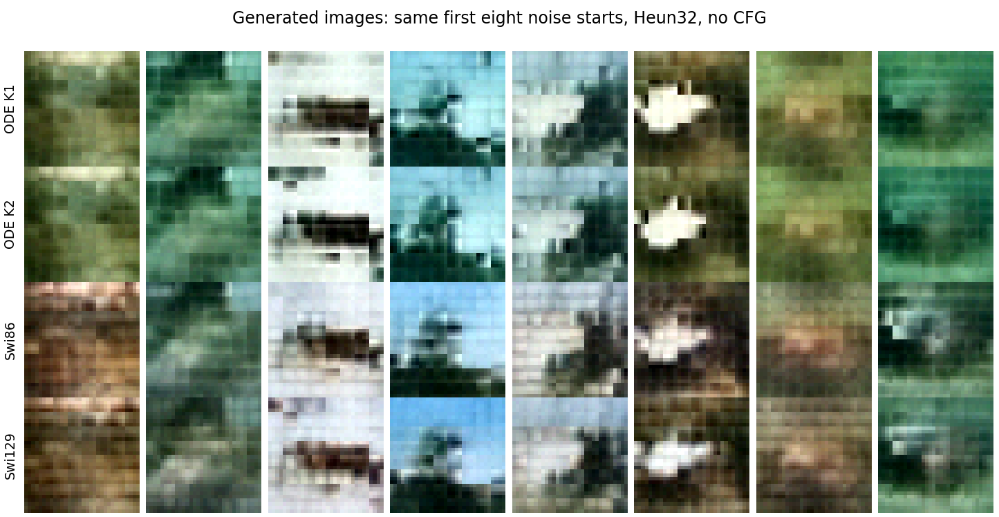
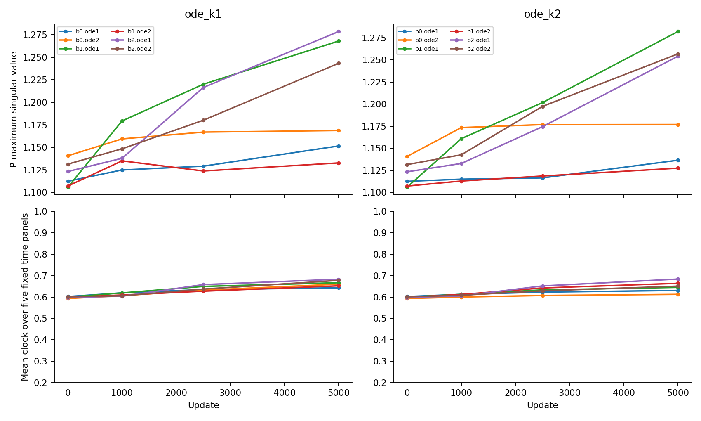
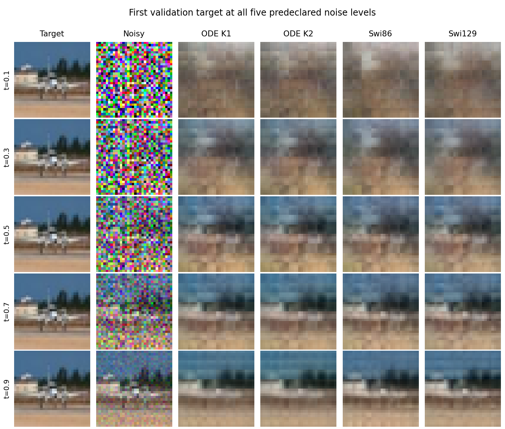

# ODE has lower image FID here; K2 does not earn its extra computation

The original ODE blocks have a lower measured image FID than the two SwiGLUs,
while fitting the validation targets slightly worse. Adding the quadratic
term does not produce the registered K2 improvement: its weighted error is
0.25% higher than K1 and its FID is only 0.82% lower. This image baseline
setting fails its joint continuation rule. No new architecture is selected.

## A controlled image comparison

The four models use the same small JiT backbone: 64 tokens from 4x4 RGB patches,
width 64, three attention blocks and a 32-dimensional patch bottleneck. Only the FFN changes.
The original input-clock K1/K2 share initial P and controller tensors. Swi86
covers ODE parameters and K1 matrix work; Swi129 covers K2 matrix work.
All surrounding tensors and buffers match exactly.

Each model trains for 5,000 updates, batch size 64, on the same paired noise/image/time
stream, using the fixed 45,000/5,000 CIFAR training/validation split. The output
predicts clean pixels with a velocity-weighted loss. There is no image-class
information, CFG, EMA, augmentation or additional loss. The source, final
checkpoint, sample starts, metrics and decision thresholds were fixed before
quality outcomes; see the [protocol](protocol.md).

Final held-out regression and generation results, lower is better:

| Model | Parameters | Weighted MSE | Clean MSE | FID (1024/2048) |
|---|---:|---:|---:|---:|
| ODE K1 |211094|0.176393|0.081246|184.91|
| ODE K2 |211094|0.176842|0.081240|183.40|
| Swi86 |211412|0.172921|0.080213|195.46|
| Swi129 |236438|0.171234|0.079722|194.10|

K2 has 5.52% lower FID than Swi129 but 3.28% higher weighted MSE. It also
fails the 10% fitting-improvement requirement against Swi86. The clean-MSE
and FID guards pass; the fitting gate and K2-versus-K1 gate do not. These
are the original descriptive gates, not significance tests.

The curves preserve all saved checkpoints. SwiGLU's fitting advantage is
visible through much of training; the K1/K2 curves are close. The final 5,000-update checkpoint is
used throughout, with no validation-best snapshot selection.

## What the lower FID does and does not show

FID uses 1,024 common-source generated images and 2,048 fixed validation images,
with standard pinned Inception compatibility features. It is not FID-50K or
a published CIFAR benchmark score. All models use the same Heun-32 sampler.

The first eight starts produce similar coarse layouts across the four models.
For example, the third and sixth columns retain similar light/dark structures.
All rows are still blurred and lack reliable object detail. The lower score
does not demonstrate a visual breakthrough or better mode coverage.

A post-result **accounting of the same FID**, without changing any images,
features or score, separates its squared feature-mean distance and covariance
mismatch:

| Model | Feature-mean term | Covariance term | Total FID |
|---|---:|---:|---:|
| ODE K1 |73.0413|111.8668|184.9081|
| ODE K2 |70.2054|113.1898|183.3952|
| Swi86 |79.1627|116.2991|195.4619|
| Swi129 |81.2502|112.8503|194.1005|

Against Swi129, K2 reduces the mean term by 11.0448 while the covariance term
is 0.3395 worse. Its 10.7053-point FID advantage is therefore explained by better
Inception-feature mean matching in this bank, rather than a lower covariance
mismatch. This is feature-space accounting, not a claim about pixel means,
diversity, or the cause of the learned difference. It is not a proposed
postprocessing correction. Exact values are in [FID accounting](results/FID-accounting.csv).

## P and clocks remain active, without a higher-order win

Initial maximum singular values span 1.106–1.141 across the six P matrices.
Final K2 values span 1.127–1.282; K1 spans 1.133–1.279. K2 singular-value CVs
span 0.614–0.651, so the matrices have not become spectrally flat. No cap or
flattening penalty was applied.

Across the five final held-out time panels, K2 mean clocks span 0.602–0.698
and within-panel clock SDs 0.006–0.029. Its quadratic-term RMS is 0.092–0.347;
the second term is active. Activity alone does not establish usefulness.
P spectra describe a local learned generator, not the complete FFN, attention
backbone or external velocity Jacobian.

K1/K2 parameters are identical in count. K2 executes 24,704 dense FFN forward
MACs/token/block versus 16,512 for K1, approximately 50% more **FFN** matrix
work. Whole-model latency does not increase by that percentage because
attention and the rest of the backbone are shared. The small final FID
change and slightly worse fitting do not pass the registered order test.

## A denoising case

The first validation target is shown at all five fixed times. At t = 0.3 the
models mainly recover coarse color/layout; their clean errors are similar
(K2 0.07323, Swi129 0.07339). At t = 0.9 more image information is visible, but all
predictions still smooth details. K2 clean error is 0.01485 versus 0.01166 for
Swi129. This illustrates a fitting difference on one example, not a causal
explanation for the aggregate FID ordering. All 20 case/model values are kept
in [the case table](results/first-case.csv).

## Verification and decision boundary

The four cells completed in 18.46 minutes on two one-thread Mac CPU workers.
Independent replay checks 44 checkpoints, all 80 time panels, 48 P snapshots,
240 clock records and all 4,096 generated images. The shared 5,000-batch stream
matches all four checkpoint histories, including RNG, buffers and moments.
Inception features reproduce bitwise; a different SVD implementation agrees
with all four FIDs within 4.3e-13. Native replay and feature audits preserve
all 223 training-output files and all 6 metric-output files.

The first feature-audit attempt failed before numerical work because its
hash helper received a string path. Its source/log/status remain preserved;
v2 fixes only the path conversion. Training, sampling, feature production,
metrics and numerical tolerances were not changed or rerun. The full
[audit receipts](results/training-audit.json) and
[feature replay](results/feature-audit.json) support the table.

- **Keep:** lower small-sample FID for the original ODE baselines in this image
  setting. Source: complete cohort and FID accounting. Allowed wording is
  specific to this bank/budget; it is not an overall superiority or mode-
  coverage claim. A numerical-resolution check would be needed before
  attributing this to continuous-field quality rather than the finite sampler.
- **Keep:** K2 does not pass its fixed fitting or order gates. Source:
  [decision checks](results/decision-checks.csv). Do not extend this to an
  impossibility theorem for all ODE architectures.
- **Reject as established:** the active quadratic term or P spectrum explains
  the FID difference. No such causal intervention was made. Preserve the
  measured trajectories; do not select spectral/order/solver rescues here.

The earlier failed synthetic families remain stopped. This bridge provides
image evidence and a metric-ordering question; it does not complete the
useful-ODE-successor objective.
