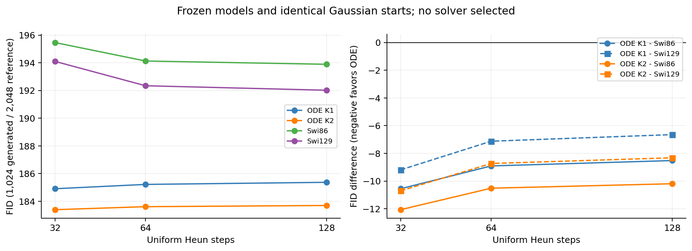
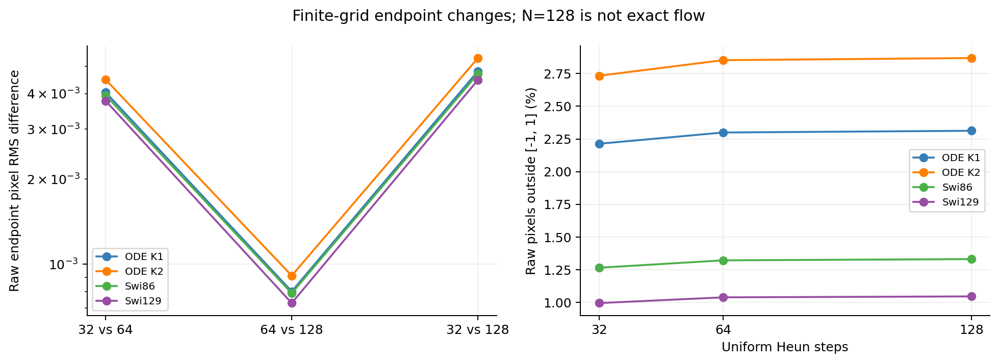
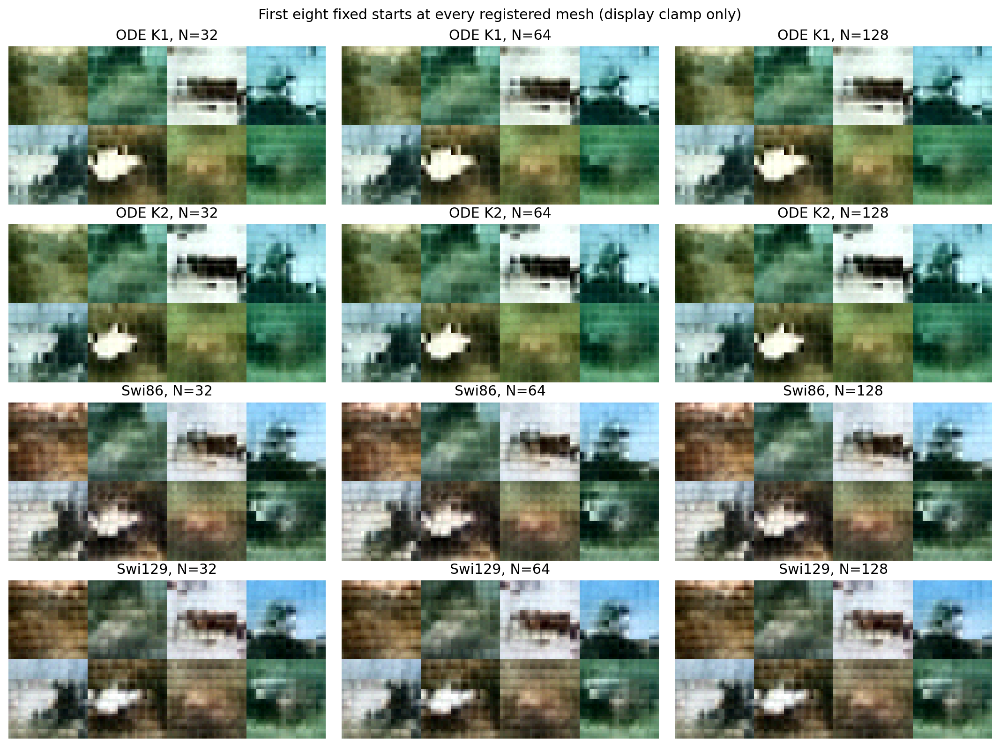

# The ODE FID lead persists under finer sampling, but becomes smaller

The image FID ordering does not reverse at 64 or 128 Heun steps. The original
32-step mesh exaggerates the ODE advantage over Swi129: K2's gap shrinks from
10.71 to 8.32 FID points. Finite resolution affects the comparison, but it does
not account for the full ordering on the three tested meshes. This is a frozen
model diagnostic; cycle17's failed fitting and order gates remain failed.

## What changed

Only uniform Heun steps change: 32, 64, 128, or 64/128/256 model calls per
image. All four final-5,000-update checkpoints, runtime buffers, 1,024 source
images, uint8 conversion and 2,048 validation references remain fixed. There
is no training, clipping of sampler states, adaptive mesh or solver selection.
The [protocol](protocol.md), [pre-outcome time allowance](resource-amendment.md)
and [execution correction](deviations.md) specify the run.

## Every registered score

Lower is better. These are small-sample FIDs, not FID-50K benchmark results.

| Model | FID N=32 | FID N=64 | FID N=128 |
|---|---:|---:|---:|
| ODE K1 | 184.908059 | 185.219856 | 185.371544 |
| ODE K2 | 183.395181 | 183.612509 | 183.698067 |
| Swi86 | 195.461857 | 194.128093 | 193.891018 |
| Swi129 | 194.100513 | 192.342846 | 192.017939 |

All ODE-versus-SwiGLU contrasts remain negative. At 128 steps, K2 is 8.32
points below Swi129 and 10.19 below Swi86. K1 is 6.65 below Swi129. The K2
advantage over K1 changes from 1.51 to 1.67 points, without any change in
paired validation loss. K2 still fits worse than K1 and both ordinary models.
Neither its original 10% fitting gate nor its 5% order gate is rescued.

Finer sampling slightly raises ODE FID: K1 changes by +0.46 and K2 by +0.30
from 32 to 128. Swi86 changes by -1.57 and Swi129 by -2.08. Numerical
refinement therefore does not uniformly improve this task score. A finer
approximation to a learned field and a better generated distribution are
different claims.

The same FID accounting retains the earlier pattern. At 128 steps K2's
feature-mean term is 70.4863 versus 79.3170 for Swi129, while its covariance
term is 113.2118 versus 112.7009. The 8.3199-point advantage equals an
8.8307-point mean-term improvement minus a 0.5108-point covariance penalty.
This is an exact decomposition of the registered score, not a new metric,
diversity claim or explanation of how the networks learned the difference.

## Endpoint differences get smaller, with some larger coordinate changes

| Model | Pixel RMS: 32 vs 64 | Pixel RMS: 64 vs 128 | Ratio |
|---|---:|---:|---:|
| ODE K1 |0.004042|0.000802|5.040|
| ODE K2 |0.004481|0.000911|4.917|
| Swi86 |0.003946|0.000790|4.992|
| Swi129 |0.003772|0.000729|5.171|

Successive changes decrease for every arm. Three grids do not establish an
asymptotic convergence order or an exact-flow error bound. The velocity cap
has a derivative kink at t=.95, and 128 steps is a finer reference, not ground
truth. The largest coordinate difference from 32 to 128 is 0.264 for K2,
versus 0.054 for Swi129, despite the small overall RMS values. Lower ODE FID
does not establish uniformly lower numerical sensitivity or full-network
stability. Exact maximum/RMS values are in [the difference table](results/sample-differences.csv).

All raw out-of-range fractions rise slightly with refinement. At 128 steps
they are 2.313%, 2.869%, 1.331% and 1.045% for K1/K2/Swi86/Swi129. The
sampler never clips states; the common display/feature conversion does.

## Fixed examples

Every panel contains the same first eight starts, arranged in two rows.
Within a model, the coarse layouts change little across the three meshes.
For example, the high-contrast white central region in the second sample
of the bottom row persists, as does the dark region against a pale background
in the third sample of the top row. All arms remain blurred. These examples
do not establish better object detail or explain the aggregate feature score;
none was selected by appearance or largest numerical error.

## Interpretation and verification

The [mathematical note](interpretation.md) distinguishes regression, external
transport and local hidden order. In an exactly solvable zero-data normal
coordinate, the .05 denominator cap leaves terminal standard deviation
.05/e even with a perfect clean predictor. A deliberately biased predictor
can reduce its final Wasserstein distance while increasing regression loss.
This is an analytic counterexample, not a fitted-image result or cap-fix
proposal. The Gaussian material-acceleration identity is already part of the
project's earlier complete-field derivation; no novelty is claimed for it.

All 8,192 new raw outputs reproduce bitwise in an independent Heun expression;
the original 4,096 outputs passed native replay before the new run. Fresh
Inception extraction reproduces all 12,288 generated and 2,048 reference
features bitwise. Independent SciPy gesvd FIDs agree with NumPy SVD to within
6.54e-13. Sampling and feature audits respectively preserve all 20 and 30
formal output files. Sampling takes 481.1 seconds; its complete replay takes
765.1 seconds, feature production 110.2 seconds and feature/FID replay 188.2
seconds. All execution is on Mac mini, with CPU sampling and MPS features.

The initial audit failed before numerical work because an optional SciPy
import was placed at module scope in the lean training environment. The
failed source/log/controller status are preserved. The separately bound v2
moves only that import into the FID function; the sampling banks were neither
changed nor regenerated. All tolerances and acceptance rules remain fixed.

## What we retain

- **Keep:** ODE's lower small-sample FID persists across these three meshes.
  Evidence: the full table, [all contrasts](results/contrasts.csv) and bitwise
  feature replay. Allowed claim: the fixed 32-step mesh is not the sole cause
  of this ranking on the tested grids. It is not a continuous-limit, FID-50K,
  diversity or architectural-causation claim.
- **Keep:** the coarse mesh inflates the ODE advantage over Swi129. Evidence:
  the gap changes at fixed weights and sources. Do not assign all of that
  change to a local P property; the complete numerical field is involved.
- **Reject as established:** K2's extra internal order improves the FM task.
  The previous fitting/order gates fail, and its small FID increment alone
  does not isolate a mechanism or justify about 50% more dense FFN matrix work.

The registered diagnostic ends here. No extra grids, best-solver choice,
training extension or architecture rescue follows. A useful new ODELayer
still requires a distinct task-related property and strong ordinary controls.
