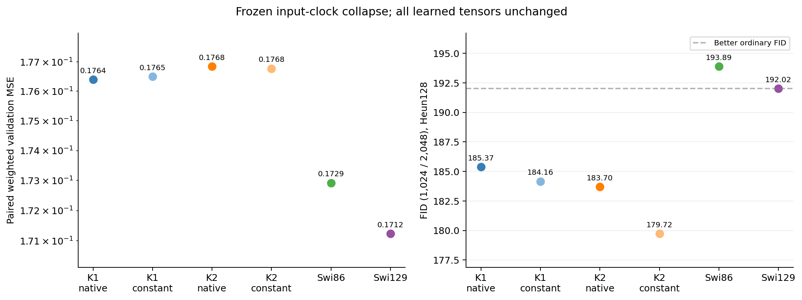
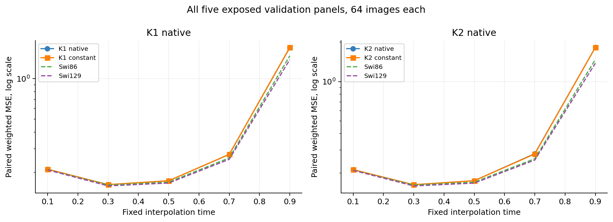
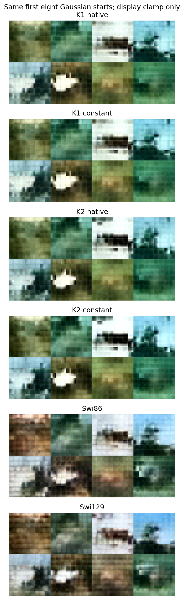

# The image FID lead survives without input-varying local clocks

Fixing all six local clocks does not remove the original ODE models' image
FID lead. It lowers FID from 185.37 to 184.16 for K1 and from 183.70 to 179.72
for K2, while paired validation error changes by less than 0.1%. Input-varying
local durations are therefore not necessary to retain that ordering at these
weights and constants. This is not a new trained architecture or proof that
clock conditioning is generally useless.

## The one intervention

For each original final checkpoint, a native forward on the first 64 validation
inputs records six duration tensors. Each scalar constant is the float64 mean
over 4,096 token states, stored in float32. No clean target, oracle, feature
score or optimizer enters calibration. K1 constants range from 0.64057 to
0.69286; K2 from 0.60850 to 0.68245. The corresponding native calibration SDs
are 0.01159–0.03874 and 0.00811–0.02913. These describe token-state variation,
not uncertainty over trained models.

All six clocks are replaced simultaneously. P, the middle SiLU, attention,
external time/AdaLN conditioning, readout and all learned tensors stay fixed.
Every downstream state is recomputed. Heun128, all 1,024 Gaussian starts,
2,048 validation references and Inception preprocessing remain unchanged.
The four native controls are explicitly reused from sealed cycles17/18.
See the [protocol](protocol.md) and [calibration](results/calibration.json).

## Every endpoint

Lower is better. FID uses 1,024 generated / 2,048 validation reference images.

| Model | Weighted MSE | Clean MSE | FID Heun128 |
|---|---:|---:|---:|
| K1 native | 0.176393 | 0.081246 | 185.3715 |
| K1 constant | 0.176499 | 0.081271 | 184.1550 |
| K2 native | 0.176842 | 0.081240 | 183.6981 |
| K2 constant | 0.176773 | 0.081254 | 179.7179 |
| Swi86 | 0.172921 | 0.080213 | 193.8910 |
| Swi129 | 0.171234 | 0.079722 | 192.0179 |



K1 weighted MSE increases by 0.0604%; K2 decreases by 0.0391%. Clean MSE
increases slightly for both. Both interventions still fit worse than the
SwiGLU controls, so the previous fitting/order failures remain unchanged.

The constant-clock FID leads over the better ordinary control are 7.86 points
for K1 and 12.30 for K2, versus 6.65 and 8.32 natively. Under the registered
frozen-necessity question, neither arm needs its input variation to retain the
lead. This does not show that every individual clock is dispensable, that a
retrained constant-clock model will behave identically, or that the whole
predictor has stopped depending on its image and external time.

The K2 FID reduction decomposes into a 3.5249-point improvement in the same
feature-mean term and 0.4553 in covariance mismatch. This is accounting of the
registered score, not a diversity, semantic-detail or training-causation claim.

## The fitting difference is small across the fixed panels



All five panels are retained. For K2 at t=.3, weighted MSE changes from
0.162445 to 0.162530. At t=.9 it changes from 1.823849 to 1.822837, while
Swi129 is 1.380893. For K1 at t=.9 it rises from 1.694257 to 1.701994.
Removing local clock variation does not repair the late paired-regression
gap. These are 64-image panel averages, not oracle field errors or independent
trained repetitions. Full numbers are in [time-panels.csv](results/time-panels.csv).

## Fixed generated examples and raw range



The first eight starts are shown for all six endpoints. K1 changes little
visually. K2's constant-clock output has stronger light/dark contrast in some
examples, including the third start's dark region against a pale background.
All outputs remain coarse and blurred; the FID reduction is not evidence of
a visual breakthrough. Cases are fixed by index, not selected for improvement.

The raw out-of-range fraction increases from 2.313% to 2.576% for K1 and from
2.869% to 4.427% for K2. Only the common display/Inception uint8 conversion
clips. That larger K2 tail is a reason to avoid equating the lower FID with
uniformly better image behavior. This study does not establish whether the
clipping change causes any part of the score reduction.

## What remains of the local ODE interpretation

At a fixed duration c, one layer is a fixed linear map:

```text
K1: M = I + c P
K2: M = I + c P + .5 c^2 P^2
FFN: M2 SiLU(M1 h)
```

Thus the measured lead survives in a local function expressible by two fixed
matrices around SiLU. This identity alone is not novel. Formal evaluation uses
the original float32 recursive polynomial; separate promoted whole-network
folding checks agree exactly on all ten prescribed witness inputs. It does
not claim a bitwise compiled-float32 replacement or a measured speedup.

The observation blocks a specific explanation: that this image lead requires
a locally input-varying integration duration. It leaves parameterization,
initialization, training dynamics, nonlinearity and whole-backbone interactions
unresolved. A useful new ODE method must distinguish those alternatives and
face an ordinary same-form SiLU control as well as SwiGLU. No new training
family, higher order, time-dependent calibration or gate rescue is selected.

## Verification and limits

Both new validation predictions, all ten new panels and all 2,048 generated
images reproduce bitwise with the separate literal-clock/Heun expression.
All native parameters and buffers are unchanged. The new 2,048 generated and
2,048 reference Inception feature rows reproduce bitwise; four native feature
banks retain their sealed cycle18 audit. All six FIDs are independently
recomputed with SciPy gesvd and agree within 5.41e-13. Sampling and feature
audits preserve 24 and 27 formal output files respectively.

The first preparation stopped on a promoted-witness dtype error, before
formal intervention outputs. V2 lifts only the witness time features; native
float32 quality functions and all tolerances are unchanged. A collection bug
also attached 32-step raw fractions to the four reused 128-step controls.
The original JSON is preserved; a separate metadata receipt corrects only
those four fields from the actual raw banks. Every FID, loss, feature and
sample is unchanged. See [deviations](deviations.md).

The calibration is exposed validation data and the cohort is deliberately
small. This is a finite-checkpoint mechanism test, not FID-50K, a new holdout,
a retraining comparison or a general rejection of conditional computation.

- **Keep:** local input variation is not necessary for this measured image
  FID ordering under the registered simultaneous collapse. Source: all six
  endpoints, exact replay and two retained-lead contrasts. Do not extend this
  to all tasks, calibrations or trained constant-clock models.
- **Keep:** the same image lead can be retained by a fixed two-matrix SiLU
  local function. Source: constant-clock algebra and whole-network witnesses.
  Do not call this a new ODE method, an ordinary-model training win or a
  unique explanation of how the fitted P matrices arose.
- **Reject as established:** dynamic integration or useful higher-order
  computation caused the original lead. Neither is isolated by these data;
  earlier failed families and cycle17's fixed gates remain stopped.
