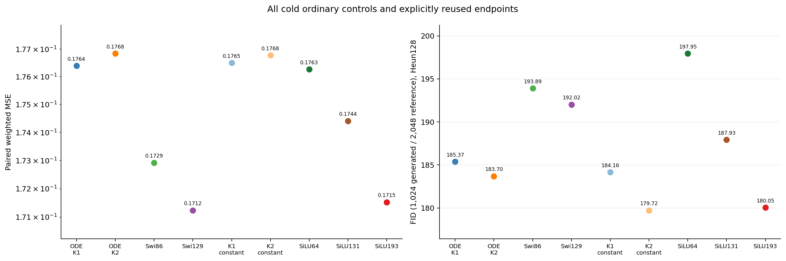
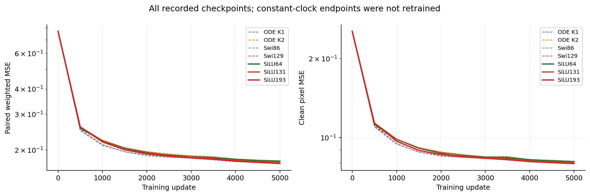
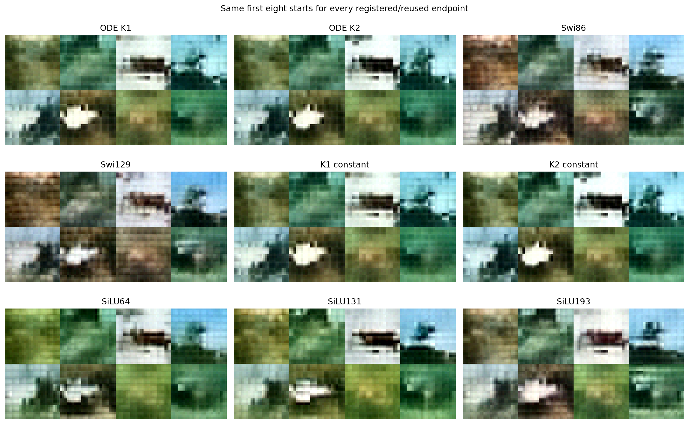
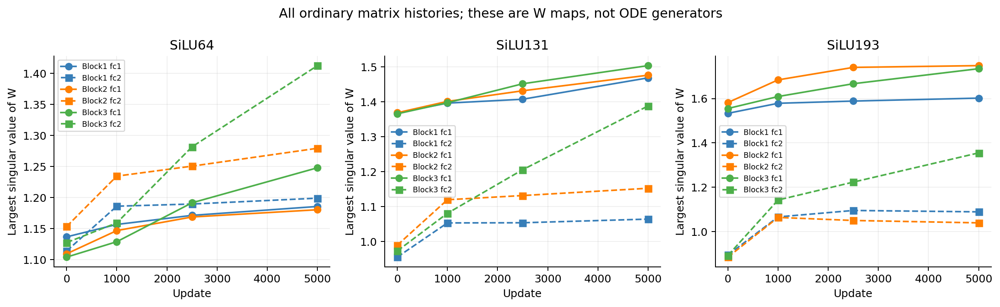

# An ordinary SiLU FFN removes the native K2 image lead at matched matrix work

A cold ordinary SiLU FFN reaches FID 180.05, compared with 183.70 for the
professor's original K2 block, at exactly the same FFN matrix work. Its paired
validation error is 3.01% lower. This removes the native K2 lead under the
work-matched comparison. It does not establish parameter dominance: this
ordinary model has 11.46% more whole-model parameters. The near-parameter
control gives a mixed result, and the frozen constant-clock K2 still has the
lowest FID. No new ODE architecture is nominated.

## Why this control was needed

The [clock intervention](../cycle19-image-clocks/analysis-report.md) retained
the image FID lead after fixing every local duration. For fixed c, each
professor solve is a matrix `M = T_K(cP)`. The two-solve FFN is therefore
`M2 SiLU(M1 h)`. An ordinary width64 two-matrix FFN contains that frozen
function in real arithmetic. This does not mean default initialization and
Adam will reach the same function.

We trained precisely three bias-free `W2 SiLU(W1 h)` controls from scratch:
width64 preserves this local shape; width131 minimally covers the original
FFN parameter count; width193 matches K2's dense matrix work. These roles
were fixed before training. They are baseline coverage, not an architecture
search. The [protocol](protocol.md) and [derivation](theory.md) state the
costs and interpretation limits.

All models retain the same small JiT backbone: 32x32 CIFAR-10 images, patch4,
hidden64, three blocks, four attention heads, clean-image prediction and
external time conditioning. Training uses the same official 45,000/5,000
split, 5,000 updates, batch64, AdamW and weighted clean loss. Model seed is0.
The new models share every cold non-FFN tensor and the complete native data
stream. The FFN initial functions differ; no fitted ODE weights are transferred.
Four native and two frozen-clock endpoints are explicitly reused, not retrained.

## Every registered endpoint

Lower is better. FID uses 1,024 common Gaussian starts and 2,048 validation
reference images, with the same Heun128 sampler and Inception conversion.
MACs below are per FFN per token, not whole-model wall time.

| Model | Whole parameters | FFN forward MACs | Weighted MSE | Clean MSE | FID128 |
|---|---:|---:|---:|---:|---:|
| ODE K1, reused | 211,094 | 16,512 | 0.176393 | 0.081246 | 185.3715 |
| ODE K2, reused | 211,094 | 24,704 | 0.176842 | 0.081240 | 183.6981 |
| Swi86, reused | 211,412 | 16,512 | 0.172921 | 0.080213 | 193.8910 |
| Swi129, reused | 236,438 | 24,768 | 0.171234 | 0.079722 | 192.0179 |
| K1 constant, frozen | — | — | 0.176499 | 0.081271 | 184.1550 |
| K2 constant, frozen | — | — | 0.176773 | 0.081254 | 179.7179 |
| SiLU64, new | 185,744 | 8,192 | 0.176269 | 0.081058 | 197.9503 |
| SiLU131, new | 211,472 | 16,768 | 0.174409 | 0.080503 | 187.9297 |
| SiLU193, new | 235,280 | 24,704 | 0.171526 | 0.079590 | 180.0454 |

SiLU193 and K2 both execute 24,704 forward and 74,112 forward-plus-backward
matrix MACs. SiLU193 lowers weighted MSE by 3.01%, clean MSE by 2.03%, and
FID by 3.65 points. More parameters remain a competing explanation. Relative
to Swi129, its parameters and matrix work are slightly lower, FID is 11.97
points lower, clean MSE is 0.166% lower, but weighted MSE is 0.170% higher.
That ordinary comparison is a tradeoff, not a win on both registered axes.

SiLU131 has only 378 more whole-model parameters than K1 and 1.55% more
matrix work. It fits 1.12% better but has FID 2.56 points higher. SiLU64 also
fits slightly better than K1, while its FID is 12.58 points higher. Thus the
three controls do not support a blanket claim that ordinary SiLU dominates
ODE at every budget. They do show that the native K2 FID lead over SwiGLU
is insufficient evidence for a useful ODE-specific computation.

The frozen constant-clock K2 has FID 179.72, 0.33 below SiLU193, with worse
paired fitting. It is an intervention of a trained model, not another cold
training arm. Its training cost cannot be treated as a newly matched ordinary
budget, and the small FID difference is not an established population advantage.

## Training and a late-time case

All seven cold trajectories begin with the same zero-head prediction and
weighted error 0.771377. SiLU193 reaches 0.219284 at update1,000, 0.186572 at
2,500 and 0.171526 at5,000; K2 is 0.223979, 0.190996 and 0.176842. These are
the recorded endpoints, without validation-best checkpoint selection.

The fixed t=.9 panel makes the remaining fitting gap concrete. Weighted MSE
is 1.82385 for K2, 1.53619 for SiLU193 and 1.38089 for Swi129. At t=.5,
SiLU193 is 0.165816 versus 0.174472 for K2 and 0.167229 for Swi129. Ordinary
SiLU can recover the image FID ordering without being the best late-time
regressor. These panels contain 64 paired examples each; they are not oracle
velocity errors or a decomposition of FID. All five panels for every model
are retained in [time-panels.csv](results/time-panels.csv).

## Generated cases and matrix trajectories

The third start has a horizontal dark object against a pale background across
families. SiLU193 changes its color and surrounding contrast rather than
revealing a clear new level of detail. The sixth start retains a pale central
region and dark lower area in both ODE and ordinary outputs. All examples
remain coarse and blurred. The fixed cases support neither a semantic-quality
breakthrough nor a causal account of the FID difference.

The raw coordinate fraction outside [-1,1] is 2.848% for SiLU193, 2.869% for
native K2, 1.045% for Swi129 and 4.427% for constant-clock K2. States are not
clipped during integration; the shared image conversion clips for display and
Inception. Lower FID should not be read as uniformly better range behavior.

The third block's output-map largest singular value grows from 0.8918 to
1.3549 in SiLU193 and from 0.9726 to 1.3884 in SiLU131. SiLU193's first maps
end between 1.6020 and 1.7486. These are finite saved weight diagnostics, not
continuous-time stability bounds. Full singular spectra and the square
SiLU64 matrices' eigenvalues are retained in
[matrix-history.csv](results/matrix-history.csv). Rectangular matrices have
no eigenvalue records. These W maps do not replace the native
[P trajectories](../cycle17-cifar-baselines/results/P-history.csv).

## Decision and limits

Keep these ordinary baselines. Reject an established claim that the native
K2 image lead requires its ODE computation: an ordinary control is better on
both recorded quality axes at the same matrix work. Keep the narrower
parameter-budget tradeoff and frozen constant-clock result visible.

The width64 result also illustrates why function containment is not a training
theorem. Its class contains each fixed-clock core, yet its cold run has much
worse FID. Initialization, parameterization and whole-network training remain
different. This experiment cannot isolate which of them caused the gap, and
does not justify a new initialization or optimizer rescue.

Independent audits replay all new checkpoint predictions, fixed panels,
matrix histories, paired batch streams and generated images. New generated
and reference features reproduce bitwise; all nine FIDs agree with a separate
SVD calculation within 5.41e-13. Existing feature banks remain under their
prior seals. The [statistics appendix](stats-appendix.md) defines this scope.

This remains a small CIFAR validation screen, not FID-50K or a held-out test
claim. Stop after the three specified widths. No extra width, seed, bias,
initialization, loss, training duration or solver adjustment is selected.
Cycle17's failed fitting/order gates and earlier stopped families remain
unchanged. A future ODE design must explain what task-relevant computation
it adds beyond these ordinary maps; an internal Taylor formula alone is not
enough. The useful-ODE-successor objective remains open.
