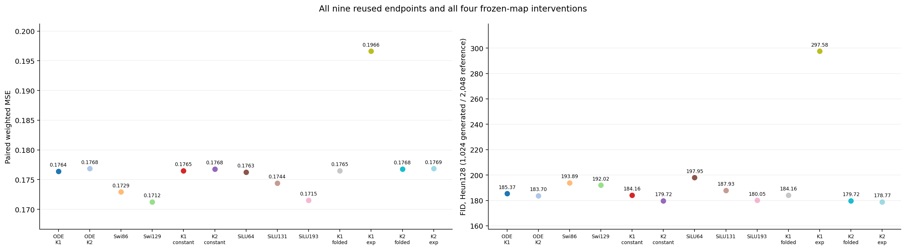
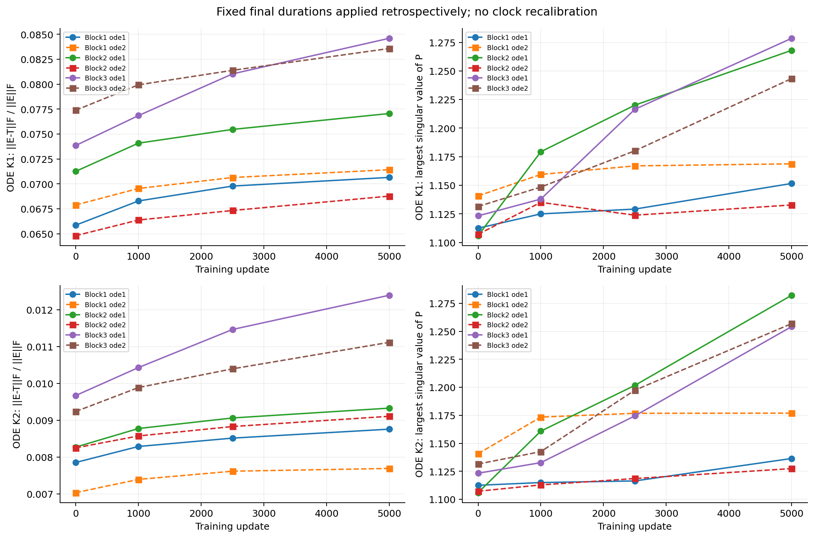
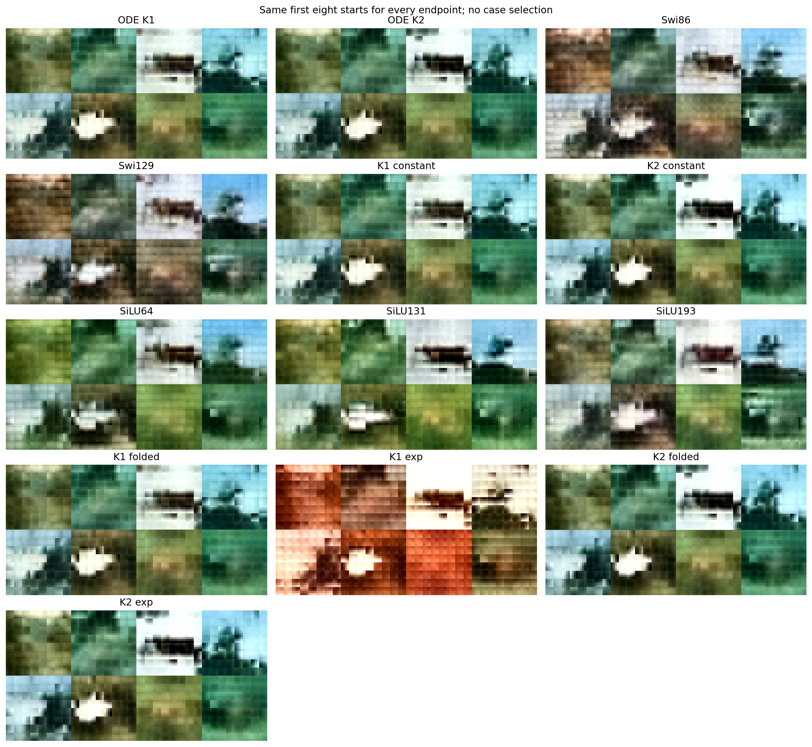

# More accurate local flows do not give a uniform image improvement

Replacing the fixed-clock K1 maps by matrix exponentials makes both fitting
and generation worse. K2 gives a mixed result: FID decreases from 179.72 to
178.77, while weighted validation MSE increases by 0.0453%. Neither frozen
substitution improves both recorded quality axes. This does not support a
new exact-flow training family or another polynomial-order search.

## The question and the arithmetic control

The [ordinary image comparison](../cycle20-image-silu/analysis-report.md)
already removed native K2's lead at equal matrix work, with a parameter-count
caveat. The [constant-clock intervention](../cycle19-image-clocks/analysis-report.md)
retained the earlier image FID lead without input-varying local durations.
Here we ask a narrower mathematical question: how does that frozen predictor
change when its learned polynomial maps are replaced by their linear flows?

For each of the two final models, retain its six calibrated constants c and
all trained P matrices. Compare `T_K(cP)` with `exp(cP)`. Both matrices are
constructed in float64, cast once to float32 and applied by the same matrix
multiplication. Separate folded-polynomial endpoints measure the effect of
changing the old literal float32 recurrence into this expression. Nothing is
retrained, recalibrated or selected by FID. Attention, SiLU, external time,
readout, learned parameters and buffers stay unchanged.

The [protocol](protocol.md) fixes four interventions and nine reused endpoints.
All use the same 1,024 starts, Heun128, 2,048 validation references and Inception
conversion. This is a frozen image counterpart to the older
[synthetic order study](../../research-2026-10-20-followup/analysis-report.md),
not permission to reopen that stopped training direction.

## Every endpoint

Lower is better. The first nine endpoints are explicitly reused; the last
four are new frozen interventions, not new training runs or new cost controls.

| Model | Weighted MSE | Clean MSE | FID128 | Raw out-of-range % |
|---|---:|---:|---:|---:|
| ODE K1 native | 0.176393 | 0.081246 | 185.3715 | 2.3126 |
| ODE K2 native | 0.176842 | 0.081240 | 183.6981 | 2.8691 |
| Swi86 | 0.172921 | 0.080213 | 193.8910 | 1.3307 |
| Swi129 | 0.171234 | 0.079722 | 192.0179 | 1.0453 |
| K1 constant, literal | 0.176499 | 0.081271 | 184.1550 | 2.5765 |
| K2 constant, literal | 0.176773 | 0.081254 | 179.7179 | 4.4269 |
| SiLU64 | 0.176269 | 0.081058 | 197.9503 | 1.6573 |
| SiLU131 | 0.174409 | 0.080503 | 187.9297 | 2.2782 |
| SiLU193 | 0.171526 | 0.079590 | 180.0454 | 2.8483 |
| K1 folded polynomial | 0.176499 | 0.081271 | 184.1555 | 2.5765 |
| K1 exponential | 0.196617 | 0.087786 | 297.5840 | 16.0645 |
| K2 folded polynomial | 0.176773 | 0.081254 | 179.7184 | 4.4269 |
| K2 exponential | 0.176853 | 0.081329 | 178.7726 | 4.8519 |

For K1, exp versus folded polynomial increases weighted MSE by 11.40%, clean
MSE by 8.02% and FID by 113.43 points. For K2, weighted MSE increases by
0.0453% and clean MSE by 0.0925%, while FID decreases by 0.9459. The K2 FID
change is retained as a measured improvement on this bank; it is not replaced
by a blanket negative conclusion about exact flows.

The arithmetic controls are much smaller. Folded versus literal prediction
RMS is 1.26e-7 for K1 and 1.27e-7 for K2; paired sample RMS is 1.31e-7 and
9.95e-8. Their FID changes are +0.00046 and +0.00058. Exp-versus-folded
prediction RMS is 0.08211/0.00818 and sample RMS 0.45959/0.03870. Thus the
registered exponential effects are not accounted for by the observed
folding-only perturbation. This is a finite numerical control, not a
statistical significance claim.

## What P learned, and what the series error means

The plot retains all six P matrices in each model at updates 0, 1,000, 2,500
and 5,000. The same final calibrated c is applied retrospectively throughout;
these are not recalibrated clock trajectories. At initialization the largest
singular values range from 1.106 to 1.141. At the final snapshots, they range
from 1.133 to 1.279 for K1 and 1.127 to 1.282 for K2. These observations do
not show a blow-up of P. They do not bound unobserved intermediate updates.

At the final checkpoints, relative Frobenius differences
`||exp(cP)-T_K(cP)||F / ||exp(cP)||F` are 6.88–8.46% for K1 and 0.769–1.239%
for K2. These are matrix discrepancies, not prediction errors or weighted
input-action bounds. They rise modestly over the recorded histories. K1 and
K2 have different trained matrices and constants, so this cross-model contrast
is descriptive, not a same-P experiment isolating polynomial order.

The final c||P|| values are 0.716–0.873 across both models. Exponential map
norms are 1.66–1.96. Every generator has a positive largest eigenvalue real
part; the largest such values range from 0.566 to 0.689 for K2. Consequently,
these matrices are not examples of uniformly dissipative linear generators.
That fact alone neither establishes an unstable complete predictor nor
justifies forcing their spectra negative. The surrounding FFN has SiLU,
residual paths and conditioning, not repeated integration of one shared P.

The [derivation](theory.md) separates three facts. Exponentials solve the
specified local linear ODE; finite polynomials have a calculable semigroup
defect; neither property orders FM regression risk or FID. The recorded K2
polynomial defects are 0.574–0.901% in the stated Frobenius normalization.
The independent exponential checks pass, but greater flow consistency does
not create a theorem about useful denoising.

## Fixed-input and generated cases

At t=.9, K1 panel weighted MSE increases from 1.70199 to 2.47983 after the
exponential substitution; at t=.5 it increases from 0.173836 to 0.198769.
The deterioration is already present on paired validation inputs, before
outer integration. It cannot be described solely as a terminal sampler error.

K2 differs: its t=.9 panel improves from 1.82284 to 1.81711, while t=.5 is
almost unchanged, 0.174372 to 0.174405. Its aggregate random-time validation
error nevertheless rises slightly. Keep the fixed-panel and aggregate results
separate; neither decomposes FID. All 65 panels are retained in
[time-panels.csv](results/time-panels.csv).

K1's exponential outputs have strong orange/red shifts and repeated grid
patterns. In the first two fixed starts, the original green regions become
warm, patterned fields; the third start's pale region is much more saturated.
These observations accompany the large score deterioration without proving
its cause. K2's exponential cases remain visually close to its folded cases,
including the third start's dark horizontal object and the sixth start's pale
central region. They do not show a visual breakthrough.

Raw coordinates outside [-1,1] rise from 2.576% to 16.065% for K1, and from
4.427% to 4.852% for K2. Only the common display/Inception conversion clips.
K2's lower FID therefore coexists with a larger tail. No causal attribution
to clipping, diversity or semantic fidelity follows from this diagnostic.

## Decision and verified scope

Keep the measured mixed result. K1 is substantially adapted to a predictor
that changes adversely under this exponential substitution. K2 is much closer
to its local flow and gains less than one FID point, with slightly worse
fitting. This does not identify how either model would train with exact maps.
The K2 intervention still fits worse than both SwiGLUs and SiLU193.

No new model family, order grid, matrix scale, spectral constraint, duration
calibration or initialization rescue is selected. The next architecture needs
a task-relevant computation beyond a more faithful solution of `dy/dr=Py`.
The [literature review](review.md) also distinguishes spatial PDE mixing from
cross-sample graph dynamics, avoiding an architectural change based only on
shared differential-equation terminology.

All four new validation predictions, twenty panels and 4,096 generated images
reproduce bitwise. Separate NumPy/SciPy calculations verify all 48 operator
records against checkpoint P tensors. All parameters and buffers remain
unchanged. New generated/reference features reproduce bitwise, and thirteen
independent gesvd FIDs agree within 5.41e-13. Sampling and feature audits
preserve 44 and 49 formal files respectively. The initial environment failure
and corrected invocation are [documented](deviations.md); no numerical gate
was loosened. All three figures were visually reviewed.

This remains a small exposed-validation, frozen-checkpoint study, not FID-50K,
a holdout result or an independent training comparison. Submitted Report1 and
the old negative studies remain unchanged. The useful-ODE-successor objective
is still open.
