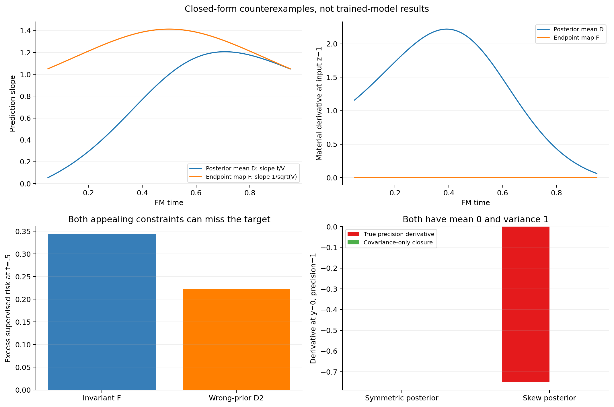
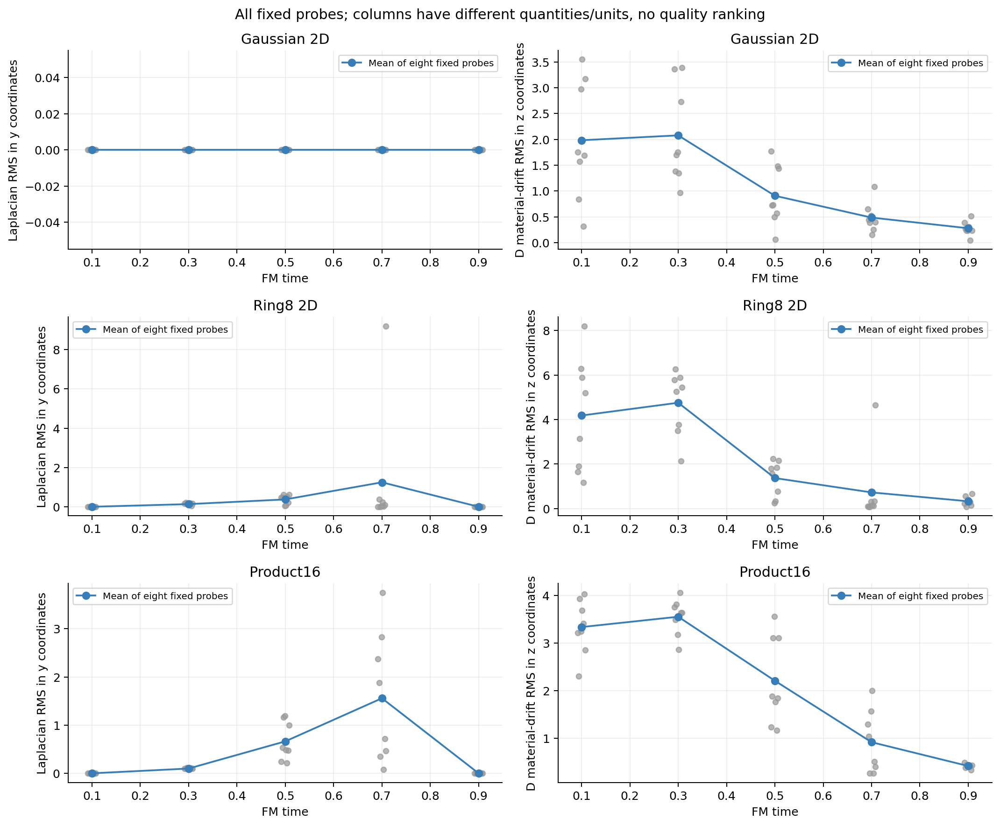

# Specify which dynamics the model should learn

The current objective supervises a clean conditional mean. It does not
supervise an output that stays constant along each generated trajectory.
That distinction holds even for a perfect Gaussian denoiser. It rules out
using endpoint invariance as an automatic architectural requirement for our
present model, while leaving endpoint predictors trained by distillation as
a separate option. No new model was trained in this study.

## The objective gives a specific mathematical object

For independent noise e and clean data X, our input is Z_t=tX+(1-t)e.
The ideal clean prediction is D(z,t)=E[X|Z_t=z]. A time-only loss denominator,
including the existing cap, changes the time weighting but not this
unrestricted conditional optimum.

In coordinates Y=X+sqrt(r)e, the same conditional mean m satisfies

```text
partial_r m = .5 * Laplacian(m) + J_m * (m-y)/r.
```

The [derivation](derivation.md) proves the identity for finite Gaussian-mixture
priors, including degenerate components, and transforms it to our FM time
convention. It states the regularity, posterior representative and interior
domain explicitly. This is an established relation obtained from Gaussian
smoothing, not a theorem of architectural superiority or a novelty claim.

## Three counterexamples prevent three different mistakes



**A perfect denoiser need not be invariant.** With independent scalar standard
Gaussian X and e, put V=t^2+(1-t)^2. The supervised denoiser is D=tz/V.
Along its true uncapped marginal flow, its total derivative is
`(1-t)z/V^2`. At t=.5,z=1, it equals 2. The endpoint map F=z/sqrt(V), by
contrast, has zero total derivative. At the same time it predicts sqrt(2)z
rather than z and incurs excess supervised risk 0.343146 per coordinate.
The two maps answer different questions; neither should silently replace
the other's training target.

**PDE consistency does not identify the correct data.** A denoiser from a
hypothetical N(0,2) prior satisfies the same necessary PDE. Against true
N(0,1) data, its prediction at t=.5 is 4z/3 instead of z, with excess weighted
risk 2/9. Therefore a zero PDE residual alone would be an inadequate selection
rule for an architecture or regularizer.

**A covariance-only posterior evolution omits a term.** At fixed observation
y, changing noise precision lambda gives

```text
d mean/d lambda = covariance * (y-mean) - .5 * third_central_moment_vector.
```

Two explicitly realized posteriors can have mean 0 and variance 1 but third
moments 0 and 1.5. At y=0,lambda=1, their true derivatives are 0 and -0.75;
the covariance-only expression predicts zero for both. This refutes that
particular prior-independent closure. It does not show that a learned model
carrying prior information or additional latent state is incapable, and it
does not causally explain the earlier hidden-covariance screen's failure.

## Checks on existing benchmark laws

The three laws and validation clean samples are unchanged. We use the first
eight validation samples per law, common seed0 Gaussian fixture noise and
the fixed five times .1/.3/.5/.7/.9. These are 120 identity probes, not new
training examples, a representative population-risk estimate or a new test
set. Product16 is evaluated by its exact latent factorization, without
enumerating its 65,536 mixture components. The prior-class application is
recorded in [assumption-discharge.json](results/assumption-discharge.json).

| Existing law | Cases | Mean/oracle max error | Variance PDE residual | FM PDE residual |
|---|---:|---:|---:|---:|
| Gaussian 2D | 40 | 4.44e-16 | 1.30e-14 | 2.40e-14 |
| Ring8 2D | 40 | 9.99e-16 | 1.87e-14 | 1.78e-14 |
| Product16 | 40 | 2.44e-15 | 1.55e-13 | 4.26e-14 |

Complete posterior means, Jacobians, Hessian traces and time/variance
derivatives are retained. The separate NumPy velocity oracle reproduces the
means; independent central differences at both registered step sizes check
all derivative arrays. Neither step is selected afterward. The largest
finite-difference FM residual is 0.00339 because the FM coordinate conversion
can amplify Laplacian subtraction error; the direct AD identities remain
within 4.27e-14. This discrepancy is retained and passes the predeclared
truncation-aware gates, rather than being reported as exact agreement.



The Gaussian mean has zero spatial Laplacian but nonzero material drift.
For Ring8 at t=.7, mean Laplacian RMS across the fixed probes is 1.2454,
with one much larger case visible. Product16 at the same time is 1.5581.
Their near-zero late values do not make the earlier term dispensable.
The two plot columns use different coordinates and quantities; they are not
a comparison of competing architectures. Full probe values remain visible.

## Literature boundary

[A Lagrangian View of Flow Matching, Milanfar, 2026v1](https://arxiv.org/html/2609.00198v1)
imposes target identity conservation to derive an invariant endpoint field.
Its time convention is reversed relative to ours. The Gaussian example here
shows why that imposed condition should not automatically be transferred to
the conditional mean trained under our independent coupling. This is a
distinction of assumptions and objects, not a rejection of that conditional
derivation or evidence that a different target cannot work.

[FP-Diffusion, ICML 2023](https://proceedings.mlr.press/v202/lai23d.html)
derives score-PDE consistency and studies a regularized training objective.
It is a mathematical precedent for this route, not a frontier architecture
recommendation or permission to change our loss. We do not reproduce its
empirical results or infer that adding its regularizer improves ODE-FFN.

## Consequence for the next design

A proposed internal state must have a clear role. If it represents posterior
statistics, state which statistics it carries, which equation they obey and
what closure assumption is made. If it is simply a feature trajectory, its
usefulness must be established against ordinary feature processors; the outer
FM ODE does not supply that result. A constant target along trajectories
belongs to a different predictor definition and cannot be imposed while
pretending the present regression optimum is unchanged.

This study selects neither a moment head nor a PDE loss, another Taylor
training rescue, a changed prediction target or a new spectral constraint.
Those would need separate justification and unchanged strong controls.
The original useful-ODE-successor objective remains unachieved.

The [proof audit](PROOF_AUDIT.md) covers all nine source units and 35 extracted
microclaims; two notation issues were corrected and rechecked. Native
same-family semantic review remains provisional. Numerical reproduction and
source-unit coverage are separate evidence, not cross-family proof acceptance.
All old datasets, model checkpoints, P histories and submitted Report1 remain
unchanged.
