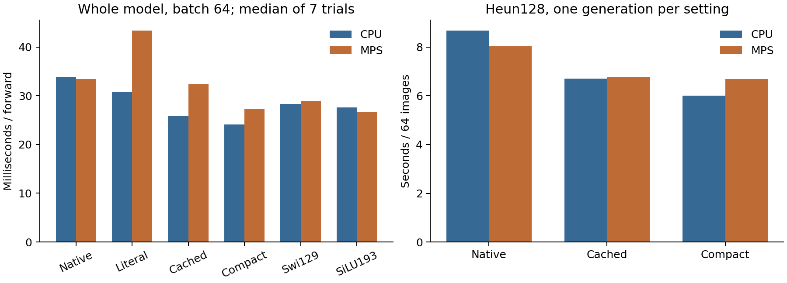

# A smaller, faster export of the existing frozen image endpoint

The compact K2 checkpoint generates 64 images in 6.00 seconds on the Mac mini
CPU, versus 8.68 seconds for the original dynamic-clock model: 31% less time.
It is a deployable export of an existing intervention, not a new trained
ODE architecture. The broader research goal remains open.

## What changes, and why this is legitimate

Cycle19 replaces each local input-dependent clock by its previously calibrated
constant. Cycle21 caches the resulting matrices in float32. We now replace
each complete FFN with `M2*SiLU(M1*h)` and discard its unused controllers,
original P storage and inference diagnostic calculations. The original
P/controller trajectories are preserved in their sealed studies.

The export retains all 48 non-FFN state tensors, all actual runtime buffers
and the six exact cycle21 cached matrices. A fresh process loads it while
access to historical runtimes and the development checkout is forbidden.
All 1,024 CPU validation predictions and all 1,024 generated images are
bitwise identical to the previous cached endpoint. The [full-bank generation
audit](results/full-replay.json) verifies the inherited FID without another
feature extraction or speed trial.

## Purpose and observations

The purpose is to measure an actual saving rather than infer speed from
matrix counts. Native, constant literal, cached and compact isolate three
changes: clock collapse, matrix folding and removal of unused FFN machinery.
Ordinary controls also omit unused diagnostics. All use the same frozen
backbone shape, float32 and eval/no_grad; no compilation or quantization.

| Model | CPU forward, batch64 (ms) | MPS forward, batch64 (ms) | Reused CPU FID |
|---|---:|---:|---:|
| Original dynamic K2 |33.87|33.44|183.6981|
| Constant literal K2 |30.82|43.39|179.7179|
| Cached matrices, old wrapper |25.84|32.34|179.7184|
| Compact folded export |24.13|27.31|179.7184|
| Ordinary SwiGLU129 |28.32|28.96|192.0179|
| Ordinary SiLU193 |27.62|26.67|180.0454|

Forward numbers are medians of 7 trials, each averaging 5 calls, after 3 warm-ups.
MPS is synchronized around each timed region, following the [PyTorch API](https://docs.pytorch.org/docs/2.14/generated/torch.mps.synchronize.html).
Device-resident timing excludes transfers; all transfer-inclusive trials,
batches 1/16/64 and min/max values remain in [timing-summary.csv](results/timing-summary.csv).
FID values are explicitly reused from the CPU parent endpoints. No new
MPS FID is estimated.

| Heun128 generation, 64 images | CPU seconds | MPS seconds |
|---|---:|---:|
| Original dynamic K2 |8.684|8.040|
| Cached matrices |6.704|6.777|
| Compact folded export |5.999|6.693|

Each generation was timed once, including input transfer and CPU output.
These are measured paths, not repeated latency estimates. CPU compact saves
31%; MPS compact saves17% relative to their respective native paths. MPS
prediction max error is<=1.02e-6 and all generated sample max differences
from CPU are<=5.55e-6, within the registered numerical gates. MPS sample
differences are not bitwise equality.



This small compact model is faster on one CPU thread than MPS at all three
tested forward batch sizes and on this generation path. Use CPU by default
for this Mac mini artifact. This says nothing about Lenovo CUDA or larger
images/models. Literal clock collapse is slower on MPS despite fewer MACs;
SiLU193 is slightly faster than compact on MPS at batch64 despite more FFN
MACs. Matrix counts alone would miss both observations.

FFN dense work falls from 4,743,168 to 1,572,864 MACs/image; this excludes unchanged
attention/backbone work. Stored parameter entries fall from 215,190 to 189,840,
including the same 4,096 fixed position entries in both totals. Stored
parameter+buffer payload falls from 909,912 to 808,512 bytes. This is not a per-arm
peak GPU-memory measurement. Observed whole-process RSS peaks at 0.780 GiB.
The original monitor's unprimed CPU-percent column is unusable and is not
reported as utilization evidence.

## Load the artifact

The self-contained local bundle is:

```text
/Users/mr.z/ode-workspace-prep/autoresearch/oct28-folded-image-inference/export
```

With that directory on Python's import path:

```python
from deployment import load_export
model = load_export('/path/to/export', device='cpu')
# model(x, t, labels): x[N,3,32,32], t[N], labels=zeros(N,long)
```

The bundle contains source, a weights-only checkpoint, actual buffers and
hash provenance. It requires the already installed torch/einops/numpy stack.
It is inference-only: the old optimizer and auxiliary training losses are
not supported. Weights and image arrays stay outside Git. [Source](deployment.py),
[benchmark protocol](protocol.md), [verification](results/artifact-verification.json).

## What this permits us to claim

An existing frozen endpoint can be exported with less storage and lower
measured inference time. This is a practical simplification of the original
model. It does not establish why ODE parameterization trained as it did,
prove a new inductive bias, or isolate an ODE-specific quality gain. The
ordinary SiLU193 has better fitting and a close FID in the previous study;
no training, initialization or spectral rescue follows this export.

The benchmark completed in 80.57 seconds on Mac mini with no new package,
dataset or training. Submitted Report1 and all sealed parent studies are
unchanged. A protocol expansion after timing checks all existing 1,024 starts
for export verification only; it changes no model, tolerance or timing outcome.
