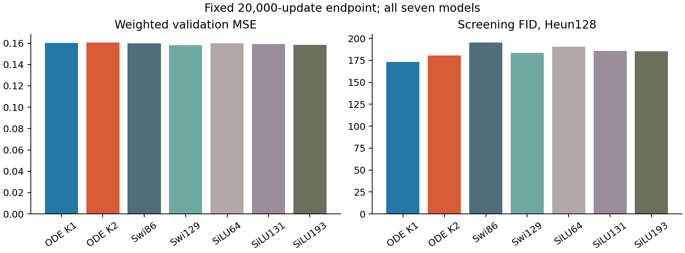
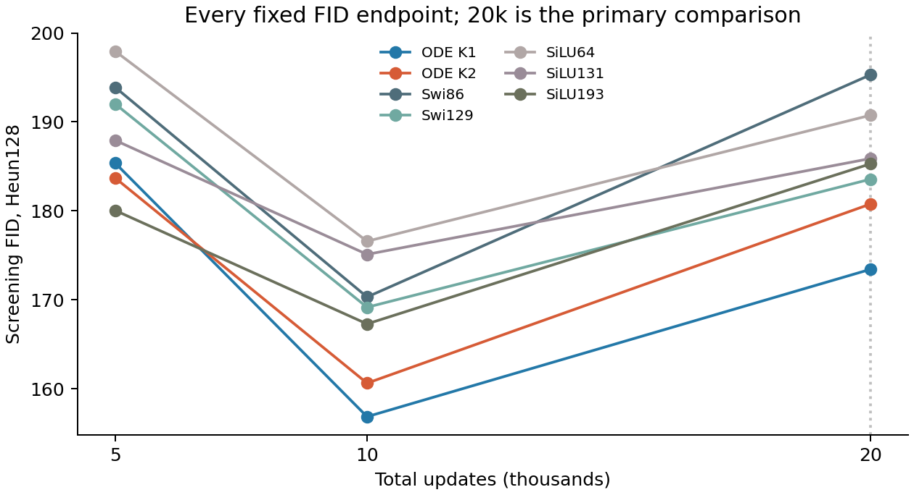
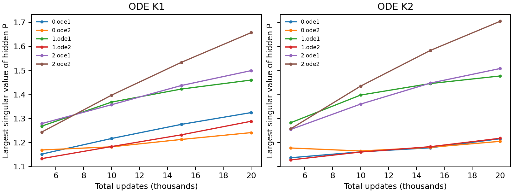
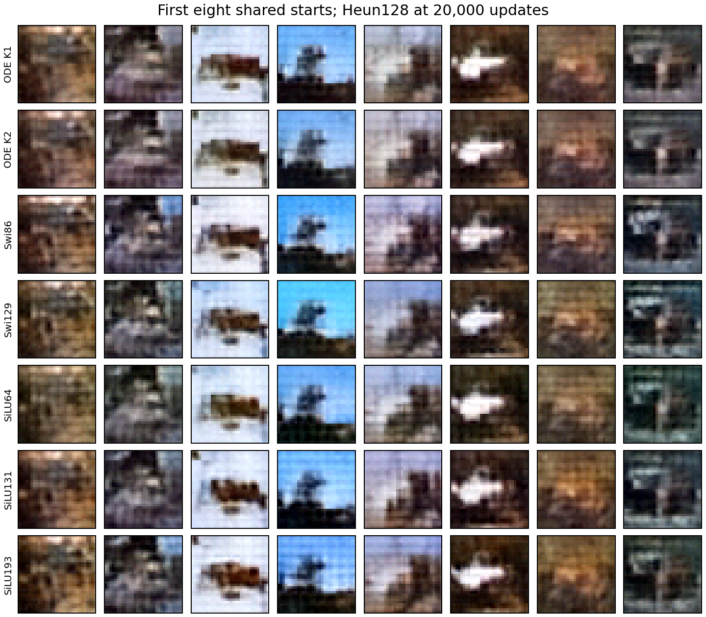

# The first-order block retains an image FID lead at 20,000 updates

Zhizhe Zhang · October 28, 2026

We study whether the professor's input-gated polynomial flows make useful FFNs in unconditional JiT. Continuing the same seven image models to 20,000 updates gives a positive result for the existing first-order block: K1 has the lowest FID, including against ordinary parameter and computation controls. K2 does not earn its extra matrix work. This identifies a model worth understanding; it does not establish a new ODE architecture or explain its advantage.

## Purpose and unchanged setup

The question was whether the earlier 5,000-update ordering survived a larger training budget. Every native model resumed its actual model, Adam, buffer and RNG state. All seven reached the fixed 20,000-update endpoint. No new architecture, loss, optimizer, data, EMA or augmentation was introduced. See the [registered protocol](protocol.md).

The small JiT uses unconditional CIFAR-10 at 32×32 resolution, patch4, hidden64 and three transformer blocks. Evaluation keeps the same image/noise/time pairs, Gaussian starts, Heun128 sampler and Inception conversion. FID uses 1,024 generated and 2,048 validation reference images. These are screening scores, not FID-50K or a fresh held-out test.

## The complete comparison

Lower is better. The primary endpoint is 20,000 updates; 10,000 is context, not a replacement selected after observing the scores.

| Model | FID at 5k | FID at 10k | FID at 20k | Weighted MSE at 20k |
|---|---:|---:|---:|---:|
| ODE K1 | 185.37 | 156.86 | **173.44** | 0.160267 |
| ODE K2 | 183.70 | 160.63 | 180.78 | 0.160527 |
| Swi86 | 193.89 | 170.32 | 195.31 | 0.159944 |
| Swi129 | 192.02 | 169.16 | 183.57 | **0.157935** |
| SiLU64 | 197.95 | 176.58 | 190.76 | 0.159842 |
| SiLU131 | 187.93 | 175.11 | 185.89 | 0.159023 |
| SiLU193 | 180.05 | 167.29 | 185.30 | 0.158280 |

K1 lowers FID by 11.20% versus Swi86 at exactly the same FFN matrix work, and by 6.70% versus SiLU131, which has 378 more whole-model parameters and 1.55% more FFN matrix work. Its weighted/clean MSE is only 0.78%/0.57% above the better of those two fitting controls. It therefore meets the predeclared follow-up margin. This margin allocates further investigation; it is not a significance test or new-method acceptance.

K2 lowers FID by only 1.52% versus Swi129 and 2.44% versus SiLU193, missing the 5% margin. These ordinary references have more parameters; SiLU193 matches its FFN matrix work exactly. K2 also fits slightly worse than K1, whose FFN matrix work is smaller. Both ODE blocks have the same parameter count. No quadratic-mechanism benefit is established.

## More training improves regression but worsens these FIDs

Every model's FID increases from 10k to 20k while both aggregate regression errors decrease. K1, for example, improves weighted MSE from 0.166241 to 0.160267 while FID rises from 156.86 to 173.44. The [full regression curves](results/continuation-curves.png) retain all intermediate checkpoints. Neither convergence nor a better population generator follows from the lower loss.

The fixed t=.9 panel also improves: K1 falls from 1.26510 to 1.01900, while Swi129 falls from 1.12707 to 0.91856. Thus worsening error on this particular late panel does not explain the FID reversal. All [five time panels](results/time-panels.png) are retained. They do not measure the field error along generated trajectories.

K1's feature-mean mismatch term rises by 17.88 points while its covariance term falls by 1.31, giving the 16.58-point FID increase. This is score accounting, not a causal explanation. Its raw out-of-range fraction decreases from 7.87% to 1.07%, so a simple account based on growing tails is unsupported.

## P is changing; the quadratic term is active

At 20k, largest singular values across the six P matrices range from 1.241–1.657 for K1 and 1.205–1.704 for K2. The final block's second P grows most in both models. In K2, quadratic-term RMS is 19–35% of linear-term RMS across the fixed time/layer records. Its lack of a measured advantage cannot be dismissed as a numerically absent term.

These saved norms neither certify stability of the complete predictor nor identify a failure caused by P. The clock derivative, SiLU, residual paths and external conditioning also affect the full Jacobian. The earlier [5k clock-collapse result](../cycle19-image-clocks/analysis-report.md) does not establish clock dispensability at these new weights.

## Fixed examples and the next question

Compare the same [eight starts at 10k](results/generation-10000.png). In the fourth column, backgrounds become more strongly blue across families; in the eighth, green backgrounds become grey. The third column retains a similar dark horizontal shape across models. All outputs remain coarse. These cases show shared changes, not a visual breakthrough or the cause of K1's FID lead.

Keep K1 as the image lead for a controlled mechanism study; do not expand K2 or extend this cohort beyond 20k. The next hypothesis worth testing is whether the longer-trained K1 lead requires input-varying local clocks. A separately registered frozen intervention can answer that before another training family. If the lead survives fixed clocks, ordinary matrix parameterization and training dynamics remain competing explanations. No such 20k intervention has yet been performed, and earlier failed designs remain stopped.

Claim checks: the supported statement is a fixed-budget K1 FID lead under the recorded image protocol. Its source is the complete table and independent replay; its limit is the small exposed-validation screen. The stronger claim that ODE integration causes the lead is withheld. The quadratic-benefit claim is unsupported by this comparison. The next check is clock necessity, not an order or optimizer search.
