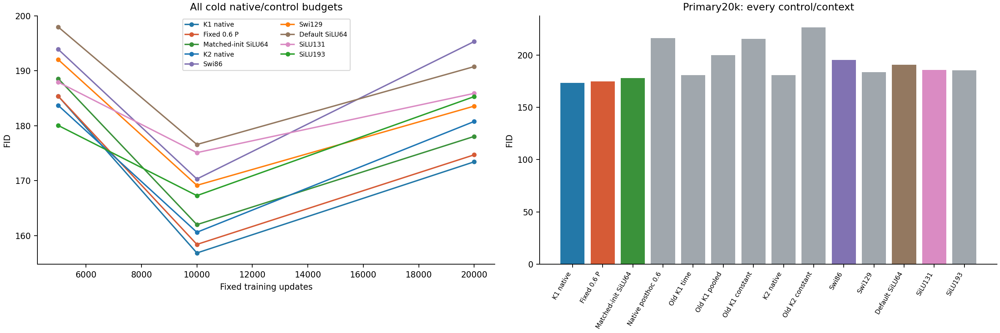
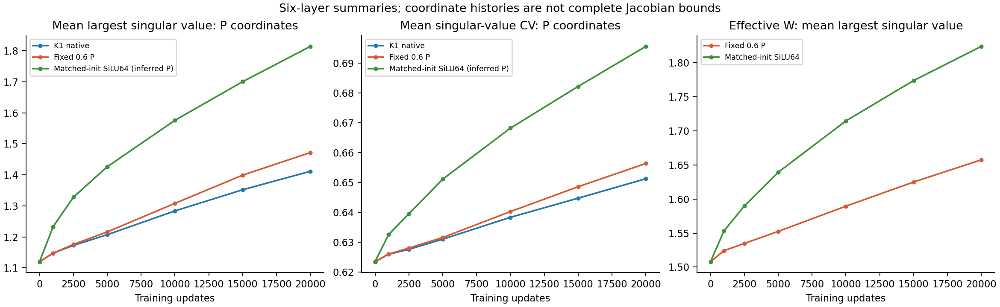

# Cold training changes the clock conclusion

Zhizhe Zhang · October 28, 2026

The project replaces JiT FFNs with the professor's ODE-inspired blocks for
clean-image flow matching. Here, a first-order block trained with a fixed
clock reaches **FID 174.71**, against **173.44 for native K1**, while using
about half its FFN matrix work. Fixing that same clock only after native
training gives **216.07**. Adaptive clocks are therefore unnecessary for the
registered quality margin in this configuration. This does not establish a
new ODE-specific function class.

## The missing training comparison

Earlier frozen replacements inherited parameters trained with adaptive clocks.
Their failure did not show that a constant model trained from the start must
fail. The [protocol](protocol.md) fixes c=float32(.6), with no calibration or
constant search. We train `h+cPh` from native step 0, and ordinary bias-free
SiLU with `W=I+cP_initial`. The latter shares its initial function up to the
measured float32 roundoff. Both keep native Adam, data, backbone and time/AdaLN.
A third, frozen reference changes the native 20k clocks to the same c.

All models use the original unconditional CIFAR-10 screen. Primary evaluation
is fixed at 20k: 1024 generated images, 2048 real references and unchanged
Heun128. The seven native families, four earlier frozen interventions and all
new 5k/10k/20k rows remain in [the complete table](results/comparison.csv).

## Primary results

| Model | Weighted MSE | Clean MSE | FID |
|---|---|---|---|
| K1 native | 0.160267 | 0.076153 | 173.44 |
| Fixed 0.6 P | 0.160392 | 0.076197 | 174.71 |
| Matched-init SiLU64 | 0.160598 | 0.076280 | 178.06 |
| Native posthoc 0.6 | 0.167715 | 0.078856 | 216.07 |
| Old K1 time | 0.160664 | 0.076303 | 180.86 |
| Old K1 pooled | 0.161006 | 0.076366 | 200.05 |
| Old K1 constant | 0.161452 | 0.076417 | 215.56 |
| K2 native | 0.160527 | 0.076292 | 180.78 |
| Old K2 constant | 0.163194 | 0.076846 | 226.23 |
| Swi86 | 0.159944 | 0.076124 | 195.31 |
| Swi129 | 0.157935 | 0.075416 | 183.57 |
| Default SiLU64 | 0.159842 | 0.075990 | 190.76 |
| SiLU131 | 0.159023 | 0.075724 | 185.89 |
| SiLU193 | 0.158280 | 0.075516 | 185.30 |

Fixed 0.6 P lowers FID by 10.55% against Swi86, 6.01% against SiLU131 and 8.41%
against equal-cost default SiLU64. Both fitting guards pass. It meets the
unchanged allocation cutoff of 176.59. Relative to native K1, FID is 0.73%
higher; weighted/clean MSE increase by 0.078%/0.058%. These are finite measured
differences, not a declared equivalence tolerance.

Matched-init SiLU also improves over default SiLU64, by 6.66%, without changing
its function class or active size. Its 178.06 beats the strict ordinary
references but misses the 5% allocation margin. Keep that negative decision;
it cannot be replaced by the better 10k score.

## What the three comparisons establish

The fixed inference architecture scores 174.71 when trained that way, versus
216.07 when imposed on native fitted weights. The frozen intervention changes
the function without allowing training to adapt. This 41.36-point contrast
concerns the whole learned model; it does not identify P as the exclusive
cause or show that every frozen replacement is harmful.

The ordinary SiLU improvement shows why default initialization is an
insufficient control for an ODE claim. At constant c, the complete core is
exactly `W2 SiLU(W1h)`, with `Wj=I+cPj`. The [derivation](theory.md) gives
`grad_P=c*grad_W`; joint clipping and Adam change with these coordinates.
Fixed P and matched-init SiLU differ by 3.35 FID points despite equal function
classes. Native Adam settings deliberately retain coordinate differences,
and float32 implementations are not identical. This is evidence about the
implemented training conditions, not proof of a unique optimizer mechanism.

Both cold controls activate 185744 learned values; fixed P also stores 25350
unused clock values. Native K1 activates 211094. Actual FFN forward and
forward-plus-backward matrix MACs fall from 16512/49536 to 8192/24576 per
token/block. Attention and backbone work remain; this is not a 2x model speedup.

## P histories and the fitting/generation split

Across the six matrices, fixed P's mean largest singular value grows from 1.120
to 1.472; singular-value CV grows from .623 to .656. Matched SiLU's inferred
`(W-I)/c` reaches 1.814 and .696; it is not a directly trained P. Their effective
W means reach 1.658 and 1.824, respectively. These are different coordinates
and update histories, not full FFN or denoiser Jacobian bounds.

Fixed P's FID improves 185.36→158.42 from 5k to 10k, then worsens to 174.71 at 20k,
while validation weighted MSE continues down to .160392. Its 10k→20k FID change
is +16.29: the Inception mean term rises 55.02→72.24 while the covariance term
falls 103.40→102.47. This is metric accounting, not a causal decomposition.
Matched SiLU similarly worsens 162.01→178.06. All seven native families also
score better at 10k than 20k. P's smooth norm growth alone does not explain this
shared behavior, and it does not justify a spectral cap.

The [complete fitting curves](results/figures/training-curves.png) show similar
regression trajectories and different early clipping fractions. Small fitting
gaps coexist with larger FID differences. This study does not establish whether
path distribution, predictor bias or another factor causes that mismatch.

## Fixed cases and decision

The [20k grid](results/figures/primary-examples.png) retains all fourteen rows
and the first eight shared starts. At start 3, native, cold fixed P and matched
SiLU preserve a dark foreground against blue. The posthoc constant is more
orange at start 6 and has stronger grid structure at start 7. Layouts remain
similar and often ambiguous at 32 pixels; these cases do not establish semantic
fidelity. The [earlier grids](results/figures/earlier-control-examples.png)
show both cold models' changing color/layout at 5k/10k, without selecting one
of those checkpoints for the primary conclusion.

Retain fixed 0.6 P as an efficient ordinary control, native K1 as the reference,
and matched-init SiLU when assessing an ODE advantage. Stop treating failure
of a frozen clock replacement as proof that adaptive clocks are necessary.
No new spectral constraint, optimizer grid or rescued clock setting is
selected. A successor must improve on these stronger controls as well as
SwiGLU. The overall useful-ODE-successor question remains open.

## Claim boundaries

- Claim: fixed-clock training passes the registered finite quality criterion.
  - Source evidence: [decision](results/decision.json) and the complete comparison.
  - Allowed wording: adaptive clocks are not necessary for this configuration's margin.
  - Forbidden stronger wording: adaptive clocks are universally useless, or ODE architectures generally win.
  - Uncertainty: a small exposed image screen; no exclusive P-mediated causal claim.
  - Next check: retain this control for subsequent architecture comparisons.
  - Decision: keep.
- Claim: matched initialization improves ordinary SiLU in this screen.
  - Source evidence: 178.06 versus 190.76, with shared initialization/stream verification.
  - Allowed wording: ordinary initialization materially changes the observed comparison.
  - Forbidden stronger wording: initialization fully explains native K1, or coordinates alone cause every gap.
  - Uncertainty: training histories change; the fixed-P comparison also has float32 roundoff.
  - Next check: require matched-init SiLU alongside the existing strong controls.
  - Decision: keep the finite contrast; withhold the stronger mechanism claim.

All independent [checks and costs](stats-appendix.md) pass. Raw checkpoints,
P histories, prior failed settings and submitted Report1 remain unchanged.
The [figure catalog](figure-catalog.md) specifies the data and scope of every
plot; no new ODE-specific architecture is accepted by this control study.
