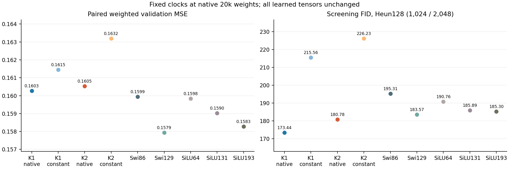
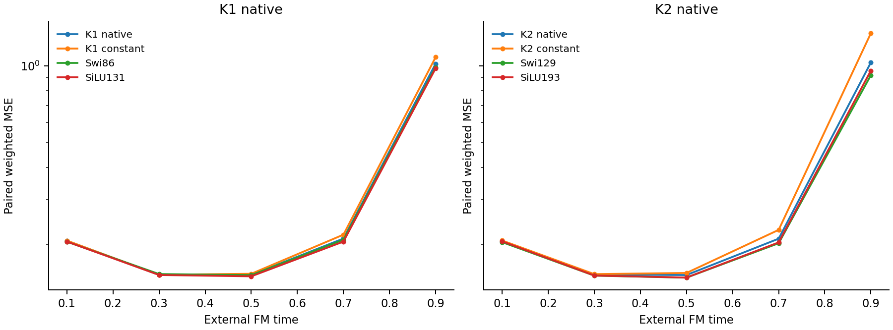
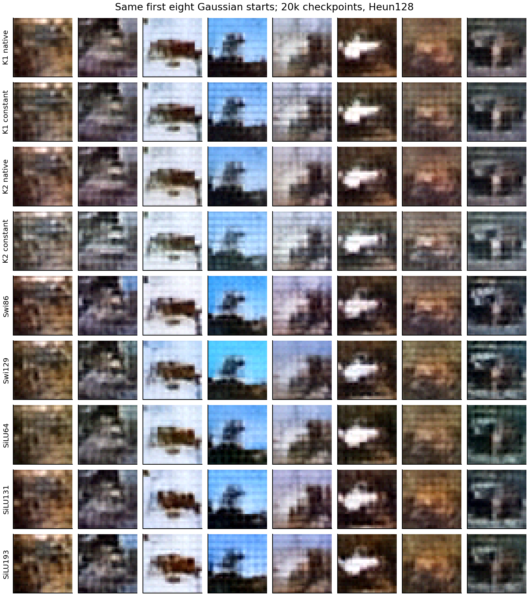

# At 20k, fixed local clocks remove the measured image lead

Zhizhe Zhang · October 28, 2026

The project asks whether the professor's ODE-inspired FFN improves unconditional JiT. The native first-order model retained a FID lead after 20,000 updates. Replacing its six local clocks by fixed means now raises FID from 173.44 to 215.56, removing that lead. K2 similarly rises from 180.78 to 226.23. Both interventions and all scores pass independent replay. This result makes the learned clock response worth understanding; it does not establish a new architecture or prove that every fixed-clock model must fail.

## Purpose and the single change

At 5k, the same collapse rule retained the ODE models' image lead. We tested whether that observation transferred to the actual 20k weights. Each of the six constants is the native mean duration over the first 64 saved validation inputs and their times, averaged over 4,096 tokens in float64 and stored float32. No target, FID or alternative calibration selects a constant.

Only the local FFN clocks change. P, SiLU, attention, external FM time/AdaLN conditioning, readout, learned tensors and buffers stay fixed. The sampler still advances external time normally with the same Gaussian starts and Heun128 updates. These are two frozen interventions, not two new training runs. See the [registered protocol](protocol.md).

## Every 20k endpoint

Lower is better. FID uses 1,024 generated and 2,048 existing validation reference images. All seven native controls are explicitly reused from the sealed budget study.

| Model | Weighted MSE | Clean MSE | FID |
|---|---:|---:|---:|
| K1 native | 0.160267 | 0.076153 | 173.44 |
| K1 constant | 0.161452 | 0.076417 | 215.56 |
| K2 native | 0.160527 | 0.076292 | 180.78 |
| K2 constant | 0.163194 | 0.076846 | 226.23 |
| Swi86 | 0.159944 | 0.076124 | 195.31 |
| Swi129 | 0.157935 | 0.075416 | 183.57 |
| SiLU64 | 0.159842 | 0.075990 | 190.76 |
| SiLU131 | 0.159023 | 0.075724 | 185.89 |
| SiLU193 | 0.158280 | 0.075516 | 185.30 |

K1's FID increases by 42.13 points (24.29%), while weighted and clean MSE increase by 0.74% and 0.35%. K2 changes by 45.45 FID points (25.14%), with MSE increases of 1.66% and 0.73%. Both constants still pass the 5% fitting guard relative to their declared ordinary controls. They fail strict FID ordering as well as the allocation margin, rather than merely crossing the 5% boundary.

For K1, the gap against its better declared ordinary reference, SiLU131, changes from a 12.45-point lead to a 29.68-point deficit. K2's previous allocation-margin failure stays failed; this frozen test does not nominate it or rescue another design.

## The early checkpoint observation does not transfer

| Checkpoint | K1 native → constant FID | K2 native → constant FID |
|---|---:|---:|
| 5k, reused prior study | 185.37 → 184.16 | 183.70 → 179.72 |
| 20k, current study | 173.44 → 215.56 | 180.78 → 226.23 |

The calibration rule and original validation inputs are the same; the fitted checkpoints differ. The [5k result](../cycle19-image-clocks/analysis-report.md) remains valid at its own weights. It cannot establish that the longer-trained predictor also tolerates constant clocks.

The new calibration constants span 0.6969–0.8209 for K1 and 0.6242–0.7586 for K2. Across the twelve individual clocks, native calibration SDs reach 0.1066. These are token-state variations on the fixed calibration set, not uncertainty over trained models. They do not establish which clock or information source matters.

## Late panels, feature accounting and fixed examples

At t=.9, K1 weighted error rises from 1.01900 to 1.08078; K2 rises from 1.03006 to 1.34066. The random-time validation bank contains no t≥.9 examples, so the five fixed panels add information not visible from its aggregate alone. They are paired-data errors, not errors along generated trajectories or a decomposition of FID.

K1's FID increase comprises 22.84 points of feature-mean mismatch and 19.29 of covariance mismatch. K2's corresponding changes are 28.24 and 17.21. This accounts for the score, without identifying a visual or dynamical cause. K1's raw out-of-range fraction actually decreases from 1.068% to 0.983%; K2's increases from 0.910% to 1.557%.

K1 constant shows stronger horizontal banding in the first and seventh columns. K2 constant has a more grid-like foreground in the fourth column. The third-column dark horizontal shape remains across variants. Cases are fixed by index and all nine rows are retained. All outputs remain coarse; the examples neither establish semantic accuracy nor explain the full FID change.

## Interpretation and next direction

Keep the narrow finding: the 20k lead is sensitive to this simultaneous clock collapse. Do not generalize it to every constant, a model trained with fixed clocks, or unique ODE causation. The clock observes hidden states that already contain external-time information; this experiment does not separate time adaptation from image/state feedback. Other time-conditioning paths remain active.

For K1, the full local Jacobian is `I + sP + (Ph) grad(s)^T`. P spectra alone omit the final term. A useful next mathematical analysis should measure this complete feedback on the original model and compare its behavior on paired-data versus generated states before proposing constraints. Its magnitude and task role have not yet been measured here. No calibration, time-only-clock, order, optimizer or training rescue is selected. The useful-ODE-successor objective remains open.
