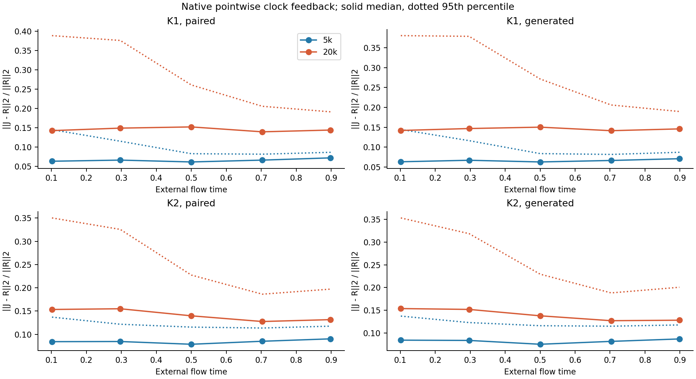
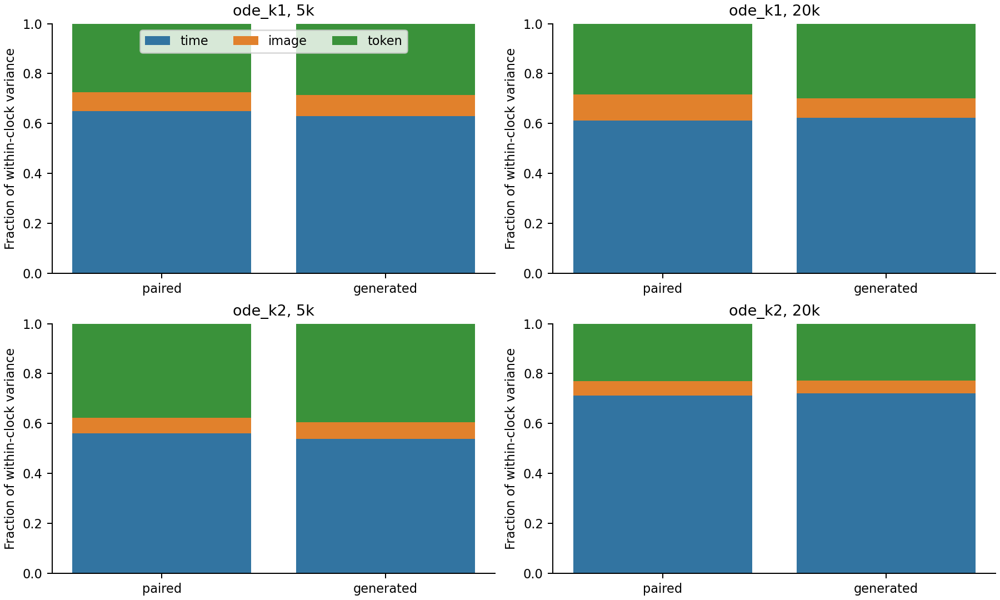
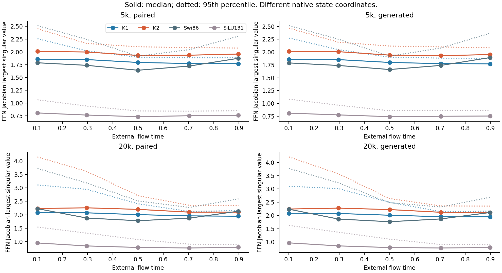

# Native gate feedback after longer image training

Zhizhe Zhang · October 28, 2026

The project replaces JiT feed-forward blocks with the professor's input-clock
polynomial maps. The existing 20k comparison favors K1 for image FID, while
K2 does not earn its extra matrix work. This report asks what the fitted clocks
actually change, before choosing a constraint on P.

**The native gates become more state-sensitive, while their median increase
in the FFN's largest singular value is only about 1–2% at 20k. Much of the
clock variation separates external time points. A P-only stability penalty
is not justified by these results.** This is a diagnostic result, not a new model gain.

## What was measured

We restored K1, K2, compute-matched Swi86 and near-parameter SiLU131 at 5k and 20k.
The same 64 Gaussian starts were used for native Heun128 paths and for fixed
interpolants with 64 clean images. At five exact sampler times, all images and
four fixed token positions were retained in every block. The two domains are
called `generated` and `paired`. All eight original endpoints reproduce
bitwise; no weights, clock values or quality-evaluation banks were changed.

The [derivation](../../../DERIVATION_PACKAGE.md) gives, in plain notation,

```text
F(h) = T_K(s(h)P) h
J = M + v g^T
M = T_K(sP),  v = P T_(K-1)(sP)h,  g = grad_h s
```

For the two-layer FFN, let R be its derivative with both clock values anchored
to their native values at that input. The full derivative differs from R by a
rank-at-most-two correction. R is a pointwise reference, not the globally
mean-clock model in the previous FID experiment. We report
`rho = ||J_FFN - R||2 / ||R||2`; rho is a relative derivative correction,
not a fraction of prediction error or FID.

## Feedback grows without a corresponding large norm increase

The following summaries pool the five times and three blocks on generated
states, with every one of the 3,840 FFN probes receiving equal weight.

| Model | Updates | rho median | rho 95th percentile | Median gain ratio |
|---|---|---|---|---|
| K1 | 5k | 6.64% | 12.60% | 1.0081 |
| K1 | 20k | 14.48% | 32.64% | 1.0207 |
| K2 | 5k | 8.20% | 12.60% | 1.0073 |
| K2 | 20k | 13.70% | 31.18% | 1.0128 |

K1's median correction more than doubles, while its median norm ratio changes
from 1.0081 to 1.0207. The direction of a correction matters: its norm is not the
increase in the largest singular value. K2 also has stronger corrections at 20k.
The paired-state results are close to the generated-state results within this
cohort; this does not establish equality of their distributions.



At the individual ODELayer level, all 30,720 generated probes have invertible
base matrices under the registered numerical criterion. The determinant
multiplier `1 + g^T M^(-1)v` stays above 0.537 for K1 and 0.766 for K2 at 20k.
The smallest observed full local singular values are 0.206 and 0.424,
respectively. These finite probes do not realize the P-bounded counterexample
in the derivation. They do not certify all inputs or the complete sampler.

A fixed case makes the distinction concrete. In block 0's first ODELayer,
image 0/token 0 at time 115/128 on the K1 generated path, the clock gradient norm
changes 0.00922→0.02361 between 5k and 20k. The relative derivative correction
changes 0.06995→0.18398, but the full local gain changes 1.584→1.732.
This position was fixed before outcomes; [all 40 cases](results/fixed-cases.csv)
are retained.

## Time variation is substantial, but it is not the whole gate

For each clock, population variance splits exactly into between-time,
within-time between-image, and within-image token components. We sum raw
components across six separately centered clocks before taking fractions.
Generated-state values are:

| Model | Updates | Between time | Between image | Within image/token | Sum of clock variances |
|---|---|---|---|---|---|
| K1 | 5k | 62.88% | 8.43% | 28.69% | 0.002980 |
| K2 | 5k | 53.79% | 6.66% | 39.54% | 0.002590 |
| K1 | 20k | 62.21% | 7.79% | 30.00% | 0.018567 |
| K2 | 20k | 72.02% | 5.27% | 22.71% | 0.019282 |

Both models have much larger absolute clock variation at 20k. K1's time
fraction remains near 62%; K2's rises to 72%. Image and token variation remain
nonzero. These are finite-array variance shares, not information importance:
each hidden state already carries both image and time information.



## Ordinary controls prevent a stability-only reading

Complete native FFN largest-singular-value summaries on generated states:

| Core | 5k median | 20k median | 20k 95th percentile |
|---|---|---|---|
| K1 | 1.812 | 2.015 | 2.945 |
| K2 | 1.971 | 2.185 | 3.770 |
| Swi86 | 1.753 | 1.942 | 3.260 |
| SiLU131 | 0.768 | 0.816 | 1.304 |

SiLU131 has smaller local gains, yet its previously measured 20k FID is 185.89,
versus 173.44 for K1. Thus this cohort does not support choosing a model simply
by reducing this statistic. Hidden coordinates, residual modulation and the
rest of the predictor differ across families. SwiGLU already has
state-dependent gates; adaptive gating alone is not a unique ODE mechanism.



## Decision

Do not add a spectral cap, flatten singular values or impose contraction on
the basis of this analysis. A P-only bound also omits the exact `v g^T` term.
The current fixed-clock FID sensitivity cannot be attributed to gate-gradient
explosion: the intervention changes clock values and the entire generated
trajectory as well as derivatives.

The next useful quality question is whether K1 needs within-time state-varying
clocks, or whether a time-varying clock can retain its lead. The time variance
makes this worth distinguishing; it does not predict success. A separate
protocol should preserve time variation, use calibration inputs fixed before
quality outcomes, retain native K1/Swi86/SiLU131 and the already-failed global
collapse, and use unchanged generation/FID. A successful frozen substitution
would still not establish a retrained architecture advantage. No such
intervention or new training was run here, and the stopped K2 candidate is not
reopened.

The [appendix](stats-appendix.md) specifies every estimand and numerical
check. Independent automatic differentiation agrees with all 122,880 analytic
probes, with maximum stored-statistic difference 6.66e-15. Native-to-promoted
forward differences reach 6.76e-6; derivatives describe the float64 real
extension at native float32 states. Local spectra do not evaluate the full
JiT or Heun endpoint Jacobian and do not explain the FID difference.
