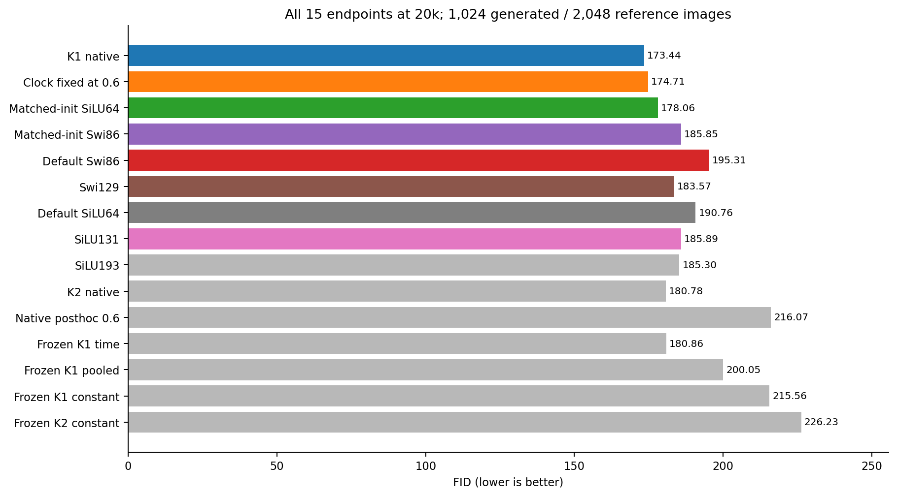
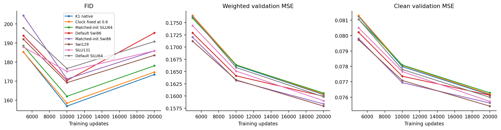

# Initialization helps SwiGLU, but does not close the K1 gap

The project tests ODE-inspired FFNs for clean-image flow matching. This
experiment fills one missing ordinary control: native Swi86 starts from the
same FFN function as the earlier matched SiLU64. Its architecture, parameter
count, optimizer, data stream and training budget remain unchanged.

At the fixed 20k endpoint, FID improves from 195.31 to 185.85, or 4.84%. This is a
measured improvement, but it misses the registered 5% gate. Native K1 remains
at 173.44, the clock-fixed model at 174.71, and matched SiLU64 at 178.06.
Initialization matters; it does not account for the remaining K1 lead.

## Purpose and comparison

The earlier SiLU initialization control improved FID 190.76 to 178.06. We ask
whether the same initial function also removes SwiGLU's deficit. The embedding
uses 64 main gate channels, unit main values and zero extra readout; the remaining
22 gate/value channels keep their original values. All parameters are trainable.
The [protocol](../protocol.md) specifies the exact weights. Initial FFN/input
derivatives and shared-backbone gradients match the SiLU reference.
Additional parameter directions are not matched.

All rows use the same small unconditional CIFAR-10 setting, 45k / 5k split and
20k primary endpoint. FID uses 1024 common Gaussian starts, 2048 real references
and the unchanged Heun128 sampler. The [complete table](comparison.csv)
retains all 32 historical rows and all three new endpoints.

| Model | Weighted MSE | Clean MSE | FID |
|---|---:|---:|---:|
| K1 native | 0.160267 | 0.076153 | 173.44 |
| Clock fixed at 0.6 | 0.160392 | 0.076197 | 174.71 |
| Matched-init SiLU64 | 0.160598 | 0.076280 | 178.06 |
| Matched-init Swi86 | 0.158379 | 0.075619 | 185.85 |
| Default Swi86 | 0.159944 | 0.076124 | 195.31 |
| Swi129 | 0.157935 | 0.075416 | 183.57 |
| Default SiLU64 | 0.159842 | 0.075990 | 190.76 |
| SiLU131 | 0.159023 | 0.075724 | 185.89 |
| SiLU193 | 0.158280 | 0.075516 | 185.30 |
| K2 native | 0.160527 | 0.076292 | 180.78 |
| Native posthoc 0.6 | 0.167715 | 0.078856 | 216.07 |
| Frozen K1 time | 0.160664 | 0.076303 | 180.86 |
| Frozen K1 pooled | 0.161006 | 0.076366 | 200.05 |
| Frozen K1 constant | 0.161452 | 0.076417 | 215.56 |
| Frozen K2 constant | 0.163194 | 0.076846 | 226.23 |

Matched Swi86 is 9.46 FID points better than default Swi86, but 12.42 worse than
K1 and 7.80 worse than matched SiLU64. It also trails the wider Swi129. The
5% cutoff is 185.5446; the observed 185.8543 misses by 0.3097. Both fitting guards
pass. Keep the continuous improvement and the failed gate together; neither
is a reason to select another checkpoint or retune this initializer.

## Better regression is not enough

New Swi86 has lower weighted/clean MSE than K1 by 1.18%/0.70%, while its FID
is 7.16% higher. Its 5k / 10k / 20k FIDs are 204.42/171.08/185.85. Regression improves
throughout, but FID worsens by 14.78 from 10k to 20k. The same late deterioration
appears in the retained ordinary and ODE references.

The default-to-matched FID improvement contains 8.60 points from the Inception
mean term and 0.85 from its covariance term. This is metric accounting, not
a causal explanation. These data do not identify P spectra, overfitting,
sampler-state errors or feature bias as the cause of the fitting/generation
split. The earlier failed empirical-reference and PSD priority tests stay
closed.

## The extra channels learn

All 18 main/extra gate/value/output weight groups change by 5k. At 20k, the
three main value-weight norms are 1.24/1.50/1.75; extra output-weight norms
are 0.99/1.15/1.10. The embedding therefore does not leave the added capacity
frozen. The [matrix/branch figure](figures/branch-and-matrix-histories.png)
shows smooth growth through the late FID deterioration. These Swi matrices
are not physical P matrices or full-model Jacobian bounds. Earlier physical
and inferred P histories remain in the
[cold-control study](../../image-clock-training/analysis-report.md).

## Fixed cases and resources

The [six-model grid](figures/fixed-start-cases.png) uses starts 0–7 without
selection. At start 1, matched Swi86 removes much of default Swi86's blue
upper-right patch. At start 6 it instead shifts the brown foreground toward
yellow/green. Native K1, fixed-clock and matched SiLU retain similar broad
layouts. These coarse 32x32 examples do not show a consistent visual winner
or establish class fidelity; [case notes](case-notes.md) retain both changes.

New/default Swi86 each have 211412 trainable values and 16512 dense FFN forward
MACs per token/block. Training takes 1491.70 swith about 100% of one CPU core and
1.02 GiBpeak training RSS. Metrics use the existing MPS extractor. All six
phases exit 0; the complete sample and feature replays pass, with independent
FID error below 4.6e-13. Raw states and arrays remain outside Git.

## Decision and claim candidates

Stop this initializer under its original rule. Retain it as comparison
context. No new ODE architecture is accepted. The next mathematical question
is what training in P coordinates changes relative to an ordinary W matrix;
the fixed-clock core is already exactly `W2*SiLU(W1*h)` with `Wj=I+0.6*Pj`.
That question precedes another architectural experiment.

- Claim: this initialization improves the measured Swi86 endpoint but does not
  close K1's lead.
  - Source: primary- 20k.csv and primary-contrasts.csv.
  - Allowed:4.84% lower FID than default Swi86; K1 remains 12.42 points lower.
  - Forbidden: the initializer is useless, all ODE benefit is initialization,
    or a new ODE method is established.
  - Uncertainty: the measured comparison does not identify the remaining mechanism.
  - Next check: inspect the exact P-to-W optimizer transformation on the preserved controls.
  - Decision: keep the measured difference; discard this initializer under its gate.
- Claim: lower paired regression error does not ensure lower generated FID here.
  - Source: the three budget rows and both validation losses.
  - Allowed: this fixed comparison has opposite fitting and FID orderings.
  - Forbidden: a general impossibility result or a causal spectral explanation.
  - Uncertainty: the cause of the mismatch remains unidentified.
  - Next check: carry both fitting and generation criteria into the next registered design.
  - Decision: keep.
