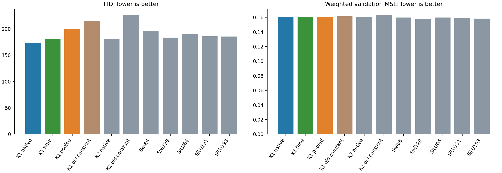
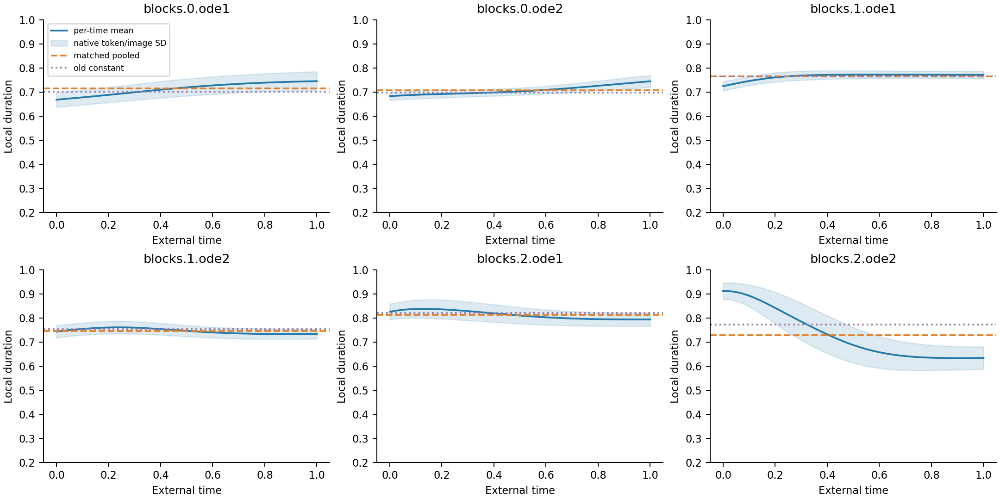

# Time-only K1 clocks at 20k

Zhizhe Zhang · October 28, 2026

The project studies the professor's ODE-inspired FFN inside unconditional JiT.
The native first-order model has a 20k image FID lead, but its previously tested
global-clock replacement loses that lead. Here, a time-only replacement gives
**FID 180.86**, versus **173.44 native** and **200.05 for its matched pooled-clock
control**. It keeps strict ordinary-control ordering but misses the registered
5% margin. Keep native K1 as the reference; this is a measured inference
tradeoff, not an accepted new architecture.

## One question and a matched control

The [native feedback analysis](../image-gate-feedback/analysis-report.md)
found substantial between-time clock variation. That observation did not show
that time variation preserves sample quality. We test it at the frozen 20k
K1 checkpoint, changing only its six local scalar clocks.

For each clock, we forward 64 fixed noisy/clean calibration pairs at every
original Heun128 node, then average its 4096 native token durations in float64.
The resulting 129 float32 means define a piecewise-linear time table. A second
arm uses one pooled mean from exactly the same native clock values. Both
remove within-time image/token dependence. The denoiser still processes its
input image; attention, SiLU, external time/AdaLN, P and every learned tensor
remain native. The older global-constant replacement is retained unchanged.

Calibration uses the first 64 original validation targets and their saved
Gaussian sources to form noisy inputs. It does not use output errors or FID.
No model is retrained, and no calendar, layer or smoothing choice is searched.
The [protocol](protocol.md) was committed before new calibration or outcomes.

## Results and the unchanged decision

All rows use the same 1024 generated starts, 2048 reference images and Heun128
sampler. Seven native models and two earlier constant interventions are reused
under their existing seals; only the two K1 replacements are new.

| Model | Weighted MSE | Clean MSE | FID |
|---|---|---|---|
| K1 native | 0.160267 | 0.076153 | 173.44 |
| K1 time | 0.160664 | 0.076303 | 180.86 |
| K1 pooled | 0.161006 | 0.076366 | 200.05 |
| K1 old constant | 0.161452 | 0.076417 | 215.56 |
| K2 native | 0.160527 | 0.076292 | 180.78 |
| K2 old constant | 0.163194 | 0.076846 | 226.23 |
| Swi86 | 0.159944 | 0.076124 | 195.31 |
| Swi129 | 0.157935 | 0.075416 | 183.57 |
| SiLU64 | 0.159842 | 0.075990 | 190.76 |
| SiLU131 | 0.159023 | 0.075724 | 185.89 |
| SiLU193 | 0.158280 | 0.075516 | 185.30 |

The time table lowers FID by 19.19 points, or 9.59%, against its same-calibration
pooled control. It also has slightly lower fitting error. This contrast passes
the declared time-versus-pooled criterion. The old constant's 215.56 versus the
new pooled control's 200.05 also shows why changing calibration alone needed
its own control; neither pooled result is nominated as a rescued model.

The time table is 7.40% below Swi86, 2.70% below SiLU131 and 5.19% below the
added equal-inference SiLU64 context. Strict ordering survives. The 5% margin
against the original Swi86/SiLU131 reference set requires FID<=176.59;
180.86 fails it. Both fitting guards pass. The full preregistered conjunction
therefore fails, even though the time/pooled contrast passes. We do not lower
the margin after seeing this result.

Relative to native K1, time-only FID is 4.28% higher. Weighted and clean
validation MSE increase only 0.247% and 0.197%. This is another case where a
small aggregate fitting change accompanies a larger sample-metric change;
it does not identify its cause.

## What the profile and fixed cases show

The six native mean profiles differ. The final block's second clock decreases
strongly with external time, while several middle profiles are nearly flat.
All six were replaced together: this plot does not isolate a critical layer
or identify clock duration with physical solver time. Shading is native
image/token SD, not uncertainty over trained models.

At the existing t=.9 panel, weighted MSE is 1.0190 for native K1, 1.0222 for
time-only and 1.0495 for pooled clocks. The [complete 55 panel scores](results/time-panels.csv)
remain available. One panel does not decompose the final FID difference.

The [fixed example grid](results/figures/fixed-examples.png) shows every row
on the first eight starts. At start 3, native/time/pooled outputs retain a
similar dark foreground and blue background. At start 1, the pooled output
has stronger horizontal striping than the time-only output. These are coarse
32-pixel samples, and the visual differences are subtle; eight examples
cannot establish the population ordering or semantic fidelity.

## Cost and interpretation

Removing the input-clock MLPs lowers measured FFN matrix MACs from 16512 to 8192
per token/block, a 50.39% reduction. This is FFN matrix work, not a 2x whole-model
speedup. The two new banks take 139.45 and 139.00 seconds to generate while
co-running on two CPU cores, with peak RSS below 0.49 GB each. Their near-equal
wall times do not establish a speedup over native K1.

Each intervention retains 211094 learned values in the source checkpoint,
of which 25350 clock-MLP values become inactive. Active learned values are
185744, plus 774 table constants or 6 pooled constants. The common 4096 fixed
position values are separate. SiLU64 matches the active learned count and
FFN matrix work, but the new replacements inherit weights trained with the
larger native clock MLPs. This is an inference comparison, not equal-cost
cold training or a demonstrated parameter-efficient learner.

With fixed positive clocks, set `W1=I+c1P1` and `W2=I+c2P2`. The K1 FFN is
then algebraically an ordinary bias-free SiLU FFN of width 64. A frozen
replacement cannot distinguish training-time adaptation, initialization and
optimizer-coordinate effects from the final function class. This remains a
useful next question; it does not nominate another calendar or a P constraint.

## Decision and limits

Retain the finite result: this prescribed time profile works better than its
matched global mean and keeps strict ordinary ordering. It does not fully
retain the original allocation margin. Stop this table/calibration setting;
no finer calendar, alternate calibration, temperature or K2 rescue follows.
No retrained architecture has been tested or accepted.

The full [independent audits](stats-appendix.md) pass: calibration, predictions,
all new samples and feature rows reproduce bitwise; independent FIDs agree.
All native weights, parent seals and Report1 are unchanged. Calibration and
FID use exposed validation data, not a fresh holdout or FID50K benchmark.
These 20k results do not overturn the earlier 5k constant-clock result or prove
that all time-only or retrained clock models must fail.
