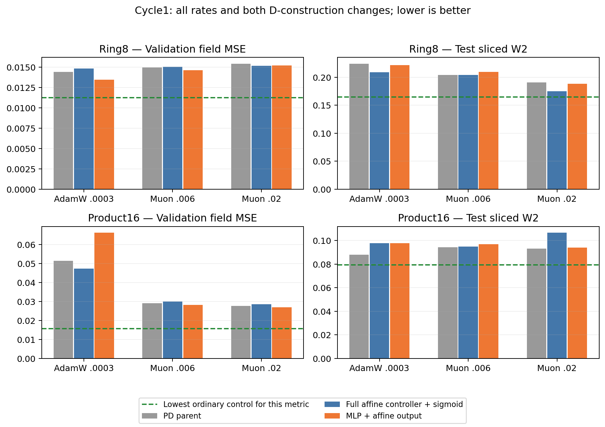

# Cycle1: two local leads, no ordinary-control advantage

All18 registered trajectories completed20k updates. All saved4096-point test
samples replay exactly. Six technical anchor reruns reproduce the earlier generated
arrays and final field errors exactly. Independent double-precision NumPy SW2
agrees within7.85e-9. Complete endpoint hashes, curves and update diagnostics are
retained beside this note; raw results.tsv stays outside Git.

The two dashed ordinary-control references minimize their respective metrics
across the retained settings; they need not be the same trained model. No candidate
in this cycle beats the strongest ordinary field control on either task.

## Controller parameterization

Product16 under AdamW: full-affine logits with sigmoid yield field MSE0.047413,
versus the MLP PD parent's0.051505, a7.94% reduction. Test SW2 worsens11.05%,
from0.087924 to0.097638. At either Muon rate its field MSE is slightly worse
than the corresponding MLP parent. Ring8's AdamW field also worsens2.67%.

The validation-only rule retains the Product16/AdamW arm as a diagnostic lead,
not a practical model improvement. The full-affine logit can learn rank64 while
the MLP's logit Jacobian has rank<=32. Cycle2's factorized-linear control starts
with the same function as the full-affine controller while keeping the parent's
rank cap and parameter count. This isolates the remaining parameterization question
more carefully; it still cannot identify rank separately from optimization geometry.

## Gate output range

Keeping the MLP but using d=.6+.02g yields Ring8/AdamW field0.013457 versus
parent0.014423, a6.69% decrease; SW2 improves1.28%, to0.221312. It remains worse
than ordinary SwiGLU field/sampling controls. Product16/AdamW instead loses28.68%
in field error. Under Muon the field gains are only1.3–3.1%, below the predeclared
5% diagnostic-retention threshold. All four Muon outcomes remain in decisions.csv.

The affine output is actually used outside the old bounds. At Product16/AdamW,
about21.65% of the sampled gate entries exceed1 and1.01% are negative, averaging
six layers. Its mean P sigma is1.796, but the two-input-per-layer conditional A
sigma averages2.026; the bounded parent has P1.865 and A1.644. Removing the bound
does not automatically reduce the actual generator or its Jacobian. These fixed
probe summaries are not population probabilities or global stability bounds.

## Decisions and next cycle

Two of12 candidates receive provisional keep under the validation-only rule;
ten are discarded as the current candidate settings. Keep means worth diagnosing,
not a new best model. There is no accepted architecture win and no image result.

Cycle2 will add the rank-matched factorized-affine controller and the two direct
input diagonals h and .2+.8sigmoid(h/10). This addresses an explicit construction
gap in the professor's proposal, using18 new runs and unchanged data/objective.
No rejected arm receives a tuned learning-rate, width, temperature or loss rescue.
The positive local outcomes and their task/sampling reversals remain visible.
