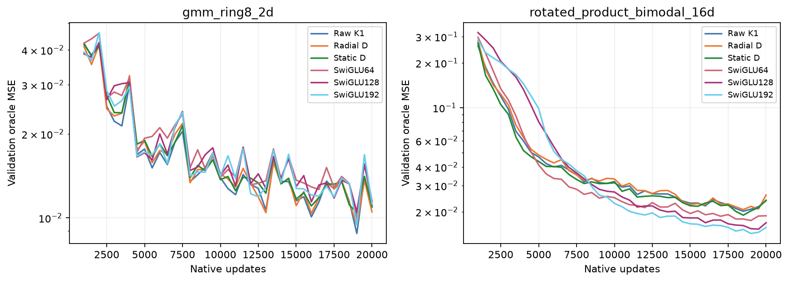
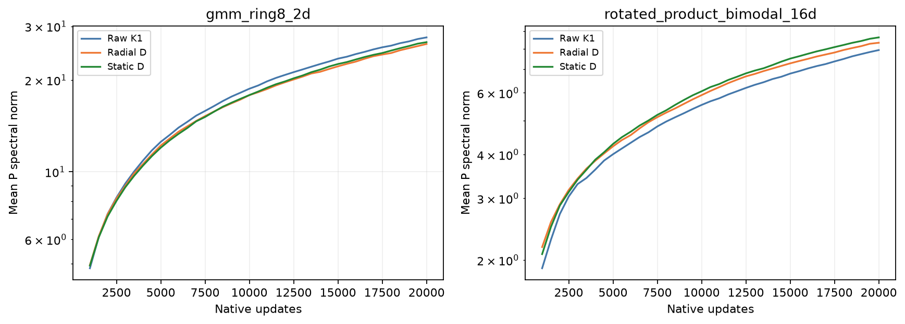
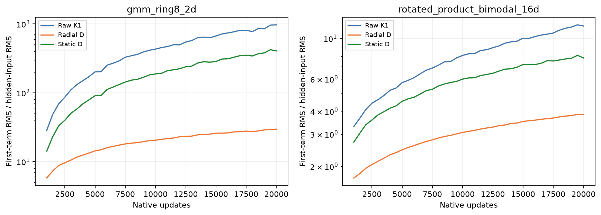
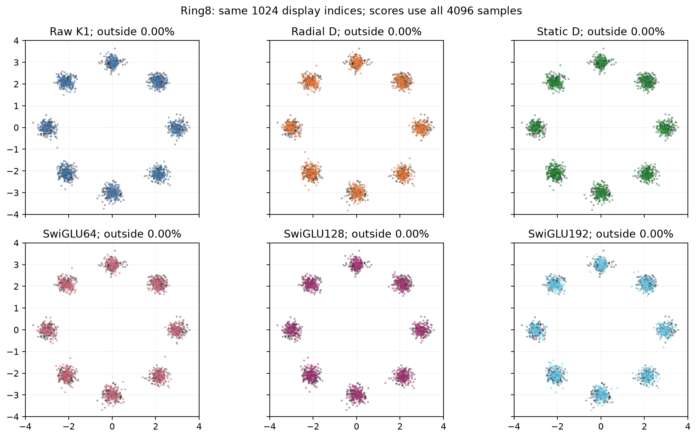
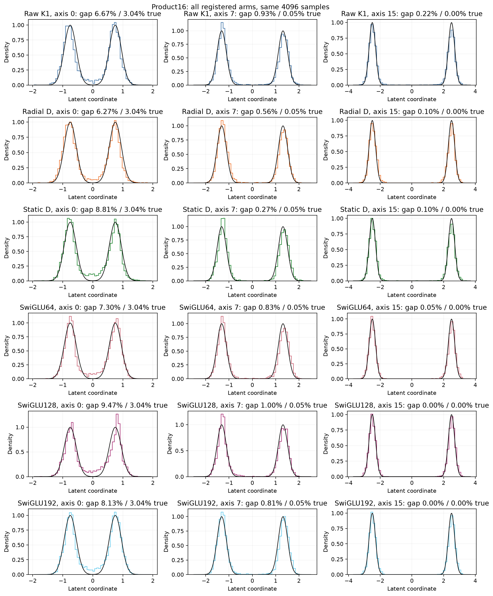

# Radial growth changes hidden responses, without a qualifying gain

All twelve registered trajectories reached20k updates. Final native CUDA
replay reproduces every generated array exactly; independent field and sliced-W2
errors are at most4.80e-10 and8.05e-9. Eight ordinary/raw reference checkpoints
match archived model, optimizer, buffers, RNG and samples exactly. Runtime7e394e2
is unchanged. These are final checkpoints, not minima selected from curves.

## Question and matched comparison

Raw K1 uses q=h^2. The radial diagonal gives q=h^2/sqrt(1+mean(h^2)), keeping
its direction and parity at a common h while softening growth. The static
q=h^2/sqrt(2) agrees on unit RMS. It has the same function class as raw after
rescaling P, with different paired initialization/optimizer coordinates.

No P constraint, new optimizer, loss or between-solve activation is added.
New arms retain the raw model's tensors, seed0, batch512, vanilla Muon rate,
native loss and Heun32. Parameter counts match raw; extra scalar operations
are not counted as free. SwiGLU64 is approximately parameter/MAC matched, and
both wider native controls remain visible at their earlier selected rates.

## All registered results

Lower is better. Validation field fitting and separate test sampling are
different readouts; neither test values nor intervening minima select a model.

| Task | Model | Validation field MSE | Test sliced W2 |
|---|---|---:|---:|
| Ring8 | Raw K1 | 0.010913 | 0.177924 |
| Ring8 | Radial D | 0.010506 | 0.177784 |
| Ring8 | Static D | 0.011025 | 0.168521 |
| Ring8 | SwiGLU64 | 0.011279 | 0.150384 |
| Ring8 | SwiGLU128 | 0.011484 | 0.164520 |
| Ring8 | SwiGLU192 | 0.011231 | 0.165805 |
| Product16 | Raw K1 | 0.023711 | 0.111139 |
| Product16 | Radial D | 0.025896 | 0.119999 |
| Product16 | Static D | 0.023908 | 0.109459 |
| Product16 | SwiGLU64 | 0.018781 | 0.081061 |
| Product16 | SwiGLU128 | 0.016855 | 0.081848 |
| Product16 | SwiGLU192 | 0.015668 | 0.079206 |

Radial improves Ring8 field error by3.73% over raw and4.71% over static. Both
fall below the preregistered5% requirement. Its sampling is nearly unchanged
from raw and worse than static and every native SwiGLU. The small20k field lead
over these ordinary controls is reported, but is not accepted as an FFN advantage.
On Product16 radial is9.22% worse than raw and8.32% worse than static on field
MSE; test distance is7.97% worse than raw. All ordinary widths fit/sample better.

These are budgeted comparisons, not assertions of convergence. The earlier
[matched80k result](../cycle6-results/findings.md) shows why short-budget Ring8
leads require caution. Under the registered rule, neither task qualifies radial
for a new80k continuation. Do not change the threshold after seeing4.71%.

## What changed internally?

Mean P spectral norms remain similar: Ring8 raw27.59, radial26.26, static26.62;
Product16 raw7.94, radial8.33, static8.63. Yet the mean first-term/input RMS on
the fixed native probes changes substantially:

| Task | Raw K1 | Radial D | Static D |
|---|---:|---:|---:|
| Ring8 | 969.70 | 29.55 | 404.98 |
| Product16 | 11.69 | 3.83 | 7.83 |

The radial map's derived bound is therefore compatible with a large observed
response reduction, without a corresponding fitting/sampling gain. These are
layer means on probes, not complete-predictor stability certificates. Different
trained models visit different states; the table is descriptive, not an isolated
causal decomposition. At common P,h radial scales all conditional singular
values uniformly, so it does not directly flatten their shape. Its full input
Jacobian also contains the derived rank-one feedback term.

## Sample cases and cost

All six Ring8 models show eight clusters, with no samples outside the displayed
frame. The scatter uses identical1024display indices; primary scores use4096.
The appearance cannot settle small distance differences.

For the registered Product16 axis0 case, radial gap mass is6.27%, raw6.67%
and static8.81%, against population3.04%. That modest favorable radial marginal
coexists with worse aggregate field/test scores. All three predeclared axes and
all six models are shown; ordinary models also retain visible20k imperfections.

Native raw/radial/static process times are180.6/206.4/179.4s on145 and
209.0/236.7/211.0s on Lenovo, including periodic evaluation, diagnostics and
checkpoints. Two concurrent workers and dispatch differ, so these are recorded
costs rather than isolated latency benchmarks. Radial has no observed cost
advantage. Both queues finished without failures and released their GPUs.

## Decision

Reject this radial setting under the registered screen. Keep raw as a research
reference, without accepting a new ODE method. Smaller responses, a bounded
module derivative and nicer numerical scales are insufficient design criteria.
Do not start a normalization-strength/rate sweep or image transfer from this
near miss. Review a distinct missing comparison before another training family.

Sources: [registration](../cycle10.md), [derivation](../radial-diagonal.md),
[endpoints](endpoints.csv), [matched comparisons](matched-comparisons.csv),
[scalar D histories](diagonal-history.csv), [samples](sample-readouts.csv),
[replay](verification.json), [exact native states](state-verification.json),
[source bindings](bindings.json) and [recorded costs](../runtime/trajectories.csv).
