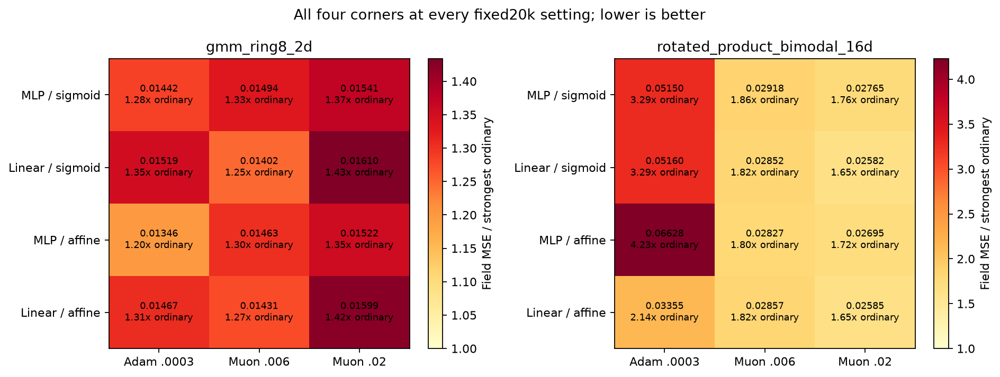
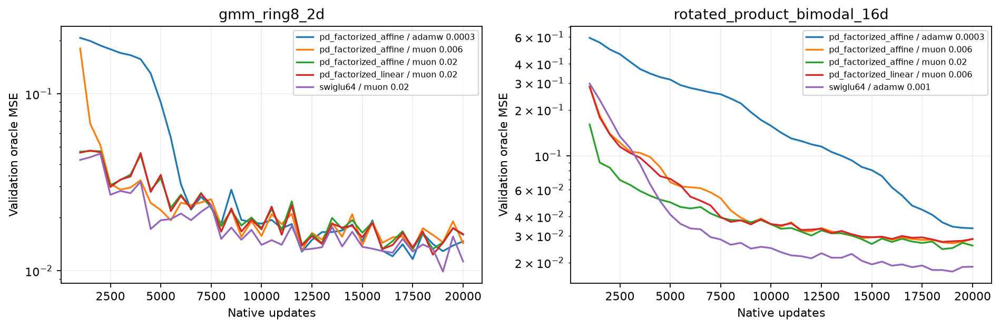

# Completing the controller/output table finds an interaction, not a winning FFN

All ten registered20k trajectories replay on their original GPUs, with exact
generated arrays and four exact archived native state/sample anchors. Maximum
field and independent sliced-W2 replay discrepancies are6.10e-10 and5.99e-9.
Runtimee493b05 remains frozen. Eighteen source-bound archived rows plus six new
candidates complete all24controller/output corners at the six fixed settings.

## Purpose and control

The new cell removes the outer sigmoid from the existing rank32 factorized
linear controller. The MLP/sigmoid, linear/sigmoid and MLP/affine corners were
already complete; a full-rank linear controller is excluded from this factorial.
No other architecture, rate, optimizer, loss, order or initialization adjustment
is added. The stored tensors/RNG match the linear/sigmoid parent exactly.

At zero hidden input, the linearized controller matches the MLP's value and
Jacobian within native folding roundoff. The resulting block difference begins
at cubic order; this does not match whole initial functions or ensure that actual
hidden inputs remain near zero. The native construction and local proof are
recorded in the [registration](../cycle11.md) and [derivation](../cycle11-analysis.md).

All four ODE corners have81858parameters on Ring8 and83664on Product16.
SwiGLU128 has81792/83598, just66fewer; Swi64 and wider Swi192 remain visible.
The parameter reference is therefore considerably stronger than a weak-ODE-only
comparison. Parameter equality does not imply identical nonlinear computation.

## New endpoints and the complete table

Lower is better. Field fitting uses the fixed validation oracle; sampling uses
the separate fixed test bank. Final endpoints, not curve minima, drive decisions.

| Task | P optimizer/rate | Validation field MSE | Test sliced W2 |
|---|---|---:|---:|
| Ring8 | adamw 0.0003 | 0.014666 | 0.213267 |
| Ring8 | muon 0.006 | 0.014308 | 0.204568 |
| Ring8 | muon 0.02 | 0.015995 | 0.202609 |
| Product16 | adamw 0.0003 | 0.033553 | 0.096983 |
| Product16 | muon 0.006 | 0.028566 | 0.096492 |
| Product16 | muon 0.02 | 0.025851 | 0.094848 |

Every new candidate loses to the nearly parameter-matched SwiGLU128 on **both**
metrics: its Ring8 reference is.011484/.164520 and Product16.016855/.081848.
The full ordinary frontier remains in the CSV/figure. Neither task has an
accepted FFN gain and no candidate qualifies for longer confirmation.

The clearest interaction is Product16 with AdamW.0003:

| Controller | Sigmoid field MSE | Affine field MSE |
|---|---:|---:|
| MLP | .051505 | .066278 |
| Rank32 linear | .051598 | .033553 |

With sigmoid, removing the MLP nonlinearity changes error by only+0.18%.
With affine output it lowers error49.37%. Equivalently, affine output harms
this MLP setting but helps the rank-matched linear setting. The new cell also
beats its linear/sigmoid parent34.97%, so the generic parent ledger marks a
provisional keep. It nevertheless has over twice the strongest ordinary field
error and fails the registered continuation rule. Do not confuse that ledger
label with mechanism acceptance.

This log-MSE interaction is−.6825, versus+.0061to+.0414 in the other five
settings. These are fixed-recipe contrasts, not independent replicates or a
significance claim. The Product16 gain is also a budgeted fitting result;
continuing improvement in the curves does not establish asymptotic capacity.

## What the gate and P summaries can tell us

Product16/AdamW provides a useful case study. MLP/affine and linear/affine have
similar mean P norms(1.80/1.76), conditional PD norms(2.03/2.10) and first-term/
input RMS(.716/.737), despite their twofold field-error difference. Their mean
fractions above the original gate ceiling are21.65%/23.44%; negative fractions
are1.01%/2.02%. The affine map is used, but these range/spectrum summaries do
not explain why one trained function fits better. They do not establish that
saturation alone caused the difference.

A second case warns against ranking by hidden Jacobians: on Ring8/Muon.02,
linear/sigmoid and linear/affine have similar conditional PD norms13.09/13.69,
but their largest logged local layer-Jacobian probes are250/994. Field and
sampling remain very close. These are different learned hidden states, not
same-state causal interventions or global full-predictor bounds. The affine
families also retain the earlier diagonal gauge freedom, so raw P spectra are
not intrinsic function descriptors.

[All18paired operator endpoints](operator-endpoints.csv) retain both affine
controllers and the bounded linear parent at every setting. Native P/update
histories are in curves.csv and updates.csv. No arbitrary value is clipped.

## Decision

Close this missing corner without a new training rescue. The outcome supports
a controller/output interaction in one weak Adam setting, while the comparable
ordinary FFN remains better everywhere. Neither removal of the MLP nor removal
of the sigmoid is a general improvement. The next useful question should explain
the interaction using existing checkpoints before introducing another design.
No image transfer, rate sweep, K1 rescue or added normalization is selected.

Sources: [factorial table](factorial-endpoints.csv), [interactions and rules](factorial-interactions.csv),
[endpoints](endpoints.csv), [source/anchor bindings](factorial-bindings.json),
[replay](verification.json), [sample readouts](sample-readouts.csv),
[parameter counts](../readiness/cycle11/parameter-counts.json) and
[all recorded costs](../runtime/trajectories.csv).
