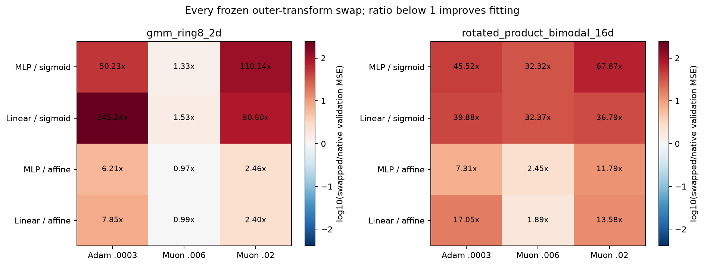
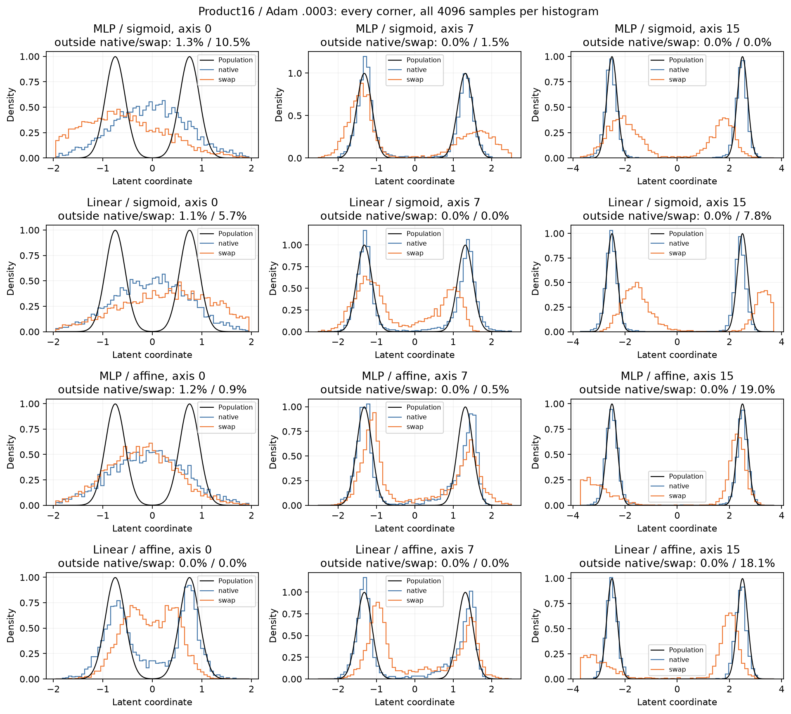
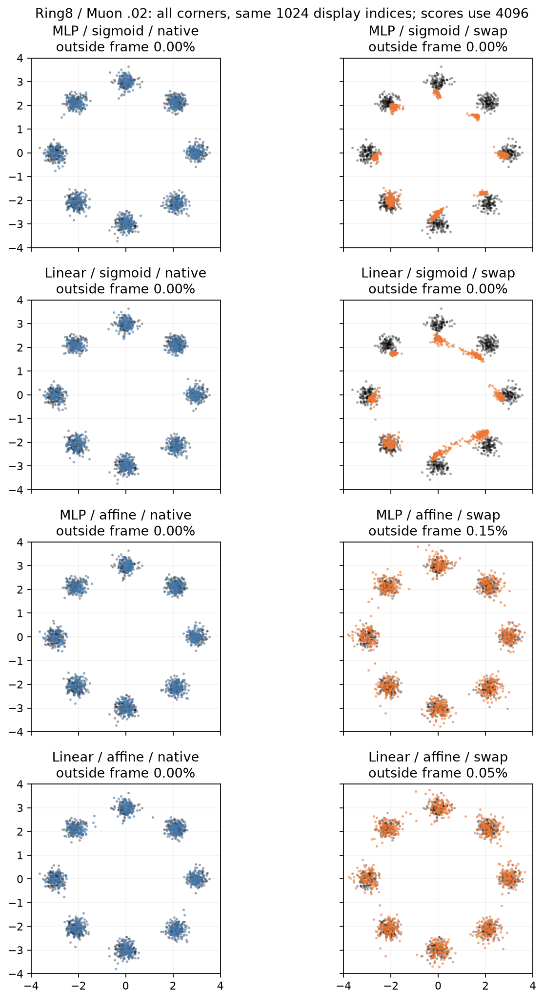

# A frozen output swap does not repair the controller/output gap

The question was whether replacing only the present-day outer sigmoid/affine
function repairs the interaction found in cycle11. All 24 predeclared checkpoints
were evaluated under native and opposite transforms. No parameter, buffer,
controller, P, loss or sampler was trained or replaced.

All native arrays reproduce exactly, and every probe returns exactly after
restoring the transform. Saved-array double-precision NumPy sliced-W2 agrees
with the native metric within 4.18e-8 across all 48finite scores. The three main
figures were generated from the complete paired cohort and inspected.

## Complete paired outcome

Every Product16 swap worsens validation field fitting and test distance. Field
ratios range from 1.89x to 67.87x. On Ring8 only two field comparisons improve:
MLP/affine->sigmoid at Muon.006 improves 3.15%, and linear/affine->sigmoid at the
same rate improves 0.58%. Their test distances improve 4.32% and 5.33%, but both
remain behind nearly parameter-matched SwiGLU128 on both metrics. All other
Ring8 field swaps worsen. No swapped case beats Swi128 field fitting.

The figure exists to test whether an immediate outer-transform repair is
consistent across the registered settings. It shows mostly large degradation,
including both swap directions. This rejects that repair in this cohort; it
does not show that sigmoid or affine output is intrinsically the better choice
when trained from scratch. Each cell is one fixed checkpoint contrast, with
no inferential error bar or selection across cases.

## The Product16 interaction case

Both directions of swapping worsen the four AdamW cases that motivated the
study. The poorly fitting MLP/affine checkpoint is not repaired by putting its
sigmoid back; its field error rises from .066278 to .484622.

| Product16, Adam .0003 | Native field MSE | Swapped field MSE | Ratio | Native / swapped test W2 |
|---|---:|---:|---:|---:|
| MLP / sigmoid | 0.051505 | 2.344561 | 45.52x | 0.087924 / 0.720305 |
| Linear / sigmoid | 0.051598 | 2.057786 | 39.88x | 0.106217 / 0.539710 |
| MLP / affine | 0.066278 | 0.484622 | 7.31x | 0.097664 / 0.281349 |
| Linear / affine | 0.033553 | 0.572247 | 17.05x | 0.096983 / 0.318650 |

This rules out an immediate-output repair of that fixed function. It is
consistent with parameters adapting to their training transform, but it does
not identify the training mechanism that produced the original twofold gap.
The swap changes values, bounds/signs and feedback derivatives together.

These cases were fixed before evaluation. On the difficult axis 0 the native
linear/affine model has better separation than the native MLP/affine model,
while swapping worsens its shape. Other axes show shifted modes and broader
or extra tails. Every histogram uses all4096 samples; the fraction outside its
frame is printed, including the large swapped tails on axis 15. Marginals are
examples, not additional selection criteria or evidence of a competitive model.

## What P does and does not explain

All learned tensors, including P, are exactly unchanged; all six raw P spectra
also match between actions at every checkpoint. Nevertheless, field fitting
and samples change markedly. P alone therefore cannot describe the conditional
function after D and downstream composition. This agrees with the existing
operator/feature derivations, without proving which spectral statistic predicts
quality or which constraint would improve training.

The fixed Ring8 examples show displaced or broadened clusters after swapping,
although most points remain within the frame. The same 1024 display indices are
used from each 4096-sample array; mode frequencies and distances use the full
arrays. This supports the measured degradation but does not establish a
population transport mechanism.

## Decision and claim boundaries

Stop this frozen outer-transform repair. No new trained ODE method is accepted,
and no cold-training or range-strength rescue follows this diagnostic. The
cycle11 interaction remains a fixed-budget learning result, not a consequence
we can remove with one present-day output replacement.

Allowed claim: changing D's transfer function at fixed learned tensors can
substantially change this conditional predictor, and does not repair the tested
Product16 gap. Evidence is the complete paired table and exact tensor/probe
checks. Forbidden stronger claims: saturation caused the training gap; bounded
gates always help; P spectra are irrelevant; a frozen improvement establishes
a superior trained FFN. Those would require separate controls or training evidence.

[Paired numeric table](paired-changes.csv), [all 48endpoint scores](endpoints.csv),
[all layer statistics](layer-statistics.csv), [verification](verification.json),
[source/array bindings](source-bindings.json), [statistical scope](stats-appendix.md)
and [figure interpretation](figure-catalog.md).
