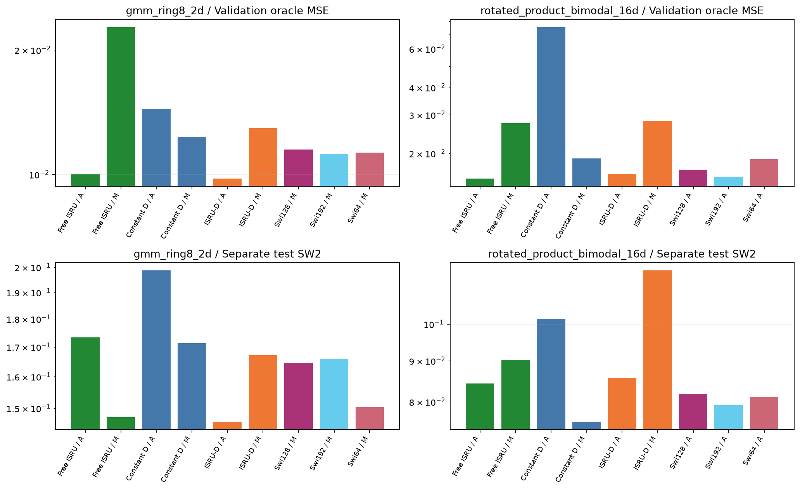
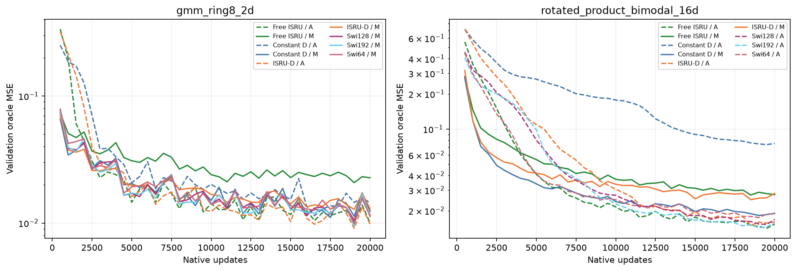
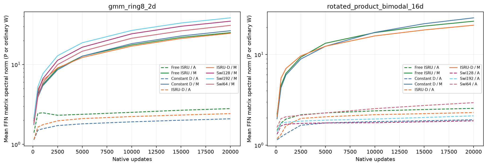
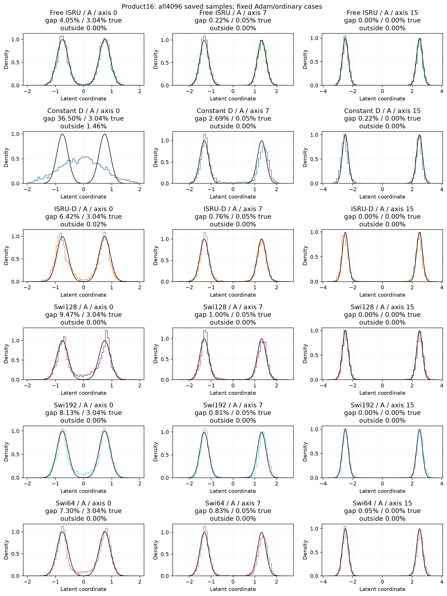
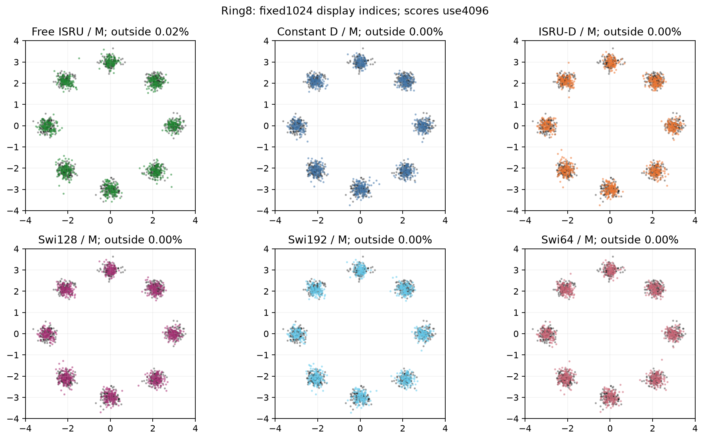

# Bounded odd features help under AdamW, without a clear ODE-specific gain

The ISRU input diagonal improves on constant D under AdamW on both tasks. Ring8
also beats all three SwiGLU controls on field fitting and test sampling. However,
its field gain over ordinary free ISRU is only2.25%, and Product16 favors the
ordinary free control. None passes the registered continuation rule. This is
a useful response-function result, not an accepted ODEFFN method.

## Purpose and implementation

Each K1 solve computes `h+P q(h)`, with `q=h/sqrt(1+1.2h^2)`. Both solves
and their middle SiLU remain. The constant-D1 parent shares every tensor and
construction RNG. Free ISRU copies the historical ordinary class and special
initializer exactly; it has two independent matrices around the same response.
All three have58,512parameters and57,408dense matrix MACs on Product16; native
Swi64 has58,572parameters and57,024MACs. Both nominally larger Swi controls
remain in the comparison. Pointwise arithmetic differs and is excluded from MACs.

All18configurations use20k native FM updates, batch512 and unchanged loss,
clip1, data and evaluation. The [registration](../cycle13.md) fixes settings
and thresholds. Validation oracle MSE is primary; test SW2 never selects a
checkpoint or rate. Ten repeated native references reproduce all archived
model/optimizer/buffer/RNG states and saved samples exactly. Every endpoint
replays exactly at the generated-array level; independent NumPy SW2 errors
are at most8.59e-9. The original trainer and official Muon remain unchanged.

## Complete endpoints

A denotes AdamW, M denotes Muon. Listed rates apply to FFN matrices; the
unchanged auxiliary group uses AdamW3e-4. Both scores are lower-is-better.

| Task | FFN | Optimizer/rate | Validation MSE | Test SW2 |
|---|---|---|---:|---:|
| Product16 | free_isru | adamw 0.0003 | 0.01535601 | 0.08431760 |
| Product16 | free_isru | muon 0.02 | 0.02742337 | 0.09023937 |
| Product16 | pd_constant_k1 | adamw 0.0003 | 0.07540868 | 0.10157618 |
| Product16 | pd_constant_k1 | muon 0.02 | 0.01896324 | 0.07552001 |
| Product16 | pd_isru_k1 | adamw 0.0003 | 0.01605896 | 0.08573749 |
| Product16 | pd_isru_k1 | muon 0.02 | 0.02813729 | 0.11673342 |
| Product16 | swiglu128 | adamw 0.0003 | 0.01685486 | 0.08184767 |
| Product16 | swiglu192 | adamw 0.0003 | 0.01566760 | 0.07920620 |
| Product16 | swiglu64 | adamw 0.001 | 0.01878107 | 0.08106103 |
| Ring8 | free_isru | adamw 0.0003 | 0.00999813 | 0.17338581 |
| Ring8 | free_isru | muon 0.02 | 0.02272616 | 0.14728478 |
| Ring8 | pd_constant_k1 | adamw 0.0003 | 0.01441079 | 0.19880177 |
| Ring8 | pd_constant_k1 | muon 0.02 | 0.01233701 | 0.17133527 |
| Ring8 | pd_isru_k1 | adamw 0.0003 | 0.00977337 | 0.14590745 |
| Ring8 | pd_isru_k1 | muon 0.02 | 0.01293306 | 0.16713193 |
| Ring8 | swiglu128 | muon 0.02 | 0.01148420 | 0.16451997 |
| Ring8 | swiglu192 | muon 0.02 | 0.01123051 | 0.16580476 |
| Ring8 | swiglu64 | muon 0.02 | 0.01127925 | 0.15038355 |

Ring8 AdamW ISRU-D lowers field error32.18% versus constant D and13.35%
versus approximately parameter-matched Swi64. Its MSE0.009773 is also below
Swi192's0.011231. Ordinary free ISRU reaches0.009998, leaving just2.25%
field separation; the corresponding SW2 difference is15.85% in ISRU-D's
favor. The5% free-control field gate fails despite the sampling gain.

Product16 AdamW ISRU-D improves78.70% over its weak constant-D parent. Its
0.016059 MSE is nevertheless4.58% above free ISRU and2.50% above Swi192.
SW2 also favors these ordinary controls. Free ISRU's0.015356 field error is
slightly below Swi192, but its SW2 is higher; ordinary field fitting is not
a general generation win. The old5k ISRU positive is therefore retained as
a lead, without treating it as an ODE-specific mechanism.

The curves preserve all evaluations and show continued improvement/noisy
late behavior, not established convergence. No best intermediate checkpoint
is substituted for the registered20k endpoint. In the tested settings,
Muon.02 improves constant-D fitting over AdamW3e-4 but worsens ISRU-D and
free-ISRU field fitting on both tasks. These are optimizer/rate comparisons,
not a rate- or update-norm-matched proof that Muon is intrinsically worse.

## Spectrum and cases

For ISRU-D, final mean P spectral norm is2.43/24.62 under AdamW/Muon on
Ring8 and2.29/21.10 on Product16. Final update stable rank rises from1.86
to34.23 and from1.65to32.91 respectively. Thus the broader update spectrum
coexists with much larger learned P and poorer field fitting here. These
measurements do not identify which spectral change caused the loss. Ordinary
free-ISRU maps are W matrices, not ODE generators; the figure labels them
separately in its quantity definition.

The prespecified Product16 AdamW axis0 case shows why the weak parent is
misleading: constant D puts36.50% of samples in the central gap, versus3.04%
population mass. ISRU-D reduces that to6.42%; ordinary free ISRU reaches
4.05%. All axes0/7/15 and all registered case models remain visible, with
outside-range fractions. This supports a feature-response improvement over
the parent, without making it uniquely ODE-based. Marginals do not certify
full16D distribution recovery.

The prespecified Ring8 panels are Muon configurations, not the better AdamW
endpoints selected after looking at results. They retain all eight visible
clusters, while their field/SW2 rankings differ. Display1024fixed indices;
all4096points enter scores. No visual winner or mode-coverage theorem follows.

## Decision and claim boundaries

- Claim: replacing constant D with the registered bounded odd feature improves
  these two AdamW configurations. Evidence: matched-comparisons.csv and ten
  exact reference anchors. Allowed: fixed-setting feature gain. Forbidden:
  universal flow-specific or ODE-specific benefit. Decision: keep this evidence.
- Claim: Ring8 ISRU-D is competitive with ordinary controls at20k. Evidence:
  all endpoint/curve/sample records. Allowed: the recorded field/sampling lead.
  Forbidden: a decisive structural advantage over free ISRU. Decision: weaken
  to a task-specific lead; the registered5% free-field gate fails.
- Claim: Muon changes update and weight spectra differently. Evidence:
  updates.csv and matrix trajectories. Allowed: measured association in these
  settings. Forbidden: flatter updates guarantee stable P or better quality,
  or P growth alone caused the error. Decision: retain descriptive conclusion.

No configuration qualifies for automatic80k continuation or image transfer.
The exact setting closes without a coefficient, K2, rate or clipping rescue.
The bounded-feature evidence remains a reference for a distinct, justified
future question; submitted reports and image code are untouched.
