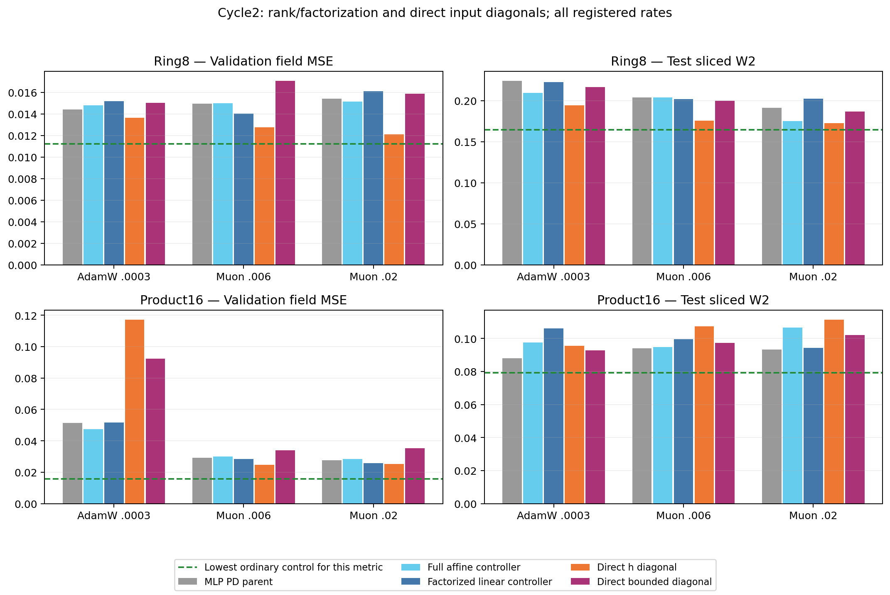

# Cycle2: direct input D is a useful lead on Ring8, not a general win

All18 new runs completed20k updates and replayed their4096 generated samples
exactly. Independent NumPy SW2 agrees within9.22e-9. Every optimizer/rate and
checkpoint hash is published; seven arms pass the validation-only5% diagnostic
retention rule, with the stated parent differing for the factorization comparison.
None beats the strongest ordinary field control.

## Direct h versus learned D and bounded h

On Ring8, direct D=diag(h) with Muon.02 yields field MSE0.012105/SW2 0.172697,
versus learned PD's0.015413/0.190948 at that same rate. This improves both
metrics and exceeds the strongest tested scalar original ODE field result0.013401
(atMuon.006). The stronger ordinary controls remain better: SwiGLU128/Muon.02
has0.011484/0.164520 and SwiGLU192/Muon.02 has0.011231/0.165805.

The direct candidate is substantially smaller:58,512 parameters,81,984 dense
MACs versus the learned-PD parent's83,664/106,560. It still uses almost the same
MACs as SwiGLU128 (81,792). A new nominal64 ordinary control is required to
resolve the smaller-parameter tradeoff; it is not an established efficiency win.

On Product16, direct raw withMuon.006 improves field error15.3% over its learned
PD parent (0.024720 versus0.029183), but sampling worsens14.1% (0.107425 versus
0.094153). It does not beat the stronger scalar ODE setting0.023849/0.088098.
AdamW raw is substantially worse (field0.117242). This is a strong optimizer-by-D
interaction, not a universal benefit of eliminating the controller.

The no-controller bounded counterpart is worse than raw under both Muon rates
on both tasks. Their parameter count/dense MACs agree, but raw versus bounded
changes amplitude, sign, derivative and feature shape together. Do not attribute
this difference to positivity alone. At AdamW, Product16 instead favors bounded.

## Factorization at the same initial function

At Product16/Muon.02, factorized linear yields0.025822 versus full-affine's
0.028482, a9.34% field improvement with lower sampling distance0.094286 versus
0.106569. Ring8/Muon.02 reverses (0.016103 versus0.015155). The two controllers
started from the same function, but have different rank constraints and parameter
optimization geometry. This rules out an arbitrary cold-function shift as the
explanation; it does not prove rank is the causal factor. Both remain behind
strong ordinary controls.

## Why order and complete-predictor checks are next

Direct h supplies
F2(h)=h+P(h*h)+.5P[h*P(h*h)]. Thus changing D introduces quadratic and cubic
features. More accurate integration is not an explanation established by this
result. A cold direct-K1 arm removes the tied cubic term while retaining all
parameters and input-derived gates; a separate scalar K1 tests the original
professor-layer question. Both must be compared with appropriate ordinary widths.

Some direct-raw hidden intermediates are enormous. At Ring8/Muon.02 the maximum
recorded two-input local ODE-layer Jacobian norm reaches5.39e8; at Product16/Muon.02
it is7.21e5. These are not Jacobians of the complete vector field. Normalization
and surrounding mappings can change the effective sensitivity substantially.
The preregistered frozen precision readout is complete. Across the selected raw
candidates, float32 versus float64 prediction RMS differences are1.29e-6 on
Product16 and2.08e-6 onRing8; field MSE changes by less than2.4e-9. Ordinary
controls show similarly small differences. Complete vector-field Jacobian norms
on16 probes reach9.61/11.75, compared with compute-matched SwiGLU128
10.97/11.18 onProduct16/Ring8. See precision/*.json. These are local finite-probe
measurements, not global Lipschitz bounds. The large hidden-layer values therefore
do not establish complete-predictor instability, and the observed field gain is
not explained by a large float32-versus-float64 field-error discrepancy.
Do not label better field error as evidence of stable internal ODE solves.

## Decision

Retain direct raw as a task/budget-dependent diagnostic lead. No image transfer,
new loss, spectral penalty or tuned gate-temperature rescue. Cycle3 is selected
as three independent blocks: original scalar K1, direct-raw K1, and smaller
ordinary SwiGLU64 (22 new runs total). It tests computational necessity and the parameter/compute
frontier while retaining all K2 and ordinary references. Preserve every failed
setting and every field-versus-sampling reversal.
