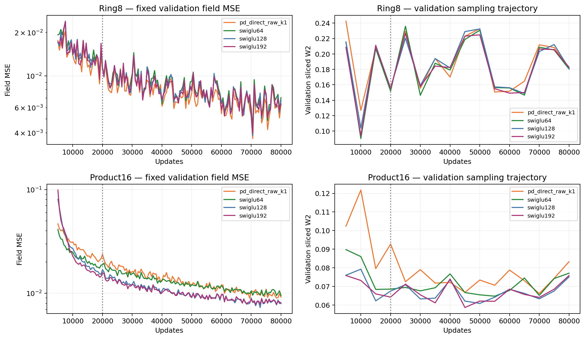
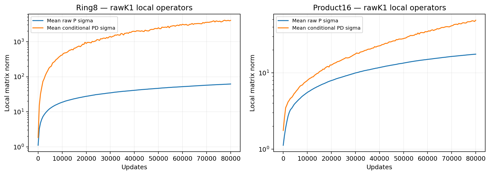
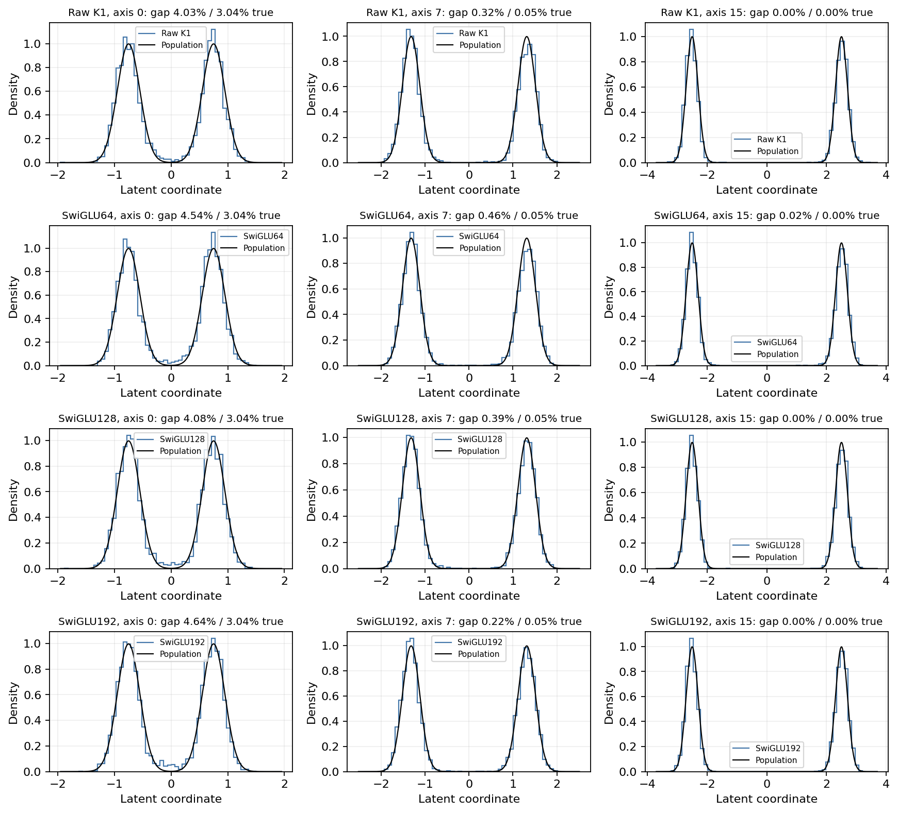
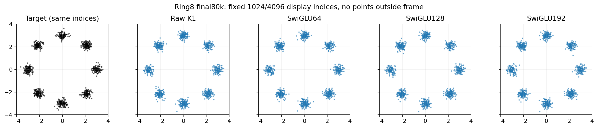

# Longer matched training does not establish an ODE advantage

All eight registered trajectories reached 80,000 updates. Their 20,000-update
model, optimizer, buffers and RNG states exactly match the archived parents.
All final generated arrays reproduce element for element on the original GPUs;
independent field and sliced-W2 recomputations differ by at most 1.76e-10 and
5.83e-9. Runtime source: b33c837. These are final-checkpoint comparisons, with
no selection from the intervening curves or sample examples.

## Matched-budget results

Lower is better. Field MSE uses the fixed validation oracle; sliced W2 uses the
separate fixed test sampling bank. Do not combine them into one score.

| Task | Model | Field MSE at 20k | Field MSE at 80k | Test sliced W2 at 80k |
|---|---|---:|---:|---:|
| Ring8 | Raw K1 | .010913 | .006383 | .178198 |
| Ring8 | SwiGLU64 | .011279 | .007045 | .169108 |
| Ring8 | SwiGLU128 | .011484 | .006723 | .170562 |
| Ring8 | SwiGLU192 | .011231 | .006339 | .167821 |
| Product16 | Raw K1 | .023711 | .009204 | .072112 |
| Product16 | SwiGLU64 | .018781 | .009480 | .062590 |
| Product16 | SwiGLU128 | .016855 | .008088 | .061186 |
| Product16 | SwiGLU192 | .015668 | .007960 | .062918 |

Raw K1 beats its approximately parameter/MAC-matched SwiGLU64 field error by
9.4% on Ring8 and 2.9% on Product16. Its test distances are respectively 5.4%
and 15.2% higher. Neither task shows a win over the wider ordinary frontier.
The small Ring8 field lead over SwiGLU192 at 20k disappears at 80k. These
outcomes support a limited fitting tradeoff, not acceptance of a new model.

The models continue improving beyond 20k, so the original endpoints were
budget-limited. The 80k curves still do not establish asymptotic convergence.
Ring8 curves oscillate together under the shared minibatch stream and constant
learning rates; checkpoint fluctuations are not independent replicates.
Validation sampling trajectories and final test values use different fixed
banks. Neither curve minima nor test readouts select a new checkpoint here.

## What P and the samples show

Raw K1's mean local P norm reaches about 62 on Ring8 and 17.6 on Product16;
the corresponding mean conditional PD norms reach about 4,036 and 49.1.
These are hidden local operators, not complete-field Jacobian bounds. A large
PD norm alone does not identify which changes would improve generation.

The predeclared Product16 axis examples improve substantially with training.
On axis 0, Raw K1's central gap mass falls from 6.67% at 20k to 4.03% at 80k,
against a population value of 3.04%. Its near-mode MSE is .04230, close to the
saved target's .04054. SwiGLU128 has gap mass 4.08% and near-mode MSE .04166.
Better-looking marginals do not erase Raw K1's worse primary test distance.
All four models and all three registered axes are shown, including easier axes.

All Ring8 arms produce the eight visible clusters. The figure uses the same
fixed 1,024 display indices from each 4,096-sample array; no points fall outside
the frame. It cannot certify mode weights or explain small distance differences.

## Decision and next question

Keep Raw K1 as a controlled research reference, not an accepted replacement.
Do not restart the rejected absolute-diagonal family or claim that more terms
in the original Taylor series are now justified. The field/sampling discrepancy
survives the longer budget, while its magnitude remains task dependent.

The next registered diagnostic directly separates P's singular-value shape
from a reduction of its leading singular value: a frozen, Frobenius-preserving
flattening path paired with scalar contractions of matched operator norm.
It tests sensitivity of existing functions. It cannot establish whether a
constraint imposed throughout training would help.

Sources: [endpoints](endpoints.csv), [budget changes](budget-growth.csv),
[matched controls](raw-versus-ordinary.csv), [sample readouts](sample-readouts.csv),
[verification](verification.json), and [exact-prefix receipts](prefix-verification.json).
