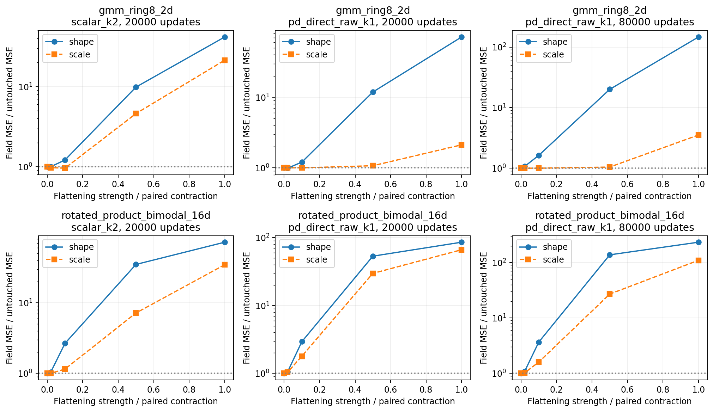

# Flattening a trained P does not repair the present models

All 54 registered frozen cases completed with finite samples. The six untouched
anchors replay the original arrays exactly and their metrics match archived
values. Independent NumPy checks verify all singular-value paths: maximum
relative Frobenius preservation error is 3.67e-9; paired operator-norm mismatch
is at most 2.26e-8. Runtime source: 35461dc. No parameters were trained here.

## Local changes are task and checkpoint dependent

The smallest registered shape intervention moves 2% toward a flat singular
spectrum and renormalizes to the original matrix energy. Its paired scalar
contraction has the same leading singular value for every P. Percentages below
refer to the untouched checkpoint; negative field change is better.

| Task | Checkpoint | Shape: field change | Paired contraction: field change | Shape: test SW2 change |
|---|---|---:|---:|---:|
| Ring8 | Original scalar K2, 20k | +0.03% | -2.64% | +0.64% |
| Ring8 | Raw K1, 20k | -1.19% | -0.05% | -0.57% |
| Ring8 | Raw K1, 80k | +6.53% | -0.02% | +0.57% |
| Product16 | Original scalar K2, 20k | +4.29% | +0.30% | +2.70% |
| Product16 | Raw K1, 20k | +5.89% | +4.21% | +4.35% |
| Product16 | Raw K1, 80k | +8.13% | +2.10% | +3.22% |

The small Raw K1/Ring8 improvement at 20k does not persist at 80k. Every larger
shape intervention worsens field error for every checkpoint. Complete
flattening raises the original scalar K2 error by about 42x on Ring8 and 72x
on Product16. The large effects confirm functional sensitivity, not a desirable
regularization target. Neither unchanged Frobenius energy nor a smaller leading
singular value preserves the learned function.

The terminal sampling readout is also a finite-sample distance. Original
test target-versus-target references are .153257 on Ring8 and .058493 on
Product16; these are reference draws, not lower bounds or confidence intervals.
They should temper interpretation of small sampled-distance differences.

## What follows and what does not

The evidence rejects post-hoc spectrum flattening as a general repair in these
settings. It does not show that training under a constraint is useless: the
other weights and D would be allowed to adapt during training, whereas this
diagnostic freezes them. Conversely, a small favorable frozen case is not a
trained-model result and does not justify selecting a new method.

One bounded follow-up can resolve that distinct question: a weak, norm-preserving
spectral relaxation after native Muon updates, compared with no relaxation and
a paired scalar-contraction control, starting from the same native initialization.
Keep the original scalar K2 and the retained raw K1 separate, use one registered
relaxation time, retain ordinary SwiGLU controls, and log the actual total update
after relaxation. Do not add a new gate, loss, scheduler or spectral-range sweep.

Sources: [all cases](endpoints.csv), [independent checks](verification.json),
[145 receipt](145-receipt.json), [Lenovo receipt](lenovo-receipt.json),
[registration and derivation](../cycle7.md).
