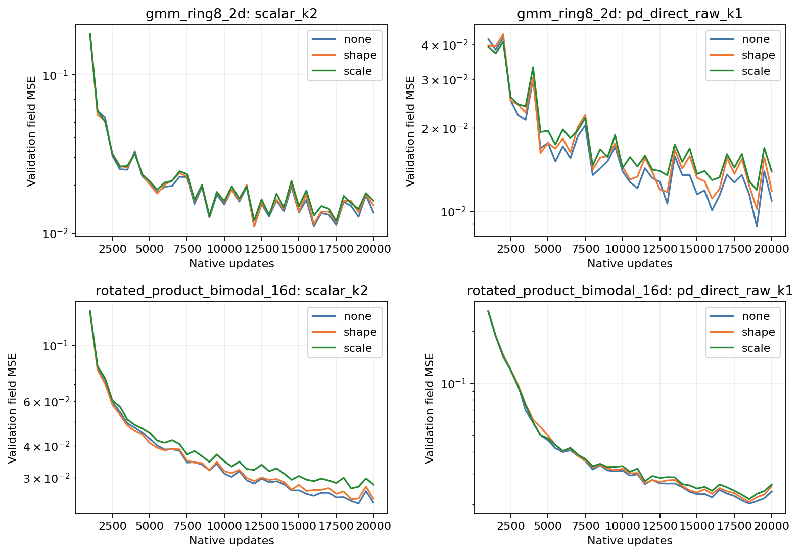
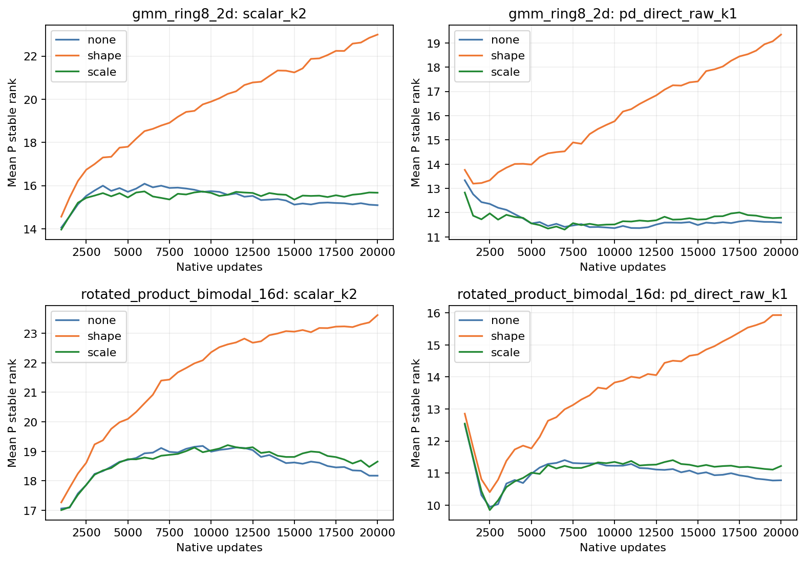
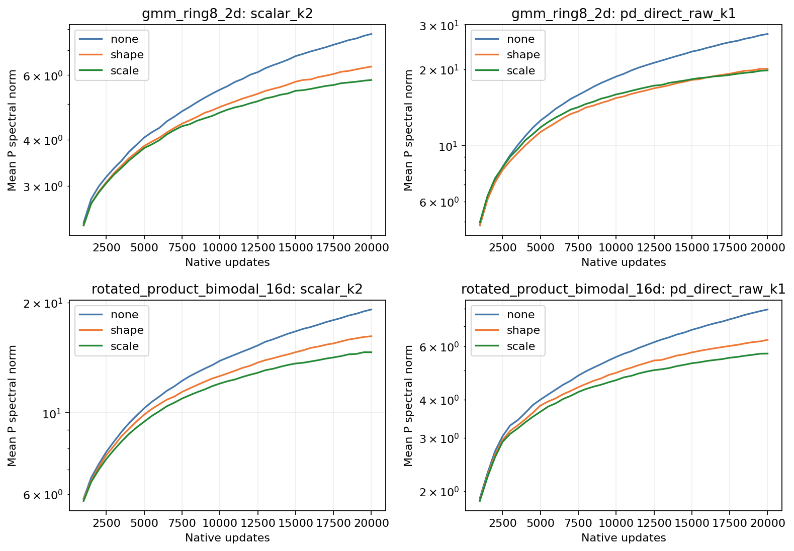
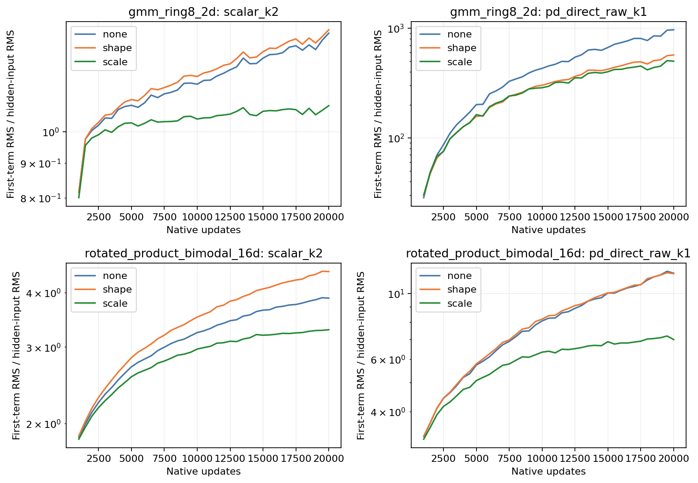
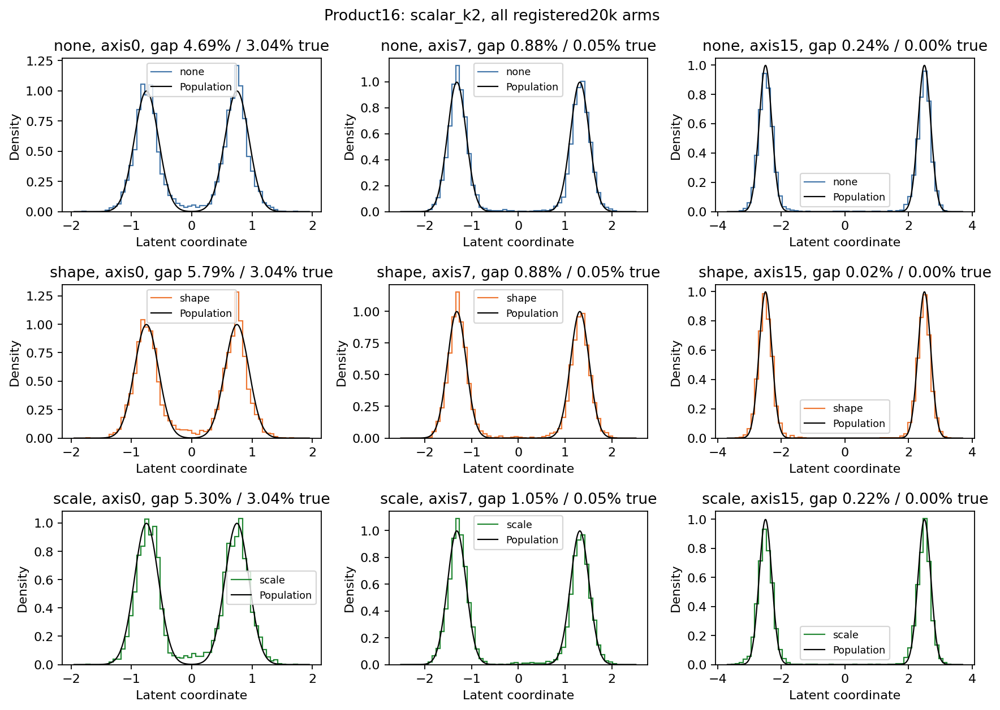
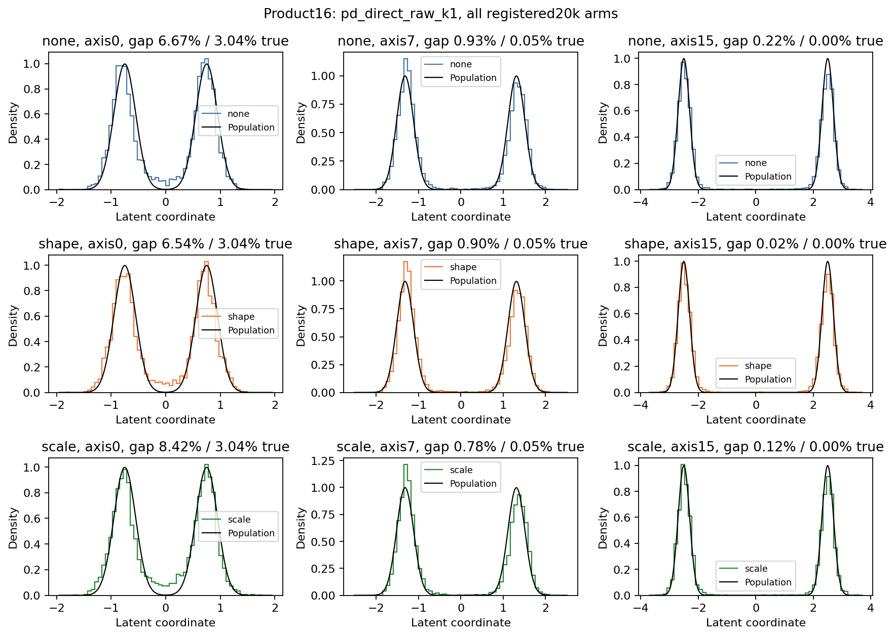
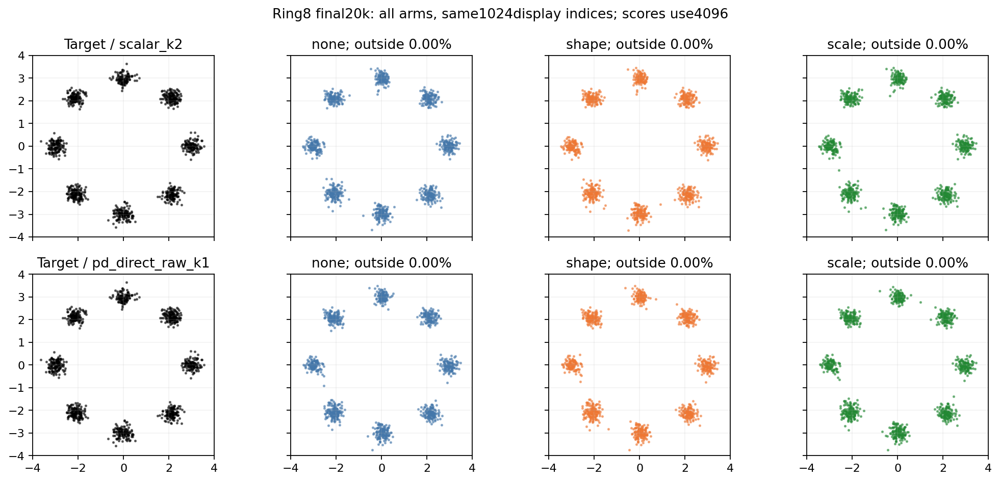

# Training adaptation does not rescue this spectral-relaxation setting

All twelve registered20k trajectories completed. Four native anchors reproduce
the archived model, optimizer, buffers and RNG states exactly, as well as the
saved generated arrays. All twelve final arrays also replay exactly on the
original GPUs. Independent field/SW2 discrepancies are at most4.80e-10/7.80e-9.
Runtime source:f6bfefc. The original readiness data-version failure was corrected
before formal training; its logs and worktree remain preserved.

## Every constrained arm loses to its native parent

The only changed factor is the post-Muon operation: none, Frobenius-preserving
singular-value relaxation, or a scalar contraction matched to the leading
singular value of that transform. Rates, models, loss and all data/evaluation
settings are unchanged. The scalar arm matches a local counterfactual on its
own current P, not the entire shape arm's diverging norm trajectory.

| Task | Model | Update | Validation field MSE | Test SW2 |
|---|---|---|---:|---:|
| Ring8 | Scalar K2 | Native | .013401 | .181819 |
| Ring8 | Scalar K2 | Shape | .014907 | .195430 |
| Ring8 | Scalar K2 | Scalar contraction | .015940 | .195098 |
| Ring8 | Raw K1 | Native | .010913 | .177924 |
| Ring8 | Raw K1 | Shape | .011862 | .182608 |
| Ring8 | Raw K1 | Scalar contraction | .013901 | .182694 |
| Product16 | Scalar K2 | Native | .023849 | .088098 |
| Product16 | Scalar K2 | Shape | .024680 | .088223 |
| Product16 | Scalar K2 | Scalar contraction | .028129 | .092648 |
| Product16 | Raw K1 | Native | .023711 | .111139 |
| Product16 | Raw K1 | Shape | .025436 | .115298 |
| Product16 | Raw K1 | Scalar contraction | .025968 | .114885 |

Shape relaxation raises field error by3.5–11.2%; scalar contraction raises it
by9.5–27.4%. All eight constrained candidates also have higher test SW2 than
their parent. No provisional keep or ordinary-control win. The existing20k
ordinary field frontier remains SwiGLU192 (.011231 on Ring8, .015668 on
Product16); matched/smaller SwiGLU controls remain in the earlier full tables.

## The intervention changed the spectrum as intended

Mean P stable rank rises under the shape constraint in every setting:

| Task/model | Native rank | Shape rank | Native P norm | Shape P norm |
|---|---:|---:|---:|---:|
| Ring8 scalar K2 | 15.09 | 23.00 | 7.76 | 6.33 |
| Ring8 raw K1 | 11.59 | 19.34 | 27.59 | 20.11 |
| Product16 scalar K2 | 18.18 | 23.62 | 19.17 | 16.20 |
| Product16 raw K1 | 10.77 | 15.93 | 7.94 | 6.31 |

The implementation therefore did not merely fail to affect P: its spectrum is
less concentrated and its leading norm is lower, while fitting is worse.
This is evidence against treating either statistic as a sufficient objective.
Per-operation energy preservation is not equality of Frobenius histories across
separately trained trajectories; their gradients and features also adapt.

The actual first-term response can move in the opposite direction to P's norm.
For Product16 scalar K2, mean first-term/input RMS increases3.88->4.47 while
mean P norm decreases19.17->16.20. Raw K1's same ratio is almost unchanged
on Product16 (11.69->11.65), but drops970->571 on Ring8. This motivates
examining actual feature moments rather than inferring layer behavior from P.
These are fixed-probe hidden responses, not complete-network stability bounds.

## Samples and verification scope

The registered Product16 examples show both favorable and unfavorable local
changes. Scalar K2 shape relaxation improves the easy axis15 gap count, but
axis0 gap mass worsens4.69%->5.79%, against a population3.04%. Raw K1's axis0
gap changes6.67%->6.54%, while its primary field and test-distance scores both
worsen. No marginal example or secondary metric selects a checkpoint.

Final logged weight spectra match saved checkpoints exactly. Total-update
energy identities close within3.80e-16 relative error. The delta log represents
the full native-plus-relaxation update; the two components are separate. At
the logged relaxation steps, shape corrections have median norm about11–16%
of the native step, and act once every ten updates. Those logs do not constitute
independent reconstruction of unsaved pre-step tensors. The native readiness
witness separately verifies the direct formula and physical checkpoint resume.

## Decision

Reject this single registered relaxation setting for both models and tasks.
Do not infer that all spectral constraints are impossible, or automatically
sweep strengths/rates after this negative result. Combined with the frozen
interventions and earlier decay controls, the evidence no longer supports
"make the singular values of P more equal" as a sufficient design argument.

The next question is diagnostic: for q=D(h)h, what do the actual second moments
M=E[qq^T] and P M P^T show? The latter determines the first increment's energy
and respects admissible diagonal reparameterizations. The
[derivation](../feature-metric.md) is complete; it is not yet trained-feature
evidence or a new optimizer. Keep all current ordinary controls and closed
negative settings visible before choosing any further method.

Sources: [all endpoints](endpoints.csv), [matched comparisons](matched-comparisons.csv),
[native replay](verification.json), [state/logger checks](state-verification.json),
[sample readouts](sample-readouts.csv), [registered protocol](../cycle8.md),
and [native execution](../cycle8-execution.md).
