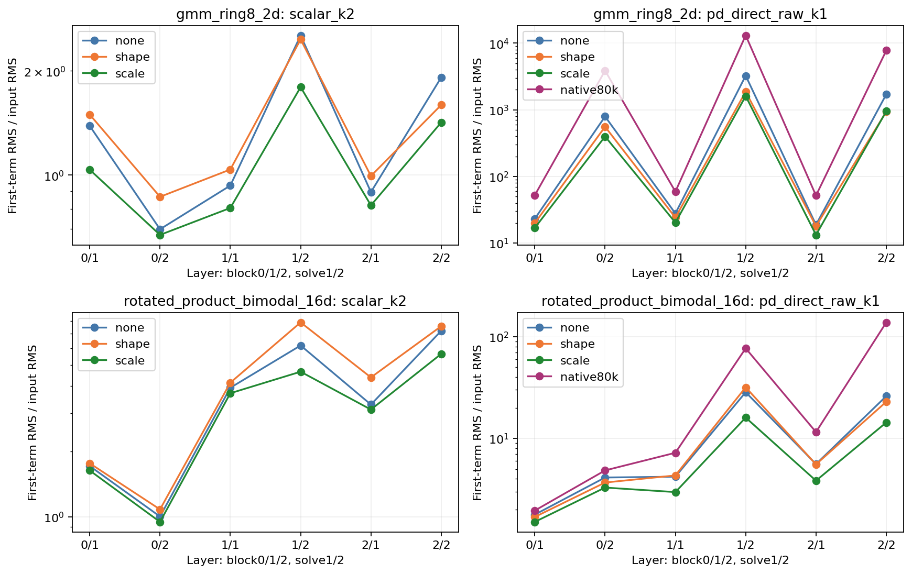
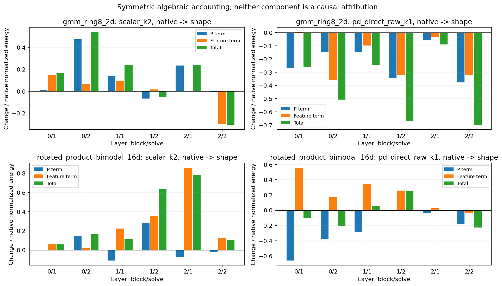
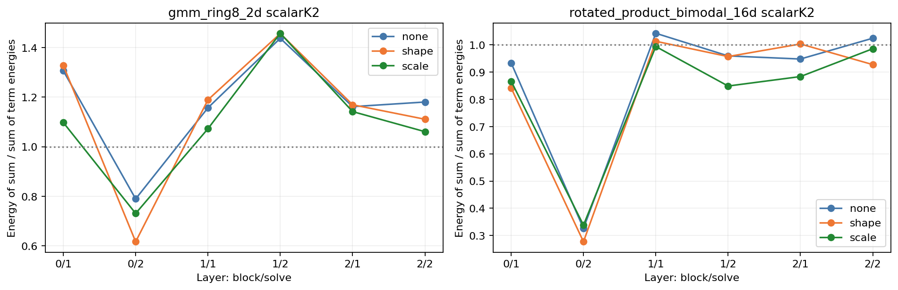

# A flatter P does not imply a flatter or smaller actual layer response

The frozen-feature audit reconstructs the recent results without training a new
model. Fourteen checkpoints and all six layers per model are retained. Native
predictions are bitwise unchanged by the capture hooks. Independent saved-array
replay closes moment/series/accounting identities within1.60e-15 relative error;
float64 reconstruction differs from native float32 layer outputs by at most
1.35e-7 in component-scaled RMS. Archived first-term amplitudes also reproduce.

## A concrete example resolves the apparent contradiction

For q=d(h)h and first increment r=Pq, the exact response is

```
R = sqrt(E||Pq||^2 / E||h||^2)
  = sqrt(E||q||^2 / E||h||^2) * sqrt(E||Pq||^2 / E||q||^2).
```

The first factor measures feature amplitude; the second measures P's gain on
the features actually present. Neither is determined by P's largest singular
value. The factors multiply per layer, not after averaging across layers.

Product16 scalar K2, block2/solve1, is an illustrative case from the full table:

| Readout | Native | Shape-constrained training |
|---|---:|---:|
| P largest singular value | 19.460 | 16.131 |
| Feature/input RMS | .2972 | .3885 |
| Gain on actual q | 11.073 | 11.304 |
| First-term/input RMS | 3.292 | 4.392 |

P's leading norm decreases, while changed features and their alignment produce
a larger response. All six Product16 scalar-layer responses increase, despite
lower leading P norms in each layer. The full layer plots retain both favorable
and unfavorable changes on the other task and models.



The symmetric energy accounting also closes exactly. In the example above,
the normalized first-term energy increases78.0%. Its algebraic P term is-7.7%
of the native energy and its feature term is+85.7%. This is a decomposition in
the trained coordinates, not proof that either term independently caused the
field-error change. Both P and features adapt together.



## Input statistics change the meaning of a weight spectrum

The relevant increment second moment is P M P^T, M=E[qq^T]. Its spectrum does
not track P's spectrum one for one. On Product16 scalar K2, mean P stable rank
increases18.18->23.62, while mean increment stable rank decreases3.60->3.17.
For raw K1 on the same task, P rank increases10.77->15.93 but increment rank
changes1.56->1.50. These are descriptive finite-probe ranks, not failed capacity
or evidence for whitening. The earlier projection-geometry study already found
strong feature anisotropy in ordinary SwiGLU as well.

The80k raw references reinforce the distinction between hidden amplitude and
quality. Ring8's mean first-term/input RMS grows about970->4141 as field MSE
improves .010913->.006383, while its test distance remains around.178. Thus
a large response cannot by itself be labeled the cause of poor field fitting,
poor sampling, or floating-point failure.

## The finite series is not uniformly suffering catastrophic cancellation

For K2, the full increment energy contains the cross term between r1 and r2.
The measured sum-energy / sum-of-energies factor varies by layer. The first
block's second solve has substantial destructive alignment: .326 native and
.277 after shape-constrained Product16 training. Other layers are near one or
constructive; Ring8 reaches roughly1.46. This is not a uniform catastrophic
cancellation signature. Raw K1 has no second term yet also loses under the
constraint. No higher-order or cancellation penalty is selected.



## Decision and limits

The new records explain why the recent spectral constraint did not control
responses as its raw-P statistics might suggest. They do not establish a new
FFN, a causal explanation of the quality gap, or a global stability certificate.
The bank contains the same256mixed-time native probes per task; it is not a
new population estimate. No inverse M or P-only whitening follows from it.

Close this diagnostic. Before another training design, require a specific
functional change and a control that distinguishes it from simple amplitude
or optimization-coordinate changes. Preserve the rejected constraint setting,
the wider ordinary frontier and all earlier stopped branches.

Sources: [all84layer records](layers.csv), [model summaries](models.csv),
[all60accounting pairs](pairs.csv), [verification](verification.json),
[raw-array/checkpoint bindings](bindings.json), [registration](../cycle9.md),
and [historical projection geometry](../../../research-architecture-search/analysis-projection-geometry/analysis-report.md).
