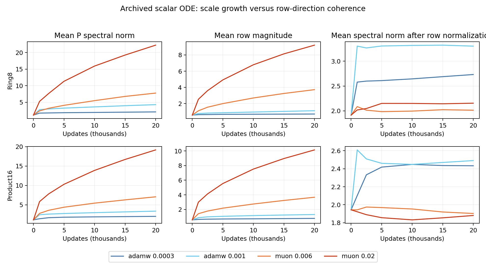

# What grew under Muon?

A read-only follow-up to the professor's spectrum question. This uses336
archived matrices (two tasks, four optimizer/rate settings, seven checkpoints,
six P matrices), not new independent training runs. All source checkpoint/config
hashes are retained in row-column.csv.

All entries below average six matrices. AdamW uses the stronger tested LR.001;
Muon uses.02. Every rate is retained in the CSV and figure.

| Task/method | Initial P sigma | Final P sigma | Initial mean row norm | Final mean row norm | Initial row-normalized sigma | Final row-normalized sigma |
|---|---:|---:|---:|---:|---:|---:|
|Product16 AdamW|1.124|3.370|0.578|1.308|1.944|2.490|
|Product16 Muon|1.124|19.173|0.578|10.141|1.944|1.881|
|Ring8 AdamW|1.109|4.269|0.576|1.116|1.915|3.303|
|Ring8 Muon|1.109|22.235|0.576|9.208|1.915|2.155|

Write P=diag(r)R, with r the row lengths and R unit-row normalized. Then
||P||2<=max(r)||R||2. Both row and column bounds were checked for every tensor.
This is an inequality, not an exact factorization of spectral-norm changes.

On Product16 Muon's P sigma grows17.06x and mean row magnitude17.54x, while
row-normalized sigma changes0.968x. On Ring8 the corresponding ratios are
20.05x,15.98x,1.125x. The large raw norms coexist with much less growth in
normalized directional coherence. AdamW's row-normalized sigma increases more.
Column-normalized results show the same qualitative distinction in these runs.

This is consistent with a scale-drift explanation rather than increasing
row-direction alignment. It does not prove a causal attribution, convergence
failure, or that directly controlling row scales will improve our objective.
The completed decay experiment already shows that shrinking P can damage fitting.

The distinction is motivated by, but not a replication of, [Muown's LLM study](https://arxiv.org/html/2605.10797v1).
That paper separates row magnitude and row coherence; here we examine small ODE
matrices and retain our own task/budget limits. No new optimizer is introduced.
For PD designs, additionally analyze A(h)=P D(h), since raw P admits compensating
rescalings with an unconstrained D. See ../logic-chain.md for the exact algebra.
