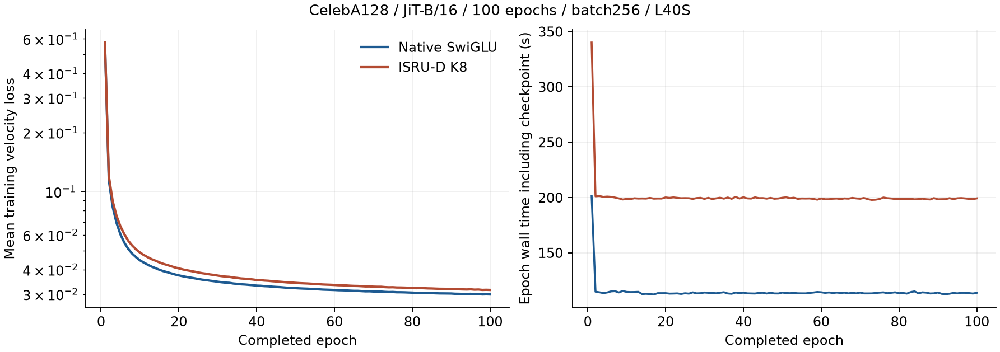
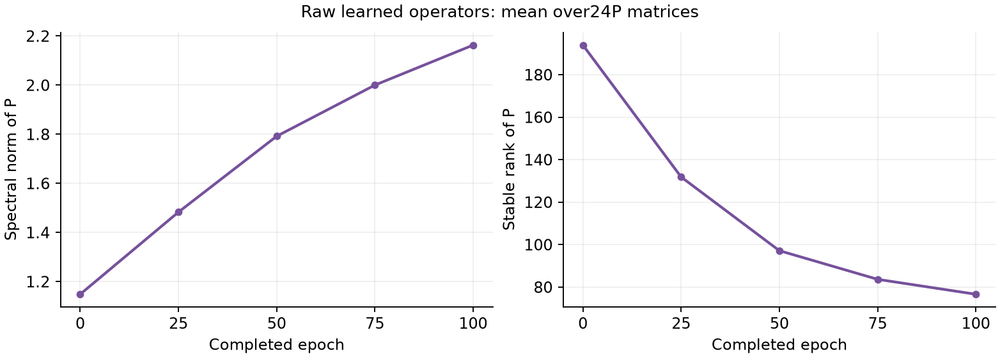
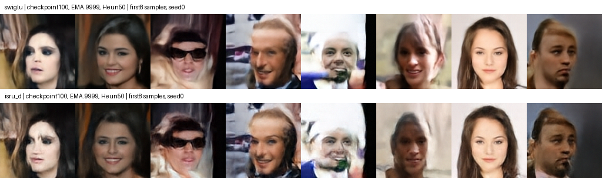

# CelebA128: completed 100-epoch comparison

Both seed 0 runs completed 100 epochs/63,500 optimizer updates, with finite
model/two-EMA weights and complete checkpoints. Both used distinct L40S
GPUs on gl066. The frozen source and saved recipe match.

| Measurement | Native SwiGLU | ISRU-D K8 |
|---|---:|---:|
| Epoch 100 training velocity loss | .02993375 | .03155256 |
| Last 5 epoch mean time (s) |113.73 |199.06 |
| Last 5 mean images/s |1429.4 |816.6 |
| Slurm elapsed |3h12m30s |5h35m53s |
| GPU utilization mean after first 5 min |95.73% |98.05% |
| Peak NVML used memory (GiB) |14.81 |22.17 |
| Full-model parameters |130,405,632 |87,879,936 |
| FID50k | **35.91785** |43.90767 |
| Fixed-checkpoint evaluation time, A100 |34m47s |54m59s |

At matched exposure, K8's final training loss is 5.41% higher and its steady
epoch time is 1.75 times native. Fewer parameters have not produced cheaper
training: the eighth-order action reuses weights but repeats matrix products.
The completed generation comparison also favors native SwiGLU: K8 FID is
7.98981 points higher (+22.24%) at the same 100-epoch exposure. The smaller
parameter count does not provide a quality or training-time advantage here.

The left panel shows the native training-velocity objective, not a synthetic
oracle field error. The right includes epoch/checkpoint time and initial
compilation. These are within-run curves; no error bars or independent-run
significance test is inferred from epochs.

## Learned P

All 101 K8 snapshots exist, each with 24 operators. Final snapshot values exactly
match the trained checkpoint. Five raw-P milestones give:

| Mean across 24 operators | Initialization | Epoch 100 |
|---|---:|---:|
| Spectral norm |1.1486 |2.1631 |
| Frobenius norm |15.9961 |18.5501 |
| Stable rank |193.95 |76.65 |
| Spectral radius |.5941 |1.1297 |

P grows and its spectrum becomes more concentrated. These averages describe
learned operators, not training repetitions. They do not establish stability
or spectrum of input-dependent PD(h), the complete FFN Jacobian, or the cause
of a final image-quality difference.

## Generation evaluation

No samples or FID existed when training completed. The
[registered evaluation](evaluation.md) uses first EMA .9999, seed 0, author
Heun50 and 50,000 images against the same deterministic training-split crop
reference. It reuses frozen source and checks checkpoint SHA256 before
loading, without additional training, solver sweeps or EMA substitution.

Exact records: [training results/checkpoint identities](training-results.json),
[all epoch records](epochs-results.csv), [P summaries](P-summary.json),
[per-operator milestones](P-milestones.csv) and
[evaluation command check](eval-command-preflight.json).

## Initial generated examples

Both checkpoint-only evaluations started on A100 GPUs (SwiGLU 22993694 on
ga013, K8 22993695 on ga022). Each loaded its verified 100-epoch checkpoint
and first EMA. The first eight generated images, in filename order, are
shown below; both final FID50k measurements are now complete.

Both produce recognizable faces, with some blurred or distorted details.
These examples do not show a clear K8 advantage. Full first 64 grids are
available for [SwiGLU](preview-swiglu.png) and [K8](preview-isru_d.png).
The [sample receipt](preview-receipt.json) binds original image hashes and
checkpoint identities. Selection uses the first filenames without filtering.
The first 64 samples are retained as examples; the full 50,000-image FID results
below determine the quantitative comparison.

## Standard FID results

| Model | FID50k | Inception Score | A100 evaluation time | Job |
|---|---:|---:|---|---|
| Native SwiGLU | **35.91785** |2.71334 |34m47s |22993694 |
| ISRU-D K8 |43.90767 |2.50937 |54m59s |22993695 |

Both jobs completed 0:0 and each saved exactly 50,000 PNG images. They share
EMA .9999, seed 0, Heun50, CFG0 and the official 162,770-image CelebA128 training
reference. The original console metrics agree with the TensorBoard values;
checkpoint mtimes remain unchanged. Original results: [SwiGLU](FID100-swiglu.json),
[K8](FID100-isru_d.json). [Comparison checks](FID100-comparison-verification.json).

The baseline passes the registered FID below 50 gate. At 100 epochs, K8 is worse
by 7.98981 FID points (+22.24%), has 5.41% higher final training loss, and takes
1.75 times as long per steady training epoch. Its 32.61% parameter reduction
has not translated into better quality or cheaper training. This result does
not identify which part of the candidate is responsible; raw P spectra alone
cannot establish the mechanism of the gap.

[Every 20-epoch evaluation](periodic-fid.md) is implemented for subsequent
training, with full numbered checkpoints and training RNG isolation. It does
not recreate the missing 20/40/60/80 weights for this completed comparison.
