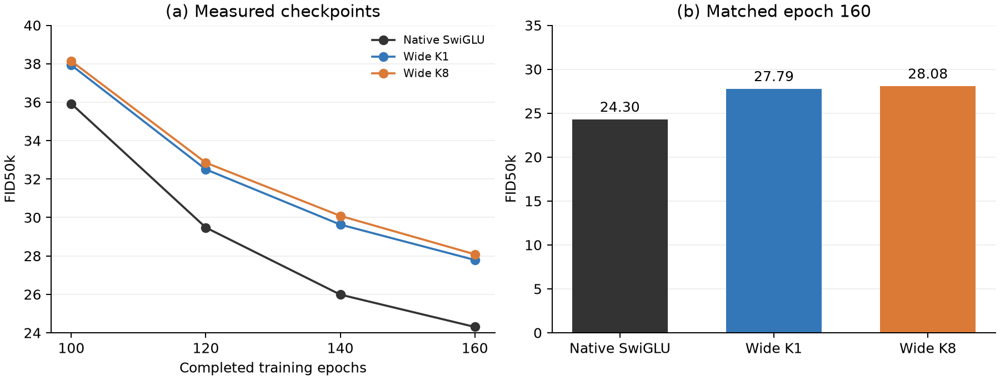

# Baseline, K1 and K8 at matching epochs

Completed result, verified15November2026. All three160epoch jobs and final
FID evaluations completed with exit0:0. Native SwiGLU has the lowest FID
at every shared checkpoint.

| Completed epoch | Native SwiGLU | Wide K1 | Wide K8 |
|---|---:|---:|---:|
| 100 | 35.91785 | 37.92486 | 38.13574 |
| 120 | 29.47602 | 32.50213 | 32.85067 |
| 140 | 25.98559 | 29.62906 | 30.08220 |
| 160 | 24.30357 | 27.78868 | 28.08343 |

All values are standard FID50k, first EMA.9999,seed0,native Heun50/CFG0 and
the same CelebA128 training reference. Total parameters are130,405,632 for
native and130,402,560 for either ODE model.

At160, K1 is3.48511FID points above native;
K8 is3.77986points above native. K8 is
0.29475points above K1 despite its extra internal
matrix work. All three improved from140to160. This is a matched-budget result,
not a statement that training has converged.

| Continuation job | GPU/node | Elapsed, including three FIDs | State |
|---|---|---|---|
| Baseline23117422 | H100/gh012 |1h44m58s | COMPLETED0:0 |
| K1 23085013 | L40S/gl024 |4h19m50s | COMPLETED0:0 |
| K8 23085012 | L40S/gl060 |11h05m23s | COMPLETED0:0 |

Different-device wall times are not a speed comparison. These durations cover
only the100-to160continuation, not the original100epochs.

All nine continuation FID values agree between original console output and
TensorBoard within.0001; each progress record reports complete160. Baseline100
comes from its original verified evaluation. This collection verifies metric
and job completion, without claiming a new tensor-level checkpoint audit.

[Exact completed metrics and source paths](completed-matched-results.json),
[table](matched-FID.csv). The [earlier live snapshot](matched-epoch-status.json)
remains dated historical evidence. [Baseline provenance](baseline/README.md)
and [resume verification](resume-validation.json) retain the launch checks.

[Next two-arm execution plan](../../research-assessments/2026-11-14-next-architecture/execution-plan.md).
No new job was submitted during result collection or planning.
