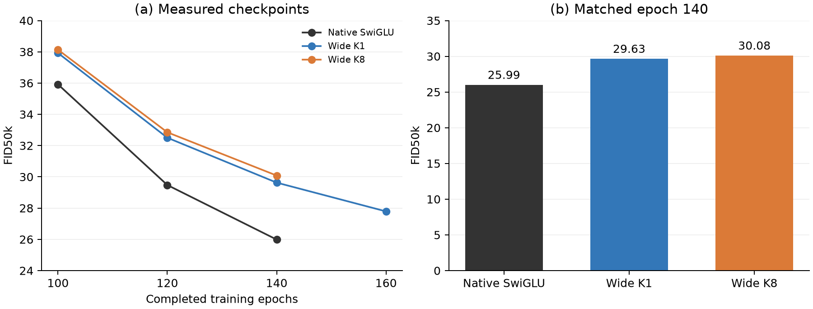

# Baseline, K1 and K8 at matching epochs

Snapshot: 14 November 2026, 22:31 Shanghai time. Both remaining jobs and their
monitors are running normally; no new experiment was submitted by this check.

**Native SwiGLU has the lowest FID at every currently available matched
checkpoint: 100, 120 and 140.** Epoch 160 comparison is still incomplete.

| Completed epoch | Native SwiGLU | Wide K1 | Wide K8 |
|---|---:|---:|---:|
|100 |35.91785 |37.92486 |38.13574 |
|120 |29.47602 |32.50213 |32.85067 |
|140 |**25.98559** |29.62906 |30.08220 |
|160 |Pending |27.78868 |Pending |

All values are standard FID50k, first EMA .9999, seed 0, native Heun50/CFG0
and the same CelebA128 training-split reference. Parameter counts are
130,405,632 for native and 130,402,560 for each expanded ODE model.
The table leaves incomplete evaluations blank rather than estimating scores.

At 140 epochs, K1 is3.64347FID points above native; K8 is
4.09662points above native. Continuing training improves all
three models, including the ordinary reference. It has not produced an ODE
advantage at the matching checkpoints measured so far.

## Current execution state

- Baseline 23117422: H100 gh012,140 completed epochs and training toward 160.
  Epoch-140 FID 25.98559; recent ordinary epochs ~40 seconds.
- K1 job 23085013: completed 160 with FID 27.78868, exit 0:0.
- K8 job 23085012: model training reached 160; its final 50k generation/FID is
  running on L40S gl060. At the snapshot generation was 34/196 batches, with
  GPU use 100%. The 160-epoch FID is not yet available.
- Baseline monitor 2838752 and ODE monitor 2415208 remain active.

Baseline and K8 are still using their original planned allocations. Their
full 160-epoch models must be distinguished from completed 160epoch metric
evaluations. K8 already has checkpoint 0160; baseline has 0120/0140 at this
snapshot.

All three logs confirm restoring the 100-epoch checkpoints and optimizer.
The seven new continuation FID points agree between original console
output and TensorBoard within .0001. Baseline 100 uses the original verified
[measurement](../../celeba128-20261112/FID100-swiglu.json) from the earlier study; its immutable
checkpoint anchor is retained.

[Matched data](matched-FID.csv), [source-bound status receipt](matched-epoch-status.json).
The individual [ODE results](results.md) and [baseline launch](baseline/README.md)
retain their phase-specific provenance.
