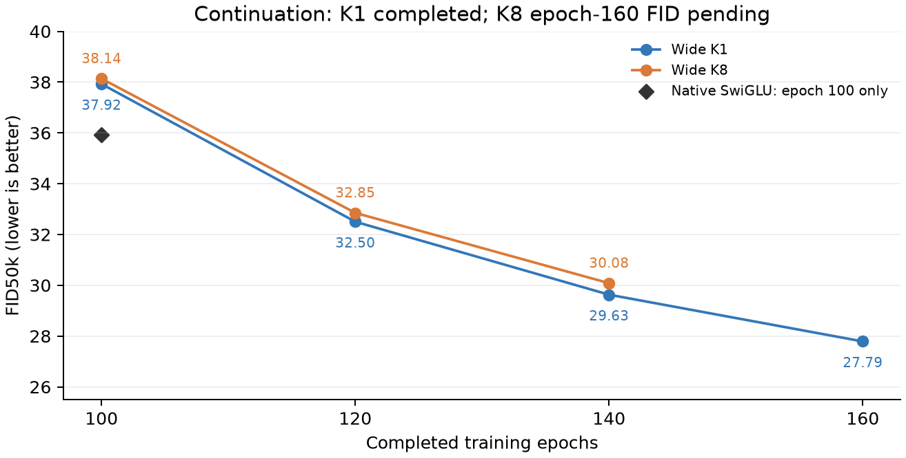

# Continuation status: K1 complete, K8 running

Checked 14 November 2026, 20:44 Shanghai time.

**K1 completed 160 epochs with FID50k 27.78868. K8 completed 142 epochs;
its latest epoch-140 FID is 30.08220.** Both resumed their original 100-epoch
checkpoints and restored optimizer state.

| Epoch | Wide K1 FID50k | Wide K8 FID50k |
|---|---:|---:|
|100 |37.92486 |38.13574 |
|120 |32.50213 |32.85067 |
|140 |29.62906 |30.08220 |
|160 |27.78868 |Pending |

Continued training improves both models. K1 improves 10.13618 FID points from
100 to 160, while K8 improves 8.05354 points from 100 to 140. At the same 140-epoch
checkpoint, K1 is .45315 points below K8. K8's 160-epoch result remains pending.
K1's 140-to-160 improvement is 1.84038 points (6.21%); improvement continues with
a smaller late-epoch change.

The fixed native reference is 35.91785 at 100 epochs. The longer-trained ODE
models have lower numerical scores after 120 epochs, with additional exposure;
this does not replace the preserved 100-epoch comparison.

## Execution

- K1 job 23085013 completed 0:0 on L40S gl024 in 4h19m50s for the added 60 epochs
  and three FID50k evaluations. Full 160-epoch checkpoint, optimizer step 101600,
  finite model/twoEMAs and 161 P snapshots are verified.
- K8 job 23085012 is running on L40S gl060, currently 142/160 completed epochs.
  Last complete ordinary epoch 305.82 seconds; current warm update~.48seconds.
  GPU utilization 99–100%, about 32.2 GiB NVML use. It has 143 P snapshots and
  full 120/140-epoch checkpoints.
- Remaining K8 time is approximately3.5hours, including the final
  50k evaluation, estimated from recent ordinary epochs and epoch 140's
  evaluation overhead. This is a projection, not a completion timestamp.
- Monitor 2415208 remains active. Both logs explicitly load the existing
  checkpoints after 100 epochs and restore optimizer state. All five new
  console FID values agree with TensorBoard within .0001.

Exact values, checkpoint/state checks and live Slurm accounting are in the
[status receipt](status-results.json). [FID data](FID-progress.csv),
[monitor snapshot](monitor.json). No new experiment was submitted by this check.
