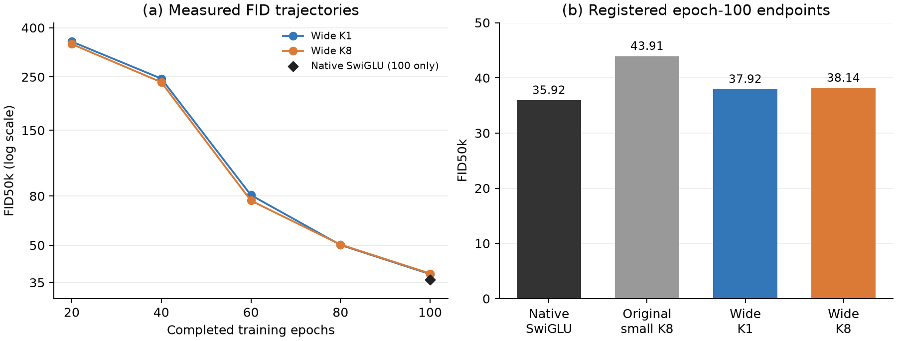

# Completed parameter-matched ISRU-D comparison

14 November 2026. Both seed 0 runs completed 100 epochs/63,500 updates and all
five scheduled FID50k evaluations. Both Slurm jobs exited 0:0; GPU allocations
ended and the persistent monitor exited after recording both terminal results.

**The fixed native SwiGLU remains best: 35.91785 FID. Widened K1 gives 37.92486
and widened K8 gives 38.13574.** The eight-term expansion provides no final
FID improvement over K1 in this comparison.

| Epoch | Wide K1 FID50k | Wide K8 FID50k |
|---|---:|---:|
|20 |350.49655 |342.36642 |
|40 |245.96788 |237.66211 |
|60 |80.73378 |76.56116 |
|80 |50.10520 |50.30532 |
|100 |**37.92486** |38.13574 |

The original baseline has only its final 100-epoch evaluation; its earlier
full checkpoints do not exist. The figure shows its measured epoch-100 endpoint. All new points use first EMA .9999, native Heun50, seed 0,
50,000 generated images and the same standard torch-fidelity/CelebA128 reference.

## What changed relative to the old result

| Model | Total parameters | FID50k at 100 |
|---|---:|---:|
| Fixed native SwiGLU |130,405,632 |**35.91785** |
| Earlier unexpanded K8 |87,879,936 |43.90767 |
| Wide K1 |130,402,560 |37.92486 |
| Wide K8 |130,402,560 |38.13574 |

The expanded K8 improves 5.77193 FID points (13.15%) over the earlier small K8.
It still trails native by 2.21789 points; K1 trails native by 2.00701. K8 is
0.21088 points worse than K1 at the final endpoint. K8 leads the new K1 curve
at 20/40/60 epochs, and K1 is slightly lower at 80/100. Both new curves continue
to improve from 80 to 100; the registered comparison remains 100 epochs.

Matching parameters therefore narrows the earlier gap without establishing
a native-baseline advantage. Expansion also adds learned input/output
projections, so its improvement does not isolate width alone. Within the
expanded pair, only order differs and initialization was identical.

## Execution and retained evidence

| Measurement | Wide K1 | Wide K8 |
|---|---:|---:|
| Job |23015408 |23015406 |
| GPU |L40S,gl068 |H10080GB,gh011 |
| Complete allocation, includes five FIDs |7h15m28s |6h08m11s |
| Late non-evaluation mean epoch |116.42s |98.47s |
| Final training velocity loss |.03070860 |.03063037 |
| Mean GPU utilization across allocation |84.25% |83.92% |
| Peak NVML used memory |14.67GiB |32.53GiB |

These wall times use different GPU types and do not establish an algorithmic
speed ranking. The paired H100 [readiness profile](cuda-readiness.json) gives
.05820/.14624 seconds per warmed K1/K8 training update, a 2.51x ratio, and
3.603/9.264 seconds per 256-image Heun50 batch. This short profile is separate
from full-run measurements.

Each output retains complete numbered checkpoints 20/40/60/80/100 and the
last checkpoint, plus 101 P snapshots. Both final models and both EMA states
are finite; optimizer counters equal 63,500. Final P snapshots contain 24
matrices and match the corresponding raw checkpoint exactly. Training loss
is the native velocity objective, not synthetic oracle field MSE.

Original console FIDs match all ten TensorBoard scalars within .0001. The
[completion receipt](completed-results.json) records final checkpoint SHA256,
arguments, finite checks, step counts, full checkpoint checks and GPU summaries.
[Exact FID points](FID-curve.csv), [all epochs](epochs-complete.csv),
[terminal monitor](monitor.json), [launch](launch.json). The read-only
collector is retained on Torch at
`operations/celeba128-wide-20261114/collect-completed.py`.

The earlier launch/readiness receipts remain historical records. No new
training, solver change, baseline change or report revision was performed
when collecting these results.
