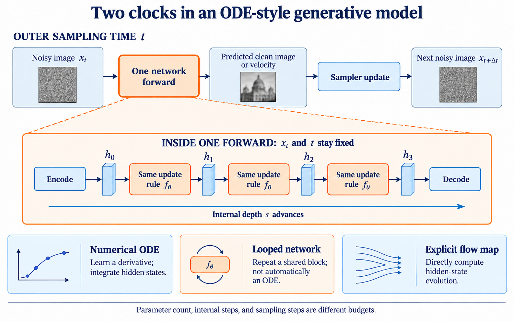

# Making a generative network ODE-like: a focused review

Reviewed on 2026-10-25. This is a curated narrative review of architecture mechanisms, not an exhaustive systematic review. Papers and proceedings were consulted; no implementation or new experiment was run for this review.

## The architecture question

A sampler moves a noisy image through external time t. Inside one network evaluation, that image and t are fixed while hidden features are computed. Making the network ODE-like means giving this internal computation its own evolution coordinate s.

```text
Outer sampling:       x_t -> network prediction -> sampler -> x_(t+Delta_t)

Inside one forward:   encode(x_t,t) -> h_0 -> h_1 -> ... -> h_K -> decode
                                      internal coordinate s increases
```

A literal continuous-depth design learns a hidden-state derivative and integrates it. A simple numerical realization is `h_next=h+Delta_s*f_theta(h,s;t)`. Attention, an FFN, or both can parameterize f_theta. Shared parameters are a convenient implementation; continuous non-autonomous dynamics can still depend on s. Merely repeating a block does not establish that it approximates one well-defined ODE as its step size changes.



The figure is an AI-generated conceptual illustration, inspected and corrected to use increasing external time. Its small trajectory icons are schematic, not empirical results or mathematical proofs.

## Four distinct mechanisms

| Mechanism | What is changed | What it permits | Main qualification |
|---|---|---|---|
| Continuous-depth hidden dynamics | Learn f_theta and integrate hidden states over s | Explicit step sizes and solver-dependent computation | More field evaluations can increase cost; solver accuracy is not generation quality |
| Shared recurrent blocks | Reapply one block or block group within one prediction | More executed depth without more unique parameters | Additional loops cost computation and can degrade predictions |
| Depth-conditioned prediction supervision | Define what intermediate predictions should accomplish | Train successive refinements rather than only the last answer | Changes the training objective as well as the architecture |
| Explicit flow maps | Directly parameterize the evolved state F_s(h) | Avoid a general numerical solver | Identity, smoothness and invertibility claims need explicit assumptions |

## Priority reading: recent image-generation evidence

### LiFT: Loop Flow Transformers — October 2026 preprint

[Primary paper](https://arxiv.org/html/2610.05538), Sections3–4 and6; AppendixB.4.

A shared DiT core receives a continuous depth coordinate. Intermediate velocity readouts are supervised along a reference from a detached initial estimate to the ordinary FM target. The outer image and time remain fixed during recurrence. The authors explicitly describe the core as a discrete recurrence, not an inner ODE solver.

A useful controlled operating point is L/2-R10 with25 sampling steps and4 loops: FID13.16 at7.397TFLOPs, versus dense L/2 FID16.94 at8.069TFLOPs. Training budgets match within this scale. However, B/2 loses at every tested cost, and training-depth settings trail their dense references. FLOPs are not measured hardware latency.

**For this project:** trajectory supervision is a relevant mechanism; the paper does not establish that an arbitrary Taylor FFN is advantageous.

### Looped Diffusion Transformer — September 2026 preprint

[Primary paper](https://arxiv.org/html/2609.40305), Sections2 and3.2–3.3, Tables2 and4.

Shared middle blocks are revisited within each denoising evaluation. Deep supervision and attention modulation support useful repeated computation. Table2 includes a deeper model with matched training and inference FLOPs: its four-benchmark mean is58.1 versus59.1 for the looped method. Parameter counts are473M and260M respectively. The same checkpoint is also tested with compute reallocated from loops to additional sampling steps.

The result concerns the complete proposed method. Its supervision and attention changes prevent attributing all gains to weight sharing or ODE structure alone. The component table separates those contributions. These are text-to-image benchmark results, not validation of our synthetic FFN.

**For this project:** compare internal iterations against additional outer steps and ordinary depth at equal total cost.

### Deeply Supervised Flow-Based Generative Models — ICCV2025

[Publisher record](https://openaccess.thecvf.com/content/ICCV2025/html/Shin_Deeply_Supervised_Flow-Based_Generative_Models_ICCV_2025_paper.html); [paper](https://arxiv.org/html/2503.14494), Sections3.2 and4.3, Tables7–8.

DeepFlow adds intermediate velocity readouts and a learned refinement/alignment module. In the uniform-time component ablation, FID changes from34.4 to33.0 with deep supervision alone, and reaches28.1 after the additional components. Capacity and compute also change in several configurations, so the complete improvement is not a supervision-only effect.

**For this project:** giving intermediate computations a task-related meaning has direct empirical precedent. The learned acceleration/refinement module is not a proof of numerical integration order or of a physical interpretation for hidden P.

## Direct precedent and supporting foundations

| Paper | Verified mechanism and relevance | Boundary |
|---|---|---|
| [ODEt(ODEl), WACV2026; first preprint2025](https://openaccess.thecvf.com/content/WACV2026/html/Gudovskiy_ODEtODEl_Shortcutting_the_Time_and_the_Length_in_Diffusion_and_WACV_2026_paper.html) | Reorganizes a generative transformer along a depth coordinate and trains length consistency, permitting shorter evaluations; [method text](https://arxiv.org/html/2506.21714) | A direct prior for nested external-time/internal-depth computation; not a new recommendation or an unconstrained block-sharing theorem |
| [Neural Ordinary Differential Equations, NeurIPS2018](https://papers.nips.cc/paper/2018/hash/69386f6bb1dfed68692a24c8686939b9-Abstract.html) | Learns the hidden derivative and uses an ODE solver | Establishes the design category, not a DiT advantage |
| [Universal Transformers, ICLR2019](https://arxiv.org/abs/1807.03819) | Reuses a transformation across computational depth | Recurrence and weight sharing alone are established prior art |
| [ODE Transformer, ACL2022](https://aclanthology.org/2022.acl-long.571/) | Uses Runge–Kutta-inspired Transformer residual computation; DOI10.18653/v1/2022.acl-long.571 | Sequence-generation evidence, not image FM; more accurate integration need not imply a better learned model |
| [Neural Flows, NeurIPS2021](https://papers.neurips.cc/paper_files/paper/2021/hash/b21f9f98829dea9a48fd8aaddc1f159d-Abstract.html) | Directly constructs time-dependent maps instead of repeatedly evaluating a derivative; [conditions and architectures](https://proceedings.nips.cc/paper_files/paper/2021/file/b21f9f98829dea9a48fd8aaddc1f159d-Paper.pdf) | Its strict flow interpretation imposes smoothness, identity and invertibility conditions; it does not enforce an autonomous semigroup for every conditional map |

An adjacent training direction is [DiffusionBlocks, ICLR2026](https://proceedings.iclr.cc/paper_files/paper/2026/hash/994c9bc68bc30954f6e5995864f1d92d-Abstract-Conference.html). It turns block updates into locally trainable denoising stages, reducing activation-memory requirements. It belongs to training decomposition, rather than being evidence that a matrix-exponential FFN should replace SwiGLU. The proceedings paper was consulted for its definition and scope, not used to recommend an unexamined implementation.

## What this means for the original ODELayer

The professor's operation is `T_K(s(h)P)h`, a polynomial approximation to a frozen-duration linear evolution. It is closest to an explicit, structured feature-flow idea. It changes a component inside a forward pass; it does not by itself turn all layers into a shared continuous-depth model. A gate depending on the initial state and a finite Taylor truncation do not automatically inherit the invertibility of a fixed-time matrix exponential.

**Our synthesis:** the most relevant recent evidence concerns useful internal refinement: which state evolves, how each intermediate prediction is supervised, and how internal work competes with outer sampling work. This is a more concrete architecture question than simply adding further powers of P. It is a research direction inferred from the sources, not a proven benefit for our model.

Any future comparison must count outer solver evaluations multiplied by internal work, and separate shared versus independent weights, intermediate supervision, and ordinary additional depth. A positive result should survive a strong ordinary-FFN baseline at the same actual computation. No new architecture or training run is selected by this literature review alone.

## Reading order and access notes

Read LiFT3.1–3.2 first for the two coordinates and intermediate targets; then Looped-DiT3.2–3.3 for budget controls and ablations; then DeepFlow4.3.1 for a published component-level reference. The older papers above explain design categories and are not offered as frontier recommendations.

LiFT and Looped-DiT are explicitly treated as preprints as of the review date. Some CVF direct fetches returned403, while the indexed publisher records and corresponding arXiv full texts were accessible. The OpenReview forum browser challenge was bypassed by consulting official proceedings, not by claiming access to private reviews. No unambiguous primary record for the name “Tied Flow” was established, so no conclusion relies on it.
