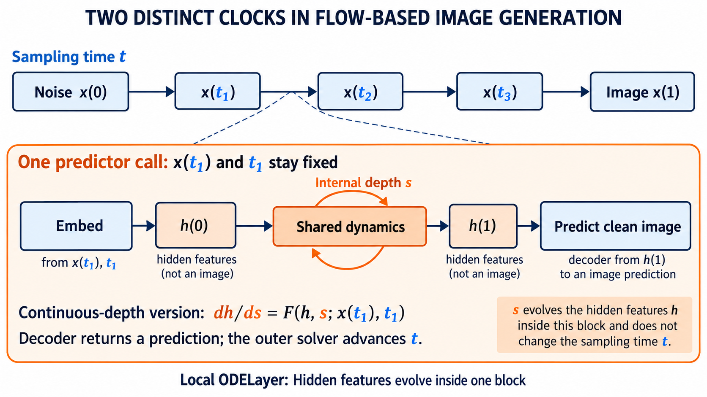

# Making a generative predictor an ODE: constructions and evidence

Focused narrative review, checked 26 October 2026. The scope is computation inside one model call. This supplements the [earlier backbone review](../literature-ode-backbone-2026-10-26/review.md), which contains additional readings and ablations.

## The intuitive construction

Replace a sequence of separately specified transformations with a learned rule for changing a hidden representation. Start from encoded input features, accumulate changes over an internal interval, and decode the endpoint. For a JiT-style clean-image predictor, an illustrative Euler implementation is:

```python
h = encode(noisy_image, sampling_time)
ds = 1.0 / internal_steps
for k in range(internal_steps):
    s = k * ds
    h = h + ds * field(h, s, sampling_time)
image_prediction = decode(h)
```

The field returns a feature derivative, while the complete model returns an image prediction. The noisy image and sampling time remain fixed during this call. The sampler later uses that prediction to advance the image state. Attention and a conventional SwiGLU may parameterize the hidden field; an ODE organization does not require replacing every nonlinear operation by a matrix exponential.



Conceptual AI-generated schematic, reused and visually checked. It illustrates a possible architecture rather than an experimental result or a description of every existing ODEFFN.

A continuous model needs a specified field and interval. In the example, increasing the step count also decreases the step size, leaving the interval equal to one. Keeping the step size fixed while adding updates instead lengthens the evolution. A useful discretization claim distinguishes those operations. An ordinary residual network resembles Euler updates; that observation alone does not identify a beneficial restriction or establish convergence when depth changes.

## Four architectural choices

| Choice | What is learned or changed | Main question |
|---|---|---|
| A hidden vector field | The derivative of features, optionally depending on continuous depth | Is this field flexible enough, and can its discretization change predictably? |
| A numerical update scheme | Substeps such as prediction, correction, or splitting | Does the altered computation improve prediction at its actual cost? |
| A local finite-time map | An endpoint approximation for a specified local system | Does that local system encode a useful task-specific restriction? |
| Recurrent prediction refinement | Shared computation and possibly targets at intermediate exits | What should each iteration improve, and how is that improvement trained? |

These choices can overlap. Their theoretical commitments and empirical controls differ. In particular, a recurrence with depth conditioning need not implement a numerical ODE solver.

## The selected papers

**DiffEqFormer: a direct architectural definition.** Tong et al., [Neural ODE Transformers: Analyzing Internal Dynamics and Adaptive Fine-tuning](https://arxiv.org/html/2503.01329v1), [ICLR 2025](https://proceedings.iclr.cc/paper_files/paper/2025/hash/82e3509393670d9d478c359b4ce6f950-Abstract-Conference.html). Sections 4.1–4.2 define attention and FFN contributions to a hidden differential equation, with weights generated as functions of depth. WikiText103 small-model perplexities are 22.87 for GPT, 36.27 for static sharing, and 22.84 for DiffEqFormer. Its relevance is that continuous depth can retain changing weights. Language-model evidence does not establish a JiT advantage.

**LiFT: give internal computation a trajectory to learn.** Derakhshani et al., [LiFT: Loop Flow Transformers](https://arxiv.org/html/2610.05538v1), 4 October 2026 preprint. Intermediate predictions target different points between a detached initial estimate and the FM target. Section 4.4 reports L/2 R10 FID 13.16 at 7.397 TFLOPs with four loops/25 sampling steps, versus dense L/2's 16.94 at 8.069 TFLOPs/50 steps. B/2 remains weaker in the tested comparisons. Appendix C.2 limits the theory to supervision: recurrence need not solve an inner ODE. The result concerns learned refinement and compute allocation.

**Looped-DiT: repeated hidden updates need suitable training.** Chng et al., [Looped Diffusion Transformer](https://arxiv.org/html/2609.40305v1), 30 September 2026 preprint. Intermediate exits predict the same clean image; attention modulation regulates repeated updates. Table 4's mean benchmark scores are 55.2 baseline, 56.2 naive looping, 57.5 looping plus supervision, and 59.1 for the full method. Table 5's deep, compute-matched supervised baseline with the attention change reaches 58.8. These are not FID values. The comparison does not isolate the full gain as an ODE effect.

**IIET: a numerical method changes the computational graph.** Liu et al., [IIET: Efficient Numerical Transformer via Implicit Iterative Euler Method](https://aclanthology.org/2025.emnlp-main.453/), EMNLP 2025. Equations 7–9 introduce an Euler prediction followed by fixed-point corrections; the implemented model also uses historical states. Table 2 compares 340M IIET accuracy 48.9 with 46.3 for static sharing and 49.0 for a 1.3B Transformer at comparable FLOPs. Finite correction does not automatically inherit exactly solved backward Euler's stability. This is a language-model precedent for designing substeps, rather than evidence for image generation.

**A mathematical perspective on Transformers: the strongest review reading here.** Geshkovski, Letrouit, Polyanskiy and Rigollet, [BAMS 62 (2025), 427–479](https://doi.org/10.1090/bull/1863); [full text](https://arxiv.org/html/2312.10794v5). Tokens evolve as interacting particles, with links to transport and gradient-flow geometry. Read Sections 2–3 for definitions and assumptions. Section 2.3 identifies practical components outside the principal analysis, including complete FFN dynamics. Its mathematical language is useful, but its simplified-system conclusions cannot be transferred directly to a trained JiT.

**A Mathematical Explanation of Transformers: a broader operator formulation.** Tai, Liu, Li and Chan, [current v2](https://arxiv.org/html/2510.03989v2), revised 12 April 2026 from an October 2025 preprint. Sections 2–4 combine attention, constrained normalization, and feedforward operations in a continuous variational framework, then describe their discretization by operator splitting. Normalization is treated as a projection, so the formulation is richer than a smooth unconstrained ODE. The derivation concerns its specified ReLU/relaxation construction. It supplies another way to formulate architecture mathematically, without establishing improved generation or directly deriving our SiLU ODEFFN.

## The professor's layer is a local flow approximation

This interpretation is derived from the supplied implementation:

```text
a = a(h)                         # evaluated once, at the input
L(h) = h + a*P*h + (a*a/2)*P*P*h # K = 2
```

It approximates `exp(a*P) h`: evolve the linear equation `dy/dr = P*y` for an input-selected duration `a(h)`. Two independent such maps surround SiLU in the original FFN. This is a valid local dynamical motivation; it does not make every Transformer layer a step of one common hidden system.

It is also different from continuously updating the clock in `dy/dr = a(y)*P*y`. That nonlinear field's second-order expansion includes the additional term `a(h) * (grad(a(h)) dot P*h) * P*h`. The original polynomial does not include it. Interpreting the gate as a selected duration avoids claiming the wrong differential equation.

The matrix exponential series converges for every finite matrix. Spectral constraints can affect amplification and finite-order approximation, but an eigenvalue-modulus bound below one is not required for convergence of that series. Improved integration of a chosen field also does not by itself improve the field's learned prediction.

## What follows for our project

The literature supports investigating internal evolution while leaving the appropriate hidden field open. Sampling-space flow matching supplies an objective for the predictor's output; it does not select a unique internal trajectory. A useful theory must connect a proposed restriction to a property of the function the task requires.

Our [existing recurrence screen](../research-recurrent-depth-2026-10-26/results/analysis-report.md) already tests sharing and intermediate supervision with unchanged original ODELayers and generic controls. It does not find an ODE-specific advantage. Our [realizable-teacher study](../research-realizable-teacher-2026-10-26/analysis-report.md) shows good ODE self-fitting but a substantial gap on the frozen SwiGLU teacher; it does not separate expressivity from optimization. Neither result justifies blindly adding loops or increasing polynomial order.

For a later candidate, distinguish three comparisons: the ordinary backbone, an ordinary nonlinear field with the same recurrence/solver, and the proposed ODELayer field. Vary intermediate supervision separately. A numerical-consistency claim should keep the field and horizon fixed; an efficiency claim should count internal evaluations and outer sampling calls. These are interpretation criteria, not a new experimental proposal or an assertion that a replacement already works.

Read DiffEqFormer for what an ODE architecture actually specifies; LiFT and Looped-DiT for recent generative evidence; BAMS for mathematical questions and assumptions. Use Tai et al. when formulating splitting/projection ideas, and IIET when considering correction substeps. ODEt(ODEl), already discussed with the user, remains direct prior art for nested sampling/depth dynamics rather than a new recommendation.

## Workflow provenance

The literature-review and planning-with-files skills guided this review; the existing schematic was inspected using the scientific-schematics guidance. [Kassis, Agarwal, He, Patel and Brueckner (2026), Scientific Agent Skills](https://doi.org/10.48550/arXiv.2609.00065) is acknowledged for workflow provenance, not as scientific evidence for an ODE architecture. Search strings, exact source locations, access limits, and figure provenance are in [notes.md](notes.md). No new training, model changes, commit, or push occurred.
