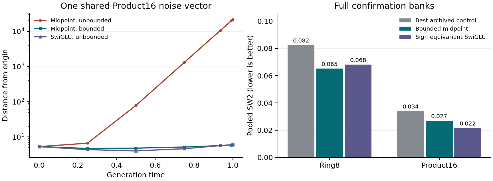

# Does the response have to follow the state?

**One bounded, four-step midpoint FFN now beats the stronger archived ordinary endpoint on both tasks.** A fresh twelve-checkpoint replication lowers pooled SW2 by 16% on Ring8 and 29% on Product16 against the strongest original ordinary checkpoint on those banks. Giving ordinary SwiGLU a sign-equivariant readout also improves both tasks and gives the best Product16 score. All rows below use seed 0, Heun128 and 32,768 paired endpoints per task and evaluation stream.

| Model | Ring8 selection | Ring8 confirmation | Ring8 fresh | Product16 selection | Product16 confirmation | Product16 fresh |
|---|---:|---:|---:|---:|---:|---:|
| Strongest archived SwiGLU or Free ISRU | 0.084 | 0.082 | 0.091 | 0.034 | 0.034 | 0.039 |
| Original four-step midpoint | 0.061 | 0.071 | — | 0.054 | 0.052 | — |
| Four-step midpoint with a bounded sign-equivariant readout | 0.057 | **0.065** | **0.076** | 0.024 | 0.027 | 0.028 |
| Sign-equivariant ordinary SwiGLU | **0.056** | 0.068 | 0.079 | **0.021** | **0.022** | **0.024** |

The bounded midpoint and sign-equivariant SwiGLU exchange rank on Ring8 across evaluation streams. The strongest historical ordinary row takes the lower score across the original and equal-training-compute checkpoints. The fresh stream was locked to twelve checkpoint hashes before sampling. Relative to the strongest archived control, the bounded model scores lower on six of eight paired banks on Ring8 and all eight on Product16. Relative to the sign-equivariant SwiGLU the corresponding counts are six and zero. [Fresh scores and all comparator hashes](bounded-fresh.json). [Archived confirmation results](archived-confirmation.json) · [Selection controls](ordinary-selection.json) · [Bounded checkpoint replay](bounded-selection.json)

The left panel follows the same noise vector through each model. We selected the most extreme endpoint of the unbounded midpoint run. All three replays reproduce the original 4,096 samples in its bank exactly. At t = 0.25 the unbounded midpoint predicts outward radial speed 24.826 where the oracle predicts −5.908. Its endpoint radius is 21,777.754; the bounded midpoint reaches 5.952 and ordinary SwiGLU reaches 6.035. Across the full evaluation, 69 of 32,768 endpoints crossed twice the largest target radius before bounding and none did afterwards. [Replayed case](escape-case.json).

For the bounded model there is also a global velocity bound. Each signed readout multiplier has magnitude at most one. LayerNorm at width H gives a coefficient vector with norm at most √H ‖γ‖∞ + ‖β‖₂. Multiplying by the output matrix gives an upper bound of 28.747 on velocity norm for this Product16 checkpoint. The unbounded model's radial speed along the escaping endpoint direction instead approaches 11.265 times its radius. These are properties of the fitted field; the same initial source also stayed within the target scale under ordinary SwiGLU.

## Where the midpoint uses its state

On Ring8 the shared four-step midpoint beats matched-compute SwiGLU (pooled SW2 0.071 vs 0.085). On Product16 it trails SwiGLU (0.052 vs 0.047), including the stronger earlier checkpoint (0.034). Freezing the diagonal throughout training worsened both 20k endpoints. That intervention changed the learned weights as well as the step rule. Eight tied Euler updates also trailed midpoint with the same matrix-call count. These controls motivate locating the contribution of the midpoint response on fixed weights.

1. Restore the original four-step checkpoint. At each substep keep the midpoint state and P unchanged, then evaluate its diagonal either at the substep entrance or the midpoint. Compare the predicted field and endpoints on identical selection inputs. A third intervention freezes the diagonal for the entire solve. The difference between the latter two locates refresh across successive substeps.
2. Train a model in which the gate can observe other coordinates: evaluate the diagonal at B y, initializing B to identity so the starting field is identical to midpoint. Use the same four substeps on both tasks. Charge the extra matrix operations against the existing training budget. If the same trained architecture fails either control, continue design selection using the selection stream.
3. Keep seed 0, the training data, sample banks, optimizer, state width and outer sampler fixed. Select on both tasks. Compare pooled Heun128 SW2 on confirmation against the native SwiGLU and Free ISRU endpoints, including their stronger earlier checkpoints. Reserve a fresh paired bank stream for the final candidate and ordinary controls after adaptive search on previously seen results. Record sampler cost separately.

[Existing compute controls](../equal-compute/README.md) · [Frozen-response controls](../reduced-state/README.md)

The frozen checkpoint replay used 512 selection field queries and 512 shared trajectories. The oracle MSE on Ring8 was 0.009 with both stages refreshed, 0.019 with the substep entrance response used at its midpoint, and 0.132 with the solve entrance response held fixed. Product16 gave 0.019, 0.034 and 0.458. The native replay reproduced the original field exactly. This is evidence that these weights use state-dependent refresh on both tasks. Distributional comparisons use all eight selection banks separately.

ARIS ablation review also identified an equal-cost placement control. On the original weights, compare four substeps before SiLU and two after it with the reverse allocation. The two mixed settings use the same 12 generator applications. Use the same ordering for both tasks only if both selection scores favor it. A separate Mac M1 replay from steps 40,000 to 43,367 reproduced the archived Ring8 Adams–Bashforth endpoint weights and training RNG exactly.

The final paired source/target stream is reserved before inspecting candidate results: 2026112300 through 2026112307, with the existing 256 directions. The endpoint comparison includes original 20k ordinary controls and their matched-compute continuations. Previously viewed selection and confirmation scores guide development.

Both laws are invariant under global sign reversal. As a diagnostic, split the fixed velocity into its odd and even components. The population velocity is odd, so the even-component energy measures a removable field error. Compare this for ordinary FFNs and midpoint before using symmetry to guide a new design.

On the same 20k checkpoints, the part of the learned midpoint field that assigns the same velocity to x and -x accounts for 31.0% of paired oracle MSE on Ring8 and 40.3% on Product16. SwiGLU also has this error (31.2% and 37.3%). To remove it in one forward pass, learn a signed carrier u = W x. Supply squared carrier features and time to the existing network, multiply the resulting coefficients by u, then apply a bias-free output projection. The coefficients are identical at x and -x, so the velocity changes sign exactly. No mode centers, rotation axes or oracle labels enter training. The first trainable version retains four-step midpoint. A SwiGLU with the same construction separates the effect of the symmetry from the choice of FFN.

## Selection results

| Change to the four-step model | Ring8 pooled SW2 | Product16 pooled SW2 |
|---|---:|---:|
| Original checkpoint | 0.061 | 0.054 |
| Read the entrance gate at the midpoint of each substep | 0.094 | 0.101 |
| Freeze the gate across all four substeps | 0.367 | 0.344 |
| Four substeps before SiLU, two after | 0.069 | 0.046 |
| Two before SiLU, four after | 0.062 | 0.057 |
| Two before and after | 0.067 | 0.046 |
| Train a dense gate map at matched compute | 0.085 | 0.071 |

The first six rows use the same fitted weights. Moving two of the substeps from one side of SiLU to the other improves Ring8 in one direction and Product16 in the other. We found no common placement rule. The seventh row fits new weights. Its extra matrix multiplication allows about 11k training updates at the cost of 20k native updates. It worsens both endpoints.

[Fixed-weight results](frozen-selection.json) · [Dense gate training endpoints](cross-selection.json) · [Reflection error on six checkpoints](parity.json)

The 10k Product16 reflection model exposes a tail problem on the training monitor's Heun32 validation bank. The generated median radius was 6.234 (target 6.282) and the 99th percentile 6.811 (target 6.750), yet the maximum reached 261.673 (target 6.942). Validation SW2 was 1.515. The native midpoint's maximum on the same bank was 7.667. The readout multiplies a normalized feature by an unbounded signed carrier. The next design changes only that multiplier to u / sqrt(1 + u²), leaving the coordinates used to compute the gate untouched. For fixed parameters this bounds the entire output velocity. A nonzero representational error can remain within the bulk of the distribution. [Exact replay of all four 10k checkpoints](endpoint-tail.json).

The selection stream's stronger ordinary scores are 0.084 on Ring8 and 0.034 on Product16, taking the better of original 20k and full-budget SwiGLU and Free ISRU. [Endpoint scores and weight hashes](ordinary-selection.json).

To check a candidate without drawing fresh samples, run `final_banks.py PREP CANDIDATE_WORK --check-eligibility`. Once a single architecture clears both ordinary selection scores, omitting the flag binds the candidate and control weight files before evaluating the reserved source and target banks. The evaluator saves generated samples and independently recomputes pooled SW2 from disk.

### Can midpoint improve a working gated field?

On Product16, the sign-equivariant SwiGLU192 control reaches **0.021** at matched training cost, versus **0.034** for the stronger archived ordinary endpoint. The sign-equivariant four-step ISRU model reaches **33.766**. Of 32,768 generated endpoints, 69 exceed twice the largest target radius. Its median radius, 6.227, is close to the target median, 6.288. On Ring8 the same midpoint architecture reaches 0.064. [Midpoint endpoint replay](odd-selection.json) · [SwiGLU Product16 endpoint replay](odd-swiglu-product-selection.json).

Hold the gated FFN fixed and reinterpret one residual block as one integration step. Its drift f(h,t) is the native SwiGLU applied to the normalized and time-conditioned state. Euler gives the ordinary update h + a f(h,t). Midpoint uses h + a f(h + a f(h,t)/2,t), with the same weights at both evaluations. Only the midpoint state is new. Width 192, AdamW, training seed, time conditioning and the signed readout are identical on both datasets. The matched Euler control on Product16 is the existing 0.021 model; on Ring8 we also train a width-192 AdamW Euler control alongside the earlier width-64 Muon result. Both methods receive the measured four-step budget.

The gated midpoint implementation reproduced an independent three-block reconstruction exactly on nonzero fields at both dimensions. The native residual block reproduced the Euler formula exactly. A forward hook recorded two different inputs to the same FFN object at each midpoint step. [Numerical checks](gated-midpoint-check.json). Since sign-equivariant SwiGLU already improves the Product16 benchmark on development banks, the same-symmetry ordinary controls are included when evaluating a finalist.

At 10k updates we crossed the trained weights with the readout used during sampling. On the Product16 validation bank (Heun32), unbounded-trained weights scored 1.515 with their native readout and 0.207 with the bound inserted. Bounded-trained weights scored 0.053 with the bound and 168.866 with it removed. The effect can be induced on either set of weights. Training with the bounded output also improves the score at fixed bounded inference. [Four-cell replay](readout-swap.json).

### Midpoint feedback inside the SwiGLU gate

A second way to refresh a gated field keeps both dense projections of ordinary SwiGLU. Let g and v be its gate and value. Start a hidden state w at zero and use the drift SiLU(g + a q(w)) times v, where q(w) = w / sqrt(1 + w²) and a is a learned vector. One midpoint step first computes w_half = SiLU(g) times v / 2 and then rereads the gate at w_half. When a = 0 the entire network and its shared-parameter gradients match ordinary SwiGLU at initialization. Each of the three FFNs still calls its input and output projections once. This isolates a feedback path that costs elementwise arithmetic and 384 trainable scalars across the network. Compare the same width-192 AdamW model on both datasets, charge the extra training operations, and inspect the fitted weights with feedback disabled if the design advances. [Implementation checks](feedback-check.json).

The bounded four-step midpoint is the first candidate in this search to beat the archived ordinary scores on both selection datasets (Ring8 0.057 vs 0.084, Product16 0.024 vs 0.034). The improved ordinary sign-equivariant SwiGLU remains competitive on Ring8 (0.056) and ahead on Product16 (0.021). The largest generated Product16 radius falls from 21,777.754 to 12.510, with zero samples above twice the maximum target radius. [Bounded model](bounded-selection.json) · [Ordinary control](odd-swiglu-selection.json).

Replicate this particular baseline comparison on fresh paired banks 2026112350–57. The bounded checkpoint and all five comparison checkpoints per dataset were [locked before generating the samples](bounded-replication-lock.json). Report performance against the archived baselines and against the sign-equivariant ordinary controls separately. The stricter search for a design that also beats the sign-equivariant controls retains its own reserved stream.

The matched readout control uses the same bounded carrier and replaces the ISRU midpoint FFN with the archived SwiGLU configurations. This measures how much of the bounded model's improvement survives that replacement. Its training budget includes the bounded readout.

**What changed in the bulk of Product16?** The largest and smallest 32 ranks in each projection account for over 99.99% of squared SW2 for the unbounded sign-equivariant midpoint. Excluding those ranks only for diagnosis, its central-rank RMS discrepancy is 0.047. Training the bounded midpoint reduces that central discrepancy to 0.022, better than the archived SwiGLU's 0.034 and close to sign-equivariant SwiGLU's 0.021. The reported headline SW2 always includes every rank. [Exact partition of pooled SW2 squared](rank-tail.json).

The gated midpoint and its exact Euler control give 0.071 vs 0.086 on Ring8 and 0.024 vs 0.021 on Product16 at width 192 and matched total training work. ARIS suggested a cheaper correction that reuses the preceding residual block's increment. Hold ordinary weights fixed and add c times the difference between the current and previous increments in blocks two and three. Compare extrapolation (c = 0.5), the original block (zero), and smoothing (−0.5). The pilot uses fixed oracle inputs and 1,024 selection sources with Heun32. Advance extrapolation to the full eight-bank comparison only if it improves both pilot SW2 and field error over zero on both tasks. The independently trained blocks have different fields, so the construction carries no second-order accuracy guarantee.

The fixed-weight extrapolation failed the pilot on both tasks. Ring8 SW2 rose from 0.146 to 0.283 and Product16 from 0.106 to 0.113. No cold training was launched for this change. [Pilot results](depth-history.json) · [Width-192 midpoint](wide-midpoint.json) · [Width-192 Euler on Ring8](wide-euler-ring.json).

## Refresh in the model that beats the archived baselines

We held the bounded model's final weights fixed, including its readout. Reusing the solve-entrance gate throughout all four steps raises selection SW2 from 0.057 to 0.104 on Ring8 and from 0.024 to 0.353 on Product16. Refreshing at substep boundaries but reusing that response at the midpoint yields 0.059 and 0.049. On Product16, even the second evaluation *within a substep* matters to the fitted field. All comparisons reuse the same 32,768 trajectories per task. This tests how these weights use their intermediate states. The trained ordinary FFN controls answer the separate architectural comparison. [Six paired frozen interventions](bounded-frozen-refresh.json).

For the native nonlinear drift f(y) = P q(y), write d = (1 + 1.2 y²)^(−1/2) and q(y) = d y. Its coordinate derivative is q′(y) = d³. Holding the gate fixed uses the larger slope d instead. For a midpoint displacement δ, the extra response is therefore approximately P[(d³ − d) δ]. On 1,024 fixed inputs per task across six layers and four substeps, this term predicts the direction of the measured gate-refresh correction with cosine 0.996 (Ring8) and 0.977 (Product16). The full correction is 4.7% and 7.4% of the stale drift in RMS. [Checkpoint-bound derivative calculation](refresh-derivative.json).

With the width-192 AdamW parent fixed, learning 384 gate-feedback coefficients lowers selection SW2 from 0.086 to 0.061 on Ring8 and from 0.0214 to 0.0206 on Product16. The historical width-64 Muon sign-equivariant SwiGLU still leads this model on Ring8 at 0.056. The cheaper gate path retains 43,468 Ring8 and 43,146 Product16 training updates within budget; recomputing the entire gated FFN at a midpoint allowed 26,007 and 25,958. [Raw selection results](feedback-selection.json).

On historical confirmation banks the gate-feedback model improves the width-192 Ring8 parent (0.058 vs 0.078). On Product16 the parent leads (0.022 vs 0.026), reversing the small development-bank gain. Disabling the learned feedback on the fitted model raises selection SW2 from 0.061 to 0.063 on Ring8 and 0.021 to 0.025 on Product16. The network uses the new path, while its advantage over training the ordinary parent depends on the task. [Confirmation replay](feedback-confirmation.json) · [Fixed-weight feedback switch](feedback-off.json).

A separate replay regenerated the locked sources and targets from their seeds, checked all twelve checkpoint hashes and training identities, and recomputed pooled SW2 from every saved endpoint. The largest absolute difference was below 7e−18. The two bounded midpoint runs used 19,983 and 19,984 updates at width 64; their measured cumulative training arithmetic differed from the reference budgets by at most 0.003%. [Replication audit](replication-verification.json).
