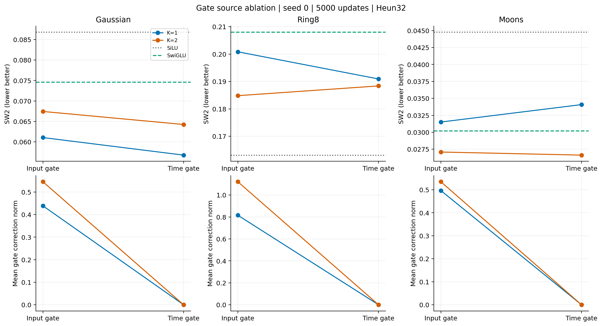
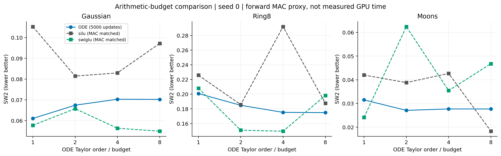
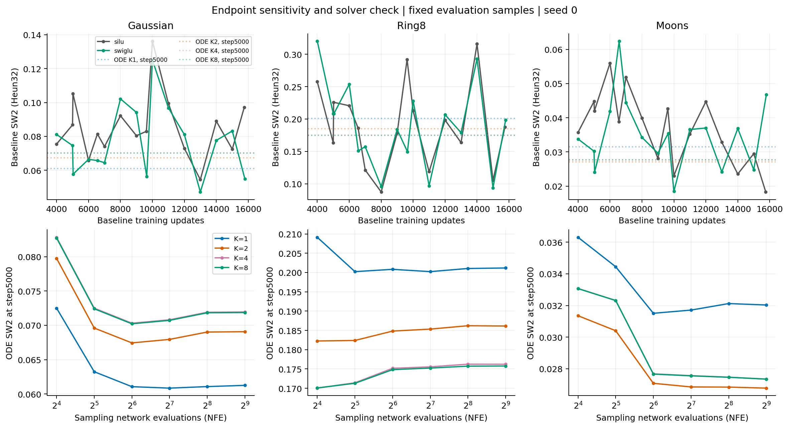
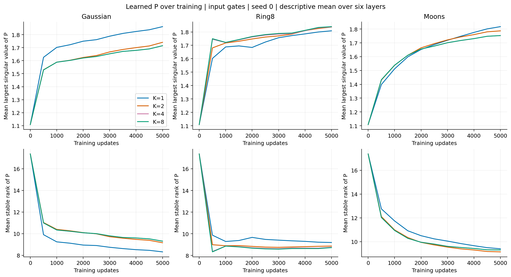
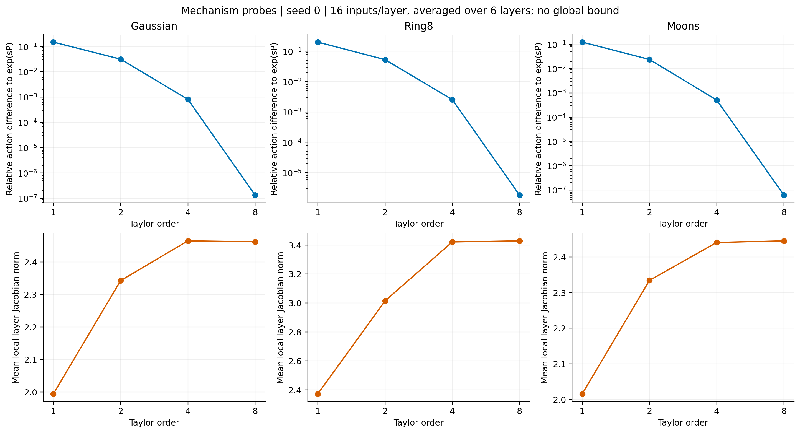

# ODELayer / Round 0 / Ablation report / 2026-10-20

轮次编号r00是临时文档编号，不表示项目第一次实验；实际实验标识为stage_20261020，包含门控与阶数/预算两波。本文是内部阶段报告，报告地点为项目仓库，没有进行Obsidian写回。

## 核心判断

这轮没有证明“把隐藏ODE解得更准确，就能更好地做flow matching”，也没有建立跨三个分布一致的计算预算优势。更有价值的发现是：K4与K8已经进入近似相同的工作区域；P会在训练中形成更强、更集中的主方向；移除输入门控导数项后，P和其余网络可能适应性补偿。

因此当前应把主问题收紧为：**原版ODELayer中的共享P、多项式阶数和输入相关步长，分别提供什么有用的归纳偏置？** 把“它像ODE”当作动机可以，但不能把它当成已经验证的优势来源。

## 本轮身份与决策背景

原版单层为：

```text
s(h) = 0.2 + 0.8 * sigmoid(g(h) / 10)
F(h) = h + sP h + s²P²h/2! + ... + s^K P^K h/K!
ODEFFN(h) = F2(SiLU(F1(h)))
```

每次forward只计算一次s，Taylor各项共享同一个P。s是隐藏演化步长，不是外部生成时间t。P作用于64维隐藏特征，不等于二维生成速度场的Jacobian。

已有18次实验表明，限制P谱范数可以降低部分内部放大，但生成收益不一致。本轮固定自由P、不加新loss或归一化，单独比较门控来源与阶数；同时补上SiLU/SwiGLU同步及计算预算对照。

## 设置与评价

三个2D分布：各向异性Gaussian、8团环形GMM、带噪声Moons。每个10万训练点、1万验证点、1万测试点。source是独立标准高斯，t均匀采样，线性插值，直接预测velocity，无类别条件。目标分布家族有相关文献先例，但本轮具体参数为自行固定的设置，不是某论文benchmark的逐项复现。

全部seed0，宽度64、3个残差block、每个ODEFFN两段ODELayer，batch512，AdamW lr3e-4、无学习率调度。基准5000步。门控input/time×K1/K2，加SiLU、SwiGLU：18条轨迹；K4/K8加两条延长baseline：12条轨迹。共30条、54个预定checkpoint诊断。

主指标SW2@Heun32，固定2048个生成/目标点、128个投影方向；另有Heun8至256、分时段oracle/pair MSE、P谱与门控/Jacobian诊断。Gaussian/Ring8有解析速度参考，Moons没有。计算预算匹配使用全网络前向线性MAC，不是实测GPU时长。

执行任务20378694_0/1/2分别耗时11:18、11:22、10:51；报告20378698耗时13秒。均正常退出。本轮每个数据集的所有配置在同一张H200上串行执行；时间包含训练、评估、存盘及诊断，不作纯训练速度比较。

## 主要结果

### 1. 同步数优势不等于预算优势

|模型 / 固定5000步|Gaussian|Ring8|Moons|
|---|---:|---:|---:|
|SiLU|0.086822|0.163125|0.044775|
|SwiGLU|0.074611|0.208018|0.030210|
|原版K1|0.061061|0.200826|0.031507|
|原版K2|0.067437|0.184820|0.027083|
|原版K4|0.070309|0.175176|0.027682|
|原版K8|0.070221|0.174829|0.027664|

SW2越低越好。原版K2在三个分布上均低于同step的SwiGLU，但Ring8上SiLU仍更低。给SwiGLU与K2对应的计算代理预算、训练6572步后，三个分数为0.065757、0.150846、0.062414：Gaussian和Ring8的方向反转，Moons仍是K2更低。

这支持降低“ODE架构已具有一致优势”的判断，不支持反过来宣称SwiGLU普遍更好。分布间不直接平均SW2。

### 2. K4到K8基本没有换来生成收益

K4到K8，全网络前向线性MAC增加约63.7%；三组SW2相对变化幅度均不到0.2%。另一方面，K8相对于矩阵指数的平均作用误差分别降到1.33e-7、1.82e-6、6.16e-8。

也就是说，指数近似精度提高了很多，但当前生成效果没有对应的大幅改善。Gaussian的K1仍比高阶好，Moons的K2仍比高阶好；Ring8从K1到K4有改善。这是任务相关现象，不能写成“高阶一定无效”。

### 3. 时间门控没有成为统一解法

time gate减input gate的SW2变化：

|数据集|K1|K2|
|---|---:|---:|
|Gaussian|-0.004288|-0.003182|
|Ring8|-0.009907|+0.003552|
|Moons|+0.002572|-0.000456|

负数表示time gate更低。虽然后者对hidden的门控导数为零，完整层Jacobian不一定下降：Moons K2从2.334升至2.509，Ring8 K2从3.014升至3.141。

对于输入门控，固定t时：

```text
J_F = T_K(sP) + [P T_(K-1)(sP) h] * grad_h(s)^T
```

time gate消去的是第二项。第一项也会随着重新训练的P和s而变化，因此不能用“删掉一个项”直接预测最终完整Jacobian。两种门控还改变输入分布，实验不是纯粹的导数项干预。

### 4. P在训练中形成更集中的主方向

原版input gate的四种K在初始化时，六层平均sigma_max(P)约1.109，稳定秩约17.37。5000步后sigma_max约1.715–1.862，稳定秩约8.31–9.40。K4与K8的训练曲线接近重合。

稳定秩等于平方奇异值之和除以最大奇异值的平方。它下降意味着相对最大方向而言能量更集中，不表示矩阵代数秩已经降到8或9。

这提示后续研究应区分“任务需要方向选择”与“有害放大”。仅因为奇异值不均匀就把它们压平，可能同时改变表达能力；目前没有证据证明这种约束会改善生成。

### 5. 固定终点的敏感性限制预算结论

Gaussian SwiGLU从5000步0.074611变到5036步0.057765；Ring8 SiLU从5000步0.163125变到5024步0.225790。固定评估样本下也有明显波动。

本报告保留预定终点，不改成选取曲线最低值；但不能把一个预算节点的胜负当成稳定优势。若下一轮继续比较效率，需要训练前写清固定尾段摘要或验证集选点规则，对所有模型一致执行；不能看到本轮测试结果后选择最有利规则。

## 统计与出处核验

本轮每配置仅一个训练seed，因此所有数字是描述性结果。不提供跨seed置信区间、p值或显著性结论；checkpoint、六层、16个探针不构成独立训练重复。主比较与绝对/相对差值见[统计附录](analysis-output/stats-appendix.md)，所有claim的允许措辞和反例见[分析报告](analysis-output/analysis-report.md)。

54个checkpoint哈希、29个冻结代码/配置文件哈希、实际远端15个数据文件哈希已核对；两条baseline前5000步权重在三个数据集均逐项相同。

冻结快照中的数据manifest注释误用了本地版本，实际训练provenance均指向正确远端版本。三个数据集12个归档内26个数组逐项完全一致，差异在归档字节、生成器文件清单和极小浮点均值统计；这不改变本轮数据与比较。保留原冻结记录，另附[更正与数据核验](data-content-audit.json)，未来提交校验已加严。

## 图与解释



上排回答生成分数是否改善，下排核实门控修正项确实被消去。二者并不一致，所以“把该项变小”还不足以成为设计目标。



同step与MAC匹配回答不同问题。图中baseline每个点来自预定长轨迹节点；它们不是独立重复，应结合下一张图阅读。



上排展示baseline的真实波动，虚线是ODE固定5000步的参考水平，不是ODE训练曲线。下排检查求解器步数；增加NFE未消除主要阶数排序，所以当前差异不能主要归因于Heun32不足。



最大奇异值上升、稳定秩下降，K4/K8曲线接近。这支持研究训练后P的方向选择，但不提供“谱集中有害”的因果证据。



指数近似误差大幅下降，完整层Jacobian却总体上升后趋于饱和。各点使用各自训练得到的P；不能将其解释为固定同一P时阶数的纯效应。

## 负结果、局限与认识变化

- 原先“更精确的隐藏ODE会改善FM”这一简单叙事被削弱；当前更值得研究共享算子与输入自适应的作用。
- “去除输入门控就更稳定”没有获得一致支持；只有门控导数项消失是确定的。
- “P奇异值应越平均越好”仍没有证据，真实训练反而形成更集中谱。
- 单seed、二维分布、自选参数与反复查看同一测试集限制结论范围。Heun256不是理论真值，局部Jacobian不是全局界。
- 当前没有attention、图像token或JiT的clean-image参数化，不能直接外推ImageNet/FID收益。
- GPU利用率偏低，单卡串行跑小模型不是理想吞吐安排。后续可先以相同训练设置测2/4进程并发吞吐，速度比较仍须独占资源单独测试。

## 下一步选项与建议

本轮分析已经具备阶段报告所需的数值、机制证据和反例，下一研究方向由用户决定；未自动新增分支实验。

我的建议优先级是：

1. **先做同一P下的阶数干预。** 使用已保存checkpoint、固定P和门控，改变求值K并与矩阵指数对照；与“不同K重新训练”的结果分开呈现。它能回答K4/K8接近究竟只是求值精度饱和，还是还有训练适应的影响。代价小、无需新trick；结果仍是部署干预，不证明优化因果。
2. **若重点回到P约束，先做受控层实验。** 分别控制整体尺度、奇异值能量分布、非正规性，预测各阶项与Jacobian，再检验实际训练P处于哪个区域。每次只改变一种性质；不要同时加谱cap、反对称结构和新loss。
3. **若选择门控方向，增加固定步长对照。** 固定s=0.6或每层可学习常数可以帮助区分“输入适应性”与“只是可学习尺度”。这属于新的预注册分支，不能把当前time gate对照当作已经完成该消融。

暂不建议继续把K提高到16/32，也不建议现在就拿当前toy胜负宣称JiT架构改进成立。

## 复现与运维入口

- [完整指标表](stage-report.md)、[协议](protocol.md)、[机器可读汇总](stage-summary.json)。
- [证据分析](analysis-output/analysis-report.md)、[统计附录](analysis-output/stats-appendix.md)、[图说明](analysis-output/figure-catalog.md)。
- [完成审计](completion-audit.json)、[数据内容核验](data-content-audit.json)、[提交回执](submission.json)。
- 图表脚本：`scripts/analyze_completed_stage.py`；审计：`scripts/audit_completed_stage.py`。
- [监控使用说明](monitoring.md)：未来提交自动附带60秒轮询、异常/停滞提示、完成核验。监控已用本轮真实作业验证，当前任务完成后自动退出。没有接入对外通知或自动聊天推送。
- 远端报告：`/scratch/zz5070/ODE_FFN/jit-codebase/docs/research-2026-10-20/`。冻结训练代码仍在`/scratch/zz5070/ODE_FFN/experiments/stage_20261020/runtime/`，保持不变。
